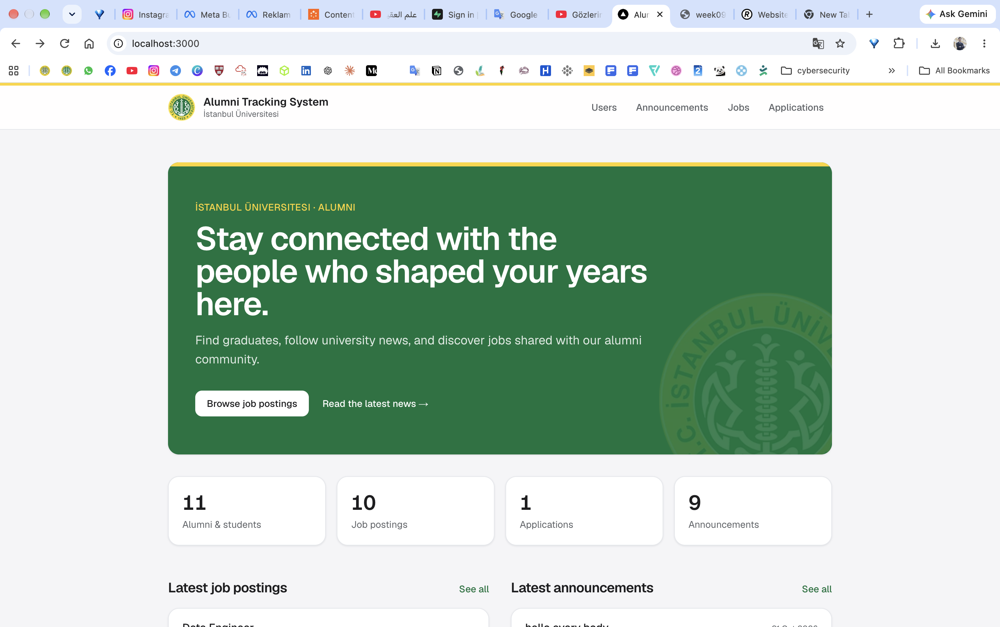
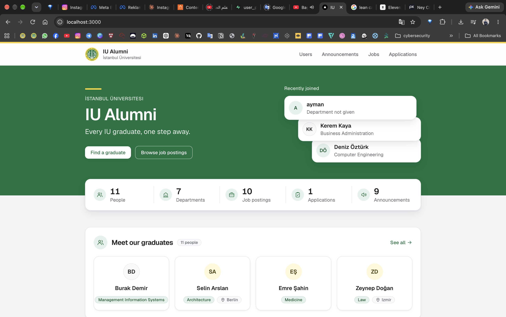

# 🎓 IU Alumni

> A modern web platform to connect universities with their graduates — built as a semester-long project for the Web Programming course, with the goal of being adopted as the university's official alumni tracking system.

---

## 📖 About The Project

Most universities lose touch with their graduates shortly after they leave campus. There is no easy way for the school to know where alumni ended up working, invite them back for events, or let current students network with people who walked the same halls.

This project, **IU Alumni** ("Every IU graduate, one step away."), is a full-stack alumni platform built from scratch as part of a university Web Programming course. Every student in the course builds their own version of this system as a semester-long assignment, delivered incrementally, week by week. The strongest implementation will be considered for real deployment as the university's official alumni platform.

This repository documents that build from day one — architecture decisions, weekly progress, and the reasoning behind them — both for course evaluation and as a portfolio piece.

### Goals

- Give the university a simple, searchable record of its alumni
- Let alumni keep their own profile (career, contact info) up to date
- Give staff/admins an easy way to manage and export alumni data
- Build something clean and real enough to actually be used after the course ends

---

## 🛠️ Tech Stack

| Layer | Technology |
|---|---|
| Framework | [Next.js](https://nextjs.org/) (App Router) — handles both frontend and backend (API routes) |
| Language | TypeScript |
| Styling | Tailwind CSS |
| API Docs | [Swagger UI](https://swagger.io/tools/swagger-ui/) (OpenAPI 3) |
| Database | [PostgreSQL](https://www.postgresql.org/) 17 — runs in Docker; the app reads and writes it with **plain SQL** through the [`pg`](https://node-postgres.com/) driver (`lib/db.ts`), no ORM |
| Migrations | Plain SQL files in `migrations/`, run by a small Node script (`scripts/migrate.mjs`) using the [`pg`](https://node-postgres.com/) driver — no ORM or migration framework |
| Containerization | [Docker](https://www.docker.com/) + Docker Compose — one command (`docker compose up`) starts the app and the database, with a volume that keeps the database files |
| Version Control | Git + GitHub |
| Deployment (planned) | TBD |

---

## ✨ Features

This project is being built incrementally over the semester. Status is updated weekly.

- [x] **Week 2 — Routing** — static pages (`/`, `/about`), plain-text route handlers (`/hello`), and dynamic routes that read URL parameters (`/hello/[name]`, `/sum/[number1]/[number2]`)
- [x] **Week 3 — REST API** — full CRUD for users under `/api/users` (`GET`, `POST`, and `GET` / `PUT` / `PATCH` / `DELETE` by id), a health check at `/api/health`, and interactive Swagger docs at `/api/swagger` (users are kept in memory for now)
- [x] **Week 4 — MVC architecture** — User Model, `UserController` / `ApiUserController`, view components, and full CRUD user pages (`/users`) using Server Actions
- [x] **Announcements** — the same MVC structure for announcements: Model, two controllers, `/api/announcements` and full CRUD pages at `/announcements`
- [x] **Week 5 — Docker** — the whole system starts with a single `docker compose up`; [the forgetting test](#-the-forgetting-test) shows why in-memory data isn't enough
- [x] **Week 5 — Database service** — a PostgreSQL container next to the app, with a named volume (`pgdata`) so its data survives `docker compose down`, and the [data design](ddd.md) for it
- [x] **Week 5 — Migrations** — plain SQL migrations create the `users` and `announcements` tables automatically on `docker compose up` ([🧱 Migrations](#-migrations))
- [x] **Week 5 — Database** — the Models store users and announcements in PostgreSQL with parameterized plain SQL (`lib/db.ts`), so data survives restarts and `docker compose down` ([🧪 The Forgetting Test](#-the-forgetting-test))
- [x] **Week 5 — Factories and seeding** — factories build realistic sample users and announcements, and a seed script inserts them into PostgreSQL on demand ([🌱 Factories and Seeding](#-factories-and-seeding))
- [x] **Week 6 — Seeding job postings** — a job posting factory (`scripts/factories/jobPostingFactory.mjs`) and 10 sample job postings in the same seed command; `--fresh` also empties `job_postings` (and, by CASCADE, `applications`). Applications are not seeded
- [x] **Week 6 — Job postings: table, model and API** — migration `003_create_job_postings`, the JobPosting Model with its rules (`lib/models/jobPosting.ts`) and a JSON API: `GET` / `POST /api/jobs` and `GET` / `PATCH` / `DELETE /api/jobs/{id}`. Following the professor's design, **job postings have no owner**: migration `004_drop_job_postings_user_id` removed `job_postings.user_id` and the nested route `/api/users/{id}/jobs` is gone; users and postings will be linked only through `applications` (many-to-many, next). Pages: see the Job posting and application pages below
- [x] **Week 6 — Applications: table, model and API** — migration `005_create_applications` creates the `applications` join table (users ↔ job postings, **many-to-many**, `ON DELETE CASCADE` on both sides, one application per user and posting); the Application Model with its rules (`lib/models/application.ts`); and a JSON API through `ApiApplicationController`: nested routes `GET` / `POST /api/jobs/{id}/applications` and `GET /api/users/{id}/applications`, direct routes `GET /api/applications` and `GET` / `PATCH` (status only) / `DELETE /api/applications/{id}`. Applying twice gives **409**
- [x] **Week 6 — Job posting and application pages** — the same MVC pattern as the announcement pages: `JobPostingController` / `ApplicationController` (page side), views in `lib/views/jobs/` and `lib/views/applications/`, and Server Actions in `app/jobs/actions.ts`. `/jobs` (list), `/jobs/new` (create), `/jobs/{id}` (detail with an **Applications** section: applicant name and email, status, date; add an application by choosing a user, change the status, remove it) and `/jobs/{id}/edit`; a read-only **Applications** section on `/users/{id}`; **Jobs** in the home page navigation
- [x] **Week 6 — Basic UIs for job postings and applications** — one design for the whole app in the İstanbul Üniversitesi colors (green `#00733e`, yellow `#fdd525`, read from the logo): **design tokens** in `app/globals.css`, shared UI pieces in `lib/views/ui/` (Button, Card, Badge / StatusBadge, PageHeader, Table, form fields, EmptyState), a site header with the logo and the main navigation (current page highlighted), job postings shown as job-listing cards, and a new **`/applications`** page listing every application ([🎨 Design and theme](#-design-and-theme))
- [x] **Week 7 — Middleware** — every JSON API request now passes one line of middlewares, each written once in `lib/middleware/`: **logger → error handler → 404 guard → controller → model**; the pages get a log line, a shared 404 page and 308 redirects from `proxy.ts` ([🧩 Middleware](#-middleware)):
  - [x] **Invalid requests tested (task 1)** — wrong ids, missing rows, broken bodies, missing fields, unknown paths and wrong methods were sent from Postman; what the API answers to each is in [Invalid requests: what the API answers](#invalid-requests-what-the-api-answers)
  - [x] **Job posting rules designed (task 2)** — new fields (`city`, `description`, `employment_type`, `status`, `deadline`), stricter rules checked by the Model and the database, a 400 that lists every broken field, and no applications to a **closed** posting, designed in [ddd.md](ddd.md#job-posting-rules-planned). **Planned — not implemented yet:** migration `006` and the code come in later tasks
  - [x] **Logger middleware (task 3)** — every API request writes one line to the terminal (`10:20:30 POST /api/users 201 18ms`: Istanbul time, method, path without the query, the real status, the duration), from a middleware written once in `lib/middleware/` and put in front of every API route handler ([🧩 Middleware](#-middleware))
  - [x] **Page logging (task 3)** — page views and form submissions also write one line (`10:20:30 GET /jobs/1 - -`), from `proxy.ts`, in the same format as the API logger; static files, link prefetches and `/api/*` are skipped ([🧩 Middleware](#-middleware))
  - [x] **404 guard middleware (task 4)** — on every API route with an `[id]`, a middleware asks the Model whether the row exists and, if not, answers **404** `{ "error": "not found", "reason": "No job posting with id 99999" }` without reaching the controller; every API 404 (also the controllers' own and unknown API paths, through a catch-all route) uses that one shape ([🧩 Middleware](#-middleware))
  - [x] **Error handler middleware, 5xx guarding (task 5)** — one middleware catches every unexpected error of the JSON API and answers a safe shape: **503** `{ "error": "service unavailable", "reason": "The database is not reachable. Try again later." }` when the database can't be reached, **500** `{ "error": "internal error" }` otherwise; the stack trace is logged once, never sent. The controllers lost their own try/catch ([🧩 Middleware](#-middleware))
  - [x] **Error log file (task 6)** — every 500 / 503 caught by the error handler is also appended to `logs/error.log` (Istanbul date and time, method, path, status, error and stack), which Docker mounts into the project folder and git ignores ([🧩 Middleware](#-middleware))
  - [x] **404 page and redirects (task 7)** — one shared "not found" look for every page 404 (a generic `app/not-found.tsx` with the asked-for path and links to the main pages; the section pages have their own text, and an invalid id like `/jobs/abc` says so), and **308** redirects to the canonical page URL (`/job/3` → `/jobs/3`, `/Jobs` → `/jobs`, `/jobs/` → `/jobs`) ([🔀 The 404 page and redirects](#-the-404-page-and-redirects))
  - [x] **Dockerfile fix** — the image runs as the `node` user, so it now creates `.next/cache` and `logs/` and gives them to `node`: `next/image` can cache the logo (no more `EACCES` on `.next/cache`) and the error handler can write `logs/error.log`. `public/` is copied into the image, so `/logo.png` works in Docker

**Open items** (planned, not implemented yet):

- [ ] **Job posting rules** — the Week 7 design in [ddd.md](ddd.md#job-posting-rules-planned): migration `006`, the Model, the forms, the factory and Swagger
- [ ] **Validation middleware** — one 400 shape for every API, `{ "error": "validation failed", "fields": { … } }` ([ddd.md, question 35](ddd.md#error-shapes-of-the-json-api)); until then every 400 is `{ "error": "<message>" }`
- [ ] **Invalid ids answer differently** — `/api/users/abc` and `/api/users/0` answer **404**, while `/api/jobs/abc` and `/api/jobs/0` answer **400** (announcements: `abc` → 400, `0` → 404). To be made consistent in the validation task ([ddd.md, question 10](ddd.md#-decisions-and-open-questions))
- [ ] `GET /api/users/{id}?include=jobs`, a factory and seed for applications, and the `/jobs` and `/applications` pages in Swagger

---

## 📂 Project Structure

```
alumni/
├── app/                              # Next.js App Router — every folder is a URL segment
│   ├── layout.tsx                    # Root layout shared by all pages: the site header (logo + navigation) above every page and the site footer below it
│   ├── not-found.tsx                 # The generic 404 page: any URL no page matches (status 404)
│   ├── error.tsx                     # The designed 500 page for browsers (a page failed on the server)
│   ├── global-error.tsx              # The same 500 page when even the root layout fails (own <html>)
│   ├── globals.css                   # Tailwind CSS + the DESIGN TOKENS (colors, fonts, radius, shadows) — change the theme here
│   ├── favicon.ico                   # Browser tab icon
│   ├── page.tsx                      # GET /               homepage: "IU Alumni", the promise, the numbers, the newest postings and announcements → HomeController
│   ├── about/page.tsx                # /about              what IU Alumni is, who it is for, what you can do
│   ├── users/
│   │   ├── page.tsx                  # GET /users          the table of users, "Add a graduate" → UserController
│   │   ├── new/
│   │   │   └── page.tsx              # GET /users/new      "Add a graduate" form (HTML)  → UserController (on submit)
│   │   ├── actions.ts                # Server Actions      create, update, delete         → UserController
│   │   └── [id]/
│   │       ├── page.tsx              # GET /users/{id}     one user's profile (HTML)      → UserController
│   │       ├── not-found.tsx         #                     "We couldn't find that graduate or student." page (404, shared look; its own text for an id like abc)
│   │       └── edit/
│   │           └── page.tsx          # GET /users/{id}/edit  edit form (HTML)             → UserController
│   ├── announcements/
│   │   ├── page.tsx                  # GET /announcements  the table of announcements, "Post an announcement" → AnnouncementController
│   │   ├── new/
│   │   │   └── page.tsx              # GET /announcements/new  "Post an announcement" form (HTML) → AnnouncementController (on submit)
│   │   ├── actions.ts                # Server Actions      create, update, delete         → AnnouncementController
│   │   └── [id]/
│   │       ├── page.tsx              # GET /announcements/{id}  one announcement (HTML)   → AnnouncementController
│   │       ├── not-found.tsx         #                     "We couldn't find that announcement." page (404, shared look; its own text for an id like abc)
│   │       └── edit/
│   │           └── page.tsx          # GET /announcements/{id}/edit  edit form (HTML)     → AnnouncementController
│   ├── applications/
│   │   └── page.tsx                  # GET /applications   every application (applicant, job posting, status) → ApplicationController
│   ├── jobs/
│   │   ├── page.tsx                  # GET /jobs           the table of job postings, "Post a job" → JobPostingController, ApplicationController
│   │   ├── actions.ts                # Server Actions      job postings: create, update, delete; applications: add, status, remove
│   │   ├── new/
│   │   │   └── page.tsx              # GET /jobs/new       "Post a job" form (HTML)  → JobPostingController (on submit)
│   │   └── [id]/
│   │       ├── page.tsx              # GET /jobs/{id}      one posting + its Applications → JobPostingController, ApplicationController
│   │       ├── not-found.tsx         #                     "We couldn't find that job posting." page (404, shared look; its own text for an id like abc)
│   │       └── edit/
│   │           └── page.tsx          # GET /jobs/{id}/edit  edit form + Delete (HTML)     → JobPostingController
│   ├── hello/
│   │   ├── route.ts                  # /hello              "Hello, World!"
│   │   └── [name]/route.ts           # /hello/{name}       "Hello, {name}!"
│   ├── sum/[number1]/[number2]/
│   │   └── route.ts                  # /sum/{a}/{b}        sum of two numbers
│   └── api/
│       ├── health/route.ts           # /api/health         health check
│       ├── [...path]/route.ts        # /api/<anything else>  catch-all: JSON 404 "No route matches METHOD /path"
│       ├── users/route.ts            # /api/users          list & create users (JSON)     → ApiUserController
│       ├── users/[id]/route.ts       # /api/users/{id}     get, replace, update, delete   → ApiUserController
│       ├── announcements/route.ts    # /api/announcements  list & create (JSON)           → ApiAnnouncementController
│       ├── announcements/[id]/route.ts  # /api/announcements/{id}  get, replace, update, delete → ApiAnnouncementController
│       ├── jobs/route.ts             # /api/jobs           list & create job postings (JSON)  → ApiJobPostingController
│       ├── jobs/[id]/route.ts        # /api/jobs/{id}      get, update (PATCH), delete        → ApiJobPostingController
│       ├── jobs/[id]/applications/route.ts   # /api/jobs/{id}/applications   list & apply (nested)   → ApiApplicationController
│       ├── users/[id]/applications/route.ts  # /api/users/{id}/applications  a user's applications    → ApiApplicationController
│       ├── applications/route.ts             # /api/applications             list all applications   → ApiApplicationController
│       ├── applications/[id]/route.ts        # /api/applications/{id}        get, status (PATCH), delete → ApiApplicationController
│       └── swagger/
│           ├── page.tsx              # /api/swagger        interactive API docs
│           └── SwaggerView.tsx       # Client component that renders Swagger UI
├── lib/
│   ├── db.ts                         # Shared PostgreSQL connection pool + query(text, params) helper
│   ├── middleware/                   # API middlewares, written once, in front of every API route handler
│   │   ├── index.ts                  # The middleware lines: withApiMiddleware (logger + error handler), withExistingResource (+ 404 guard)
│   │   ├── chain.ts                  # chain(...middlewares): puts middlewares in a line, in order
│   │   ├── logger.ts                 # withLogger: one line per API request (+ writeLogLine / logPageRequest for pages)
│   │   ├── errorHandler.ts           # withErrorHandler: unexpected errors → 503 / 500 safe JSON, stack logged once
│   │   └── notFoundGuard.ts          # withExists(resource): 404 { error, reason } if the [id] in the URL doesn't exist
│   ├── routing/
│   │   └── pageRedirect.ts           # canonicalPagePath(): the 308 redirect rules for page URLs (used by proxy.ts)
│   ├── log/
│   │   └── errorFile.ts              # appendErrorEntry(): appends one 500 / 503 entry to logs/error.log
│   ├── http/
│   │   ├── notFound.ts               # notFound(reason): the ONE JSON 404 shape { "error": "not found", "reason": … }
│   │   └── serverError.ts            # internalError() → 500, serviceUnavailable() → 503: the 5xx shapes
│   ├── controllers/
│   │   ├── databaseErrors.ts         # Turns database errors caused by the sent data into clear 400 messages
│   │   ├── pageMessages.ts           # The page wording (BRAND.md voice) for the messages people see; the API keeps its own
│   │   ├── ApiUserController.ts      # User CRUD for the JSON API: Request in, NextResponse.json out
│   │   ├── UserController.ts         # User CRUD for pages: plain arguments in, { user } / { error } out
│   │   ├── ApiAnnouncementController.ts  # Announcement CRUD for the JSON API: Request in, NextResponse.json out
│   │   ├── AnnouncementController.ts # Announcement CRUD for pages: plain arguments in, { announcement } / { error } out
│   │   ├── ApiJobPostingController.ts  # Job posting API: Request in, NextResponse.json out (status codes only, no rules)
│   │   ├── ApiApplicationController.ts # Application API: Request in, NextResponse.json out (status codes only, no rules)
│   │   ├── JobPostingController.ts   # Job posting CRUD for pages: plain arguments in, { jobPosting } / { error } out
│   │   ├── ApplicationController.ts  # Applications for pages: plain arguments in, { application(s) } / { error } out
│   │   └── HomeController.ts         # The homepage: read-only counts and the newest records from the Models
│   ├── models/
│   │   ├── user.ts                   # User Model: CRUD functions in plain SQL on the users table
│   │   ├── announcement.ts           # Announcement Model: CRUD functions in plain SQL on the announcements table
│   │   ├── jobPosting.ts             # JobPosting Model: rules + CRUD in plain SQL on job_postings
│   │   └── application.ts            # Application Model: rules + CRUD in plain SQL on applications
│   ├── views/
│   │   ├── home/
│   │   │   └── HomeView.tsx          # The homepage: two-column hero (Recently joined), stats strip, people, job cards, department bars, announcements (markup only)
│   │   ├── ui/                       # Shared UI pieces, built once and used by every view and page (markup only)
│   │   │   ├── Button.tsx            # Button / ButtonLink: primary (green), secondary, danger; buttonClasses()
│   │   │   ├── Card.tsx              # White rounded card with a light shadow
│   │   │   ├── Badge.tsx             # Badge + StatusBadge (pending = yellow, accepted = green, rejected = red)
│   │   │   ├── PageContainer.tsx     # The centered <main> wrapper of every page
│   │   │   ├── Table.tsx             # Compact dashboard table in a card (scrolls inside the card on a phone)
│   │   │   ├── Field.tsx             # Field (label + control + hint / error), Input, Textarea, Select, FormMessage
│   │   │   ├── EmptyState.tsx        # What an empty list shows
│   │   │   ├── NotFoundView.tsx      # The ONE look of every 404 page: title, reason, asked-for path, links
│   │   │   ├── SectionNotFound.tsx   # A section's 404 page: its own text, or the invalid-id text (Client Component)
│   │   │   ├── ServerErrorView.tsx   # The 500 page's look: what happened, "Try again", a link home
│   │   │   ├── RequestedPath.tsx     # Shows the asked-for path with usePathname (Client Component)
│   │   │   ├── TextLink.tsx          # Green inline link
│   │   │   ├── Hero.tsx              # Richer layer: the full-width green band (title, promise, actions, stats)
│   │   │   ├── LinkCard.tsx          # Richer layer: a card that is one link, with the hover lift
│   │   │   ├── Avatar.tsx            # Richer layer: initials avatar, tint picked from the brand tints by the name
│   │   │   ├── IconCircle.tsx        # Richer layer: an icon in a soft tinted circle
│   │   │   ├── Chip.tsx              # Richer layer: a small metadata chip (department, city, date, count)
│   │   │   ├── icons.tsx             # Richer layer: the inline SVG icon set + the empty-state illustration
│   │   │   ├── Panel.tsx             # Richer layer: a section as a white panel with a header row (icon, title, count, See all)
│   │   │   ├── SiteFooter.tsx        # The green footer on every page: yellow top line, logo, name, main links, the promise
│   │   │   ├── StatsStrip.tsx        # Richer layer: one white card of counts over the hero band's bottom edge
│   │   │   ├── PageBand.tsx          # Richer layer: the compact green header band of every page except the homepage
│   │   │   ├── Inset.tsx             # Richer layer: a light box inside a Panel (e.g. the "Add application" form)
│   │   │   ├── DetailHeader.tsx      # Richer layer: the header card of a detail page (media, title, chips, actions)
│   │   │   ├── DateBlock.tsx         # Richer layer: a date as day + short month
│   │   │   ├── BarList.tsx           # Richer layer: a horizontal bar chart in plain HTML/CSS
│   │   │   ├── SiteHeader.tsx        # Header: logo (next/image), project name, navigation
│   │   │   └── NavLinks.tsx          # Main navigation, highlights the current page (Client Component)
│   │   ├── users/
│   │   │   ├── UserListView.tsx      # A grid of person cards (markup only)
│   │   │   ├── PersonCard.tsx        # A person as a link card: avatar, name, department, city (homepage, /users)
│   │   │   ├── UserDetailView.tsx    # One user's fields + Edit / Delete (markup only)
│   │   │   ├── UserCreateForm.tsx    # "Add a graduate" form on /users/new: name*, email, age (markup only)
│   │   │   ├── UserEditForm.tsx      # "Edit user" form, pre-filled (markup only)
│   │   │   └── DeleteUserButton.tsx  # Delete button that asks for confirmation (markup only)
│   │   ├── announcements/
│   │   │   ├── AnnouncementListView.tsx      # A grid of announcement cards (markup only)
│   │   │   ├── AnnouncementCard.tsx          # An announcement as a link card (homepage, /announcements)
│   │   │   ├── AnnouncementDetailView.tsx    # Full announcement + Edit / Delete (markup only)
│   │   │   ├── AnnouncementCreateForm.tsx    # "Post an announcement" form on /announcements/new: title*, content*, author (markup only)
│   │   │   ├── AnnouncementEditForm.tsx      # "Edit announcement" form, pre-filled (markup only)
│   │   │   ├── DeleteAnnouncementButton.tsx  # Delete button that asks for confirmation (markup only)
│   │   │   └── formatDate.ts                 # formatShortDate: dates like "21 Oct 2026" (used by every view that shows a date)
│   │   ├── jobs/
│   │   │   ├── JobPostingListView.tsx        # A grid of job cards (markup only)
│   │   │   ├── JobCard.tsx                   # A job posting as a link card (homepage, /jobs)
│   │   │   ├── JobPostingDetailView.tsx      # One job posting: title, company, dates + Edit (secondary) / Delete (markup only)
│   │   │   ├── JobPostingCreateForm.tsx      # "Post a job" form: title*, company (markup only)
│   │   │   ├── JobPostingEditForm.tsx        # "Edit job posting" form, pre-filled, same look as "Post a job" (markup only)
│   │   │   └── DeleteJobPostingButton.tsx    # Delete button that asks for confirmation (markup only)
│   │   └── applications/
│   │       ├── JobApplicationsView.tsx       # A posting's Applications: table (applicant, status badge, actions) + the "Add application" form, or the empty state (markup only)
│   │       ├── ApplicationCreateForm.tsx     # "Add application" form: choose a graduate or student — the page's one primary button (markup only)
│   │       ├── ApplicationListView.tsx       # Table on /applications: applicant, job posting, status, date + status form / Remove (markup only)
│   │       ├── ApplicationStatusForm.tsx     # Status dropdown + Update for one application (markup only)
│   │       ├── DeleteApplicationButton.tsx   # Remove button that asks for confirmation (markup only)
│   │       └── UserApplicationsView.tsx      # A user's Applications: job title, company, status, date (read-only, markup only)
│   └── openapi.ts                    # OpenAPI spec rendered at /api/swagger
├── logs/                             # error.log (500 / 503 entries) — git-ignored; mounted into the app container
│   └── .gitkeep                      # keeps the empty folder in git
├── public/
│   └── logo.png                      # İstanbul Üniversitesi logo, served at /logo.png (shown in the header)
├── migrations/                       # Plain SQL database migrations, applied in number order
│   ├── 001_create_users.up.sql       # Creates the users table
│   ├── 001_create_users.down.sql     # Drops it again
│   ├── 002_create_announcements.up.sql    # Creates the announcements table (+ newest-first index)
│   ├── 002_create_announcements.down.sql  # Drops it again
│   ├── 003_create_job_postings.up.sql     # Creates the job_postings table (FK to users, ON DELETE CASCADE, user_id index)
│   ├── 003_create_job_postings.down.sql   # Drops it again
│   ├── 004_drop_job_postings_user_id.up.sql    # Removes the owner column job_postings.user_id (+ its FK and index)
│   ├── 004_drop_job_postings_user_id.down.sql  # Adds user_id back — nullable and empty (old owners are lost)
│   ├── 005_create_applications.up.sql     # Creates the applications join table (users ↔ job_postings, CASCADE, unique pair)
│   └── 005_create_applications.down.sql   # Drops it again
├── scripts/
│   ├── migrate.mjs                   # Migration runner: npm run migrate / npm run migrate:down
│   ├── seed.mjs                      # Seed script: npm run seed / npm run seed:fresh
│   ├── factories/
│   │   ├── userFactory.mjs           # Builds sample users (makeUser, makeUsers)
│   │   ├── announcementFactory.mjs   # Builds sample announcements (makeAnnouncement, makeAnnouncements)
│   │   └── jobPostingFactory.mjs     # Builds sample job postings (makeJobPosting, makeJobPostings)
│   └── lib/
│       └── database.mjs              # Shared by the scripts: reads DATABASE_URL, connects, clear errors
├── ddd.md                            # Data Design Documentation: the data, its rules and the PostgreSQL tables
├── BRAND.md                          # Brand kit: name and promise, colours, type, shape, voice and the logo (source of truth for the design)
├── DESIGN.md                         # How pages are built: layout, the table, the empty state, forms, components (parts taken from 3 references)
├── docs/
│   └── references/                   # The 3 design references (downloaded, kept unchanged) + README.md index
│       ├── README.md                 # Index: each file, its site, source link, role (ref-1/2/3) and the part we take
│       ├── shadcn.md                 # ref-1: shadcn/ui (layout, spacing rhythm, components)
│       ├── stripe.md                 # ref-2: Stripe (the table)
│       └── linear.md                 # ref-3: Linear (the empty state)
├── AGENTS.md                         # Instructions for AI coding assistants
├── CLAUDE.md                         # Points Claude Code at AGENTS.md
├── package.json                      # Dependencies & npm scripts (dev, build, start, lint, migrate, migrate:down, seed, seed:fresh)
├── package-lock.json                 # Exact installed dependency versions
├── next.config.ts                    # Next.js configuration
├── proxy.ts                          # Next.js Proxy: 308 redirects to canonical page URLs + one log line per page request
├── tsconfig.json                     # TypeScript configuration (`@/` import alias)
├── next-env.d.ts                     # Next.js TypeScript types (auto-generated)
├── eslint.config.mjs                 # Linting rules
├── postcss.config.mjs                # Loads Tailwind CSS
├── Dockerfile                        # Builds the app and runs it in production mode (npm start) on port 3000, as the node user (copies public/ for the logo; .next/cache and logs/ belong to node, so next/image can cache and logs/error.log can be written)
├── docker-compose.yml                # `docker compose up`: db (port 5432, pgdata volume) → migrate (runs once) → app (port 3000, ./logs mounted for logs/error.log); seed (on demand, "seed" profile)
├── .dockerignore                     # Keeps node_modules, .next, .git, .env files and logs/ out of the image
├── .env.example                      # Development defaults for the database settings (copy to .env to change them)
├── .gitignore                        # Keeps node_modules, .next, .env files and logs/* (all but logs/.gitkeep) out of git
└── README.md
```

*(Structure will evolve as the project grows — this section is kept up to date. See **🏗️ MVC Architecture** below for what role each file plays.)*

---

## 🏗️ MVC Architecture

### MVC in a nutshell

**MVC (Model–View–Controller)** splits an application into three responsibilities:

- **Model** — the data and the rules for reading and changing it
- **View** — what the user sees (HTML pages, or the JSON an API returns)
- **Controller** — receives a request, asks the Model for data, and decides which response (View) to send back

### How it maps onto Next.js in this project

Next.js App Router isn't an MVC framework — it organises code by **URL** (folders under `app/`), not by role. The MVC roles still exist, they just live in Next.js file conventions. Every user request now follows the same path, and for pages a View component renders the result:

```
Route / Page / Server Action  →  Controller  →  Model  →  lib/db.ts  →  PostgreSQL
                                     │
                                     └──→  View component renders the result (pages only)
```

| Request | Route (file Next.js picks) | Controller | Model |
|---|---|---|---|
| `GET` / `POST` `/api/users` | `app/api/users/route.ts` | `ApiUserController.getAll` / `create` | `lib/models/user.ts` |
| `GET` / `PUT` / `PATCH` / `DELETE` `/api/users/{id}` | `app/api/users/[id]/route.ts` | `ApiUserController.getById` / `replace` / `update` / `delete` | `lib/models/user.ts` |
| `GET /` (homepage) | `app/page.tsx` → renders `HomeView` | `HomeController.getOverview` (read-only) | `countUsers`, `countDepartments`, `countJobPostings`, `getLatestJobPostings`, `countApplications`, `countAnnouncements`, `getLatestAnnouncements` in the four Models |
| `GET /users` | `app/users/page.tsx` → renders `UserListView` | `UserController.getAll` | `lib/models/user.ts` |
| `GET /users/new`, then submit the form | `app/users/new/page.tsx` → renders `UserCreateForm`; Server Action `createUserAction` in `app/users/actions.ts` | `UserController.create` | `lib/models/user.ts` |
| `GET /users/{id}` | `app/users/[id]/page.tsx` → renders `UserDetailView` | `UserController.getById` | `lib/models/user.ts` |
| `GET /users/{id}/edit` | `app/users/[id]/edit/page.tsx` → renders `UserEditForm` | `UserController.getById` | `lib/models/user.ts` |
| Save the edit form | Server Action `updateUserAction` in `app/users/actions.ts` | `UserController.update` | `lib/models/user.ts` |
| **Delete** button | Server Action `deleteUserAction` in `app/users/actions.ts` | `UserController.delete` | `lib/models/user.ts` |
| `GET` / `POST /api/jobs`, `GET` / `PATCH` / `DELETE` `/api/jobs/{id}` | `app/api/jobs/route.ts`, `app/api/jobs/[id]/route.ts` | `ApiJobPostingController.getAll` / `create` / `getById` / `update` / `delete` | `lib/models/jobPosting.ts` (no owner) |
| `GET` / `POST /api/jobs/{id}/applications` (**nested**: the posting is `{id}`), `GET /api/users/{id}/applications` (**nested**: the user is `{id}`) | `app/api/jobs/[id]/applications/route.ts`, `app/api/users/[id]/applications/route.ts` | `ApiApplicationController.getAllForJob` / `createForJob` / `getAllForUser` | `lib/models/application.ts` |
| `GET /api/applications`, `GET` / `PATCH` / `DELETE` `/api/applications/{id}` | `app/api/applications/route.ts`, `app/api/applications/[id]/route.ts` | `ApiApplicationController.getAll` / `getById` / `updateStatus` / `delete` | `lib/models/application.ts` |
| `GET` / `POST` `/api/announcements` | `app/api/announcements/route.ts` | `ApiAnnouncementController.getAll` / `create` | `lib/models/announcement.ts` |
| `GET` / `PUT` / `PATCH` / `DELETE` `/api/announcements/{id}` | `app/api/announcements/[id]/route.ts` | `ApiAnnouncementController.getById` / `replace` / `update` / `delete` | `lib/models/announcement.ts` |
| `GET /announcements` | `app/announcements/page.tsx` → renders `AnnouncementListView` | `AnnouncementController.getAll` | `lib/models/announcement.ts` |
| `GET /announcements/new`, then submit the form | `app/announcements/new/page.tsx` → renders `AnnouncementCreateForm`; Server Action `createAnnouncementAction` in `app/announcements/actions.ts` | `AnnouncementController.create` | `lib/models/announcement.ts` |
| `GET /announcements/{id}` | `app/announcements/[id]/page.tsx` → renders `AnnouncementDetailView` | `AnnouncementController.getById` | `lib/models/announcement.ts` |
| `GET /announcements/{id}/edit` | `app/announcements/[id]/edit/page.tsx` → renders `AnnouncementEditForm` | `AnnouncementController.getById` | `lib/models/announcement.ts` |
| Save the announcement edit form | Server Action `updateAnnouncementAction` in `app/announcements/actions.ts` | `AnnouncementController.update` | `lib/models/announcement.ts` |
| Announcement **Delete** button | Server Action `deleteAnnouncementAction` in `app/announcements/actions.ts` | `AnnouncementController.delete` | `lib/models/announcement.ts` |
| `GET /jobs` | `app/jobs/page.tsx` → renders `JobPostingListView` | `JobPostingController.getAll`, `ApplicationController.getAll` (to count each posting's applications) | `lib/models/jobPosting.ts`, `lib/models/application.ts` |
| `GET /jobs/new`, then submit the form | `app/jobs/new/page.tsx` → renders `JobPostingCreateForm`; Server Action `createJobPostingAction` in `app/jobs/actions.ts` | `JobPostingController.create` | `lib/models/jobPosting.ts` |
| `GET /jobs/{id}` | `app/jobs/[id]/page.tsx` → renders `JobPostingDetailView` + `JobApplicationsView` | `JobPostingController.getById`, `ApplicationController.getAllForJob`, `UserController.getAll` (the dropdown) | `lib/models/jobPosting.ts`, `lib/models/application.ts`, `lib/models/user.ts` |
| `GET /jobs/{id}/edit`, then save | `app/jobs/[id]/edit/page.tsx` → renders `JobPostingEditForm`; Server Action `updateJobPostingAction` | `JobPostingController.getById` / `update` | `lib/models/jobPosting.ts` |
| Job posting **Delete** button | Server Action `deleteJobPostingAction` in `app/jobs/actions.ts` | `JobPostingController.delete` | `lib/models/jobPosting.ts` |
| **Add application** / **Update** (status) / **Remove** on `/jobs/{id}` | Server Actions `createApplicationAction` / `updateApplicationStatusAction` / `deleteApplicationAction` in `app/jobs/actions.ts` | `ApplicationController.createForJob` / `updateStatus` / `delete` | `lib/models/application.ts` |
| The **Applications** section on `GET /users/{id}` | `app/users/[id]/page.tsx` → also renders `UserApplicationsView` | `ApplicationController.getAllForUser` | `lib/models/application.ts` |
| `GET /applications` (and its **Update** / **Remove** buttons) | `app/applications/page.tsx` → renders `ApplicationListView`; the same Server Actions as `/jobs/{id}` (`updateApplicationStatusAction`, `deleteApplicationAction` in `app/jobs/actions.ts`) | `ApplicationController.getAll` / `updateStatus` / `delete` | `lib/models/application.ts` |

| MVC role | In this project | Notes |
|---|---|---|
| **Model** | `lib/models/user.ts` — the User Model: async CRUD functions (`createUser`, `getAllUsers`, `getUserById`, `replaceUser`, `updateUser`, `deleteUser`) that run **plain, parameterized SQL** on the `users` table. `lib/models/announcement.ts` — the Announcement Model, built the same way (`createAnnouncement`, `getAllAnnouncements`, `getAnnouncementById`, `replaceAnnouncement`, `updateAnnouncement`, `deleteAnnouncement`) on the `announcements` table. `lib/models/jobPosting.ts` — the JobPosting Model (`createJobPosting`, `getAllJobPostings`, `getJobPostingById`, `updateJobPosting`, `deleteJobPosting`) on the `job_postings` table, with its rules in `validateJobPosting`, used by `ApiJobPostingController`; job postings have no owner. `lib/models/application.ts` — the Application Model (`createApplication`, `getAllApplications`, `getApplicationsByJobPostingId`, `getApplicationsByUserId`, `getApplicationById`, `updateApplicationStatus`, `deleteApplication`) on the `applications` join table, with its rules in `validateApplication` / `validateStatus`, used by `ApiApplicationController` and `ApplicationController`; for the pages it also has two **read-only joins**, `getApplicationsWithUsersByJobPostingId` (applicant name and email), `getApplicationsWithJobPostingsByUserId` (job title and company) and `getAllApplicationsWithDetails` (both, for `/applications`). All four talk to PostgreSQL only through `query()` in `lib/db.ts` | No HTTP or Next.js code. The Models map `snake_case` columns to the `camelCase` fields the controllers and views use (e.g. `created_at` → `createdAt`), and return users in the same flat shape as before (`extra` jsonb fields side by side with the columns). Every query uses `$1, $2, …` parameters, never string concatenation, and `INSERT / UPDATE / DELETE … RETURNING` so one query does the job. |
| **Controller** | `lib/controllers/ApiUserController.ts` and `lib/controllers/UserController.ts`, plus the `route.ts` files, pages and Server Actions that call them. `lib/controllers/ApiAnnouncementController.ts` and `lib/controllers/AnnouncementController.ts` for announcements, called by the `app/api/announcements/` routes and the `app/announcements/` pages. `lib/controllers/JobPostingController.ts` and `lib/controllers/ApplicationController.ts` for the `app/jobs/` pages (and the Applications section on `/users/{id}`); unlike the user and announcement controllers they hold no rules — they turn the Models' results into `{ error }` messages | Validation and request handling live in the controllers; they `await` the async Models. For the JSON API the controllers have **no try/catch of their own**: unexpected errors go to the error handler middleware (`lib/middleware/errorHandler.ts`), which answers 400 when the database rejected the sent data (messages from `lib/controllers/databaseErrors.ts`), 503 when the database can't be reached and 500 otherwise, logging the real error once. The page controllers turn database errors into a friendly `{ error }` (logged on the server) and put every message people see in the page wording (`lib/controllers/pageMessages.ts`); the API keeps its exact messages. The `route.ts` files, pages and the `actions.ts` files are thin: they call the matching controller function and pass the result on. |
| **View** | `lib/views/users/` (`UserListView`, `UserDetailView`, `UserCreateForm`, `UserEditForm`, `DeleteUserButton`), `lib/views/announcements/` (`AnnouncementListView`, `AnnouncementDetailView`, `AnnouncementCreateForm`, `AnnouncementEditForm`, `DeleteAnnouncementButton`), `lib/views/jobs/` (`JobPostingListView`, `JobPostingDetailView`, `JobPostingCreateForm`, `JobPostingEditForm`, `DeleteJobPostingButton`), `lib/views/applications/` (`JobApplicationsView`, `ApplicationListView`, `ApplicationCreateForm`, `ApplicationStatusForm`, `DeleteApplicationButton`, `UserApplicationsView`), the shared pieces in `lib/views/ui/` (Button, Card, Badge, PageBand, Panel, Table, Field, …) and the design tokens in `app/globals.css`, `page.tsx` files and `layout.tsx`, plus the JSON bodies the API returns | The components in `lib/views/` contain only markup and Tailwind classes: they get data and Server Actions through props and never call a controller or the Model. The `app/users/` and `app/announcements/` pages fetch the data from `UserController` and hand it to the views. For the API there is no separate view file — `NextResponse.json(...)` in `ApiUserController` *is* the view. |

The mapping is loose in a few places. Next.js itself does the job of a router/front controller (matching a URL to a file), and `/hello`, `/sum` and `/api/health` are small `route.ts` files that do their own work without a Model.

**Two user controllers, one Model.** `ApiUserController` is for the JSON API: its functions take the `Request` (and route params), call the Model, and return `NextResponse.json(...)` with the right status code (201, 400, 404). `UserController` is for pages: its functions take plain arguments and return plain objects like `{ user }` or `{ error }` that a `page.tsx` can render, with no HTTP code at all. Both use the same validation rule (`name` is required) and the same User Model, so the API and the pages always show the same data — a user created with `POST /api/users` appears at `/users`, and a user created with the form on `/users` appears at `GET /api/users`.

**Two announcement controllers, one Model.** Announcements follow the same split: `ApiAnnouncementController` takes the `Request` and returns `NextResponse.json(...)` (201, 400, 404) for the `/api/announcements` routes, while `AnnouncementController` takes plain arguments and returns `{ announcement }`, `{ announcements }`, `{ id }` or `{ error }` for the `/announcements` pages. An announcement created, edited or deleted with `/api/announcements` shows the change at `/announcements` straight away, and the other way round. Both require a non-empty `title` and `content`, and both reject an id that isn't a whole number (`abc`, `1.5`) — the API side with **400**, unlike the user controllers, which report such ids as **404** "not found".

**Why Server Actions for the page forms?** Next.js can't have a `page.tsx` and a `route.ts` for the same URL, so the `/users`, `/announcements` and `/jobs` pages can't have normal `POST` / `PUT` / `DELETE` route handlers. Instead, each form's `action` is a **Server Action** (`app/users/actions.ts`, `app/announcements/actions.ts` and `app/jobs/actions.ts`, marked `"use server"`): when the form is submitted, the browser sends a `POST` to the page it's on and Next.js runs that function on the server. The edit forms and the Delete buttons attach the record's id with `action.bind(null, id)`, as the Next.js forms guide recommends.

**Job posting and application pages.** The `/jobs` pages follow the announcement pages exactly (list, detail, edit, `not-found.tsx`, a confirmation before deleting, the validation error shown in the form). The rules stay in the Models: `JobPostingController` and `ApplicationController` (page side) only call `lib/models/jobPosting.ts` and `lib/models/application.ts` and turn their results into `{ error }` messages, e.g. `"title" can't be empty` or "User already applied to this job posting" (the same text as the API's 409). One difference from announcements: a new posting is created on its own page, `/jobs/new`, which goes to the new posting's page after saving.

### All page and API routes

#### Users

**Pages (UserController)** — HTML for people using a browser:

| Method / action | URL | CRUD |
|---|---|---|
| `GET` | `/users` | **Read** — all users as person cards (avatar, name, department, city), each linking to the person's page |
| `GET` | `/users/new` | The "Add a graduate" form (name required, email and age optional) |
| Server Action `createUserAction` (form `POST`) | `/users/new` | **Create** — shows the validation error in the form, or redirects to `/users/{id}` |
| `GET` | `/users/{id}` | **Read** — one user ("We couldn't find that graduate or student." if the id doesn't exist) |
| `GET` | `/users/{id}/edit` | **Read** — the edit form, pre-filled ("We couldn't find that graduate or student." if missing) |
| Server Action `updateUserAction` (form `POST`) | `/users/{id}/edit` | **Update** — then redirects to `/users/{id}` |
| Server Action `deleteUserAction` (form `POST`) | `/users/{id}` | **Delete** — on the person's page, asks first, then redirects to `/users` |

**API (ApiUserController)** — JSON for Postman, scripts and other programs:

| Method | URL | CRUD |
|---|---|---|
| `GET` | `/api/users` | **Read** — list all users |
| `POST` | `/api/users` | **Create** |
| `GET` | `/api/users/{id}` | **Read** — one user |
| `PUT` | `/api/users/{id}` | **Update** — replace the whole user |
| `PATCH` | `/api/users/{id}` | **Update** — change only the fields sent |
| `DELETE` | `/api/users/{id}` | **Delete** |

Both sides go through the same User Model, so a change made on one side shows up on the other straight away.

#### Announcements

**Pages (AnnouncementController)** — HTML for people using a browser:

| Method / action | URL | CRUD |
|---|---|---|
| `GET` | `/announcements` | **Read** — all announcements as cards (date block, title, preview, author), newest first |
| `GET` | `/announcements/new` | The "Post an announcement" form (title and content required, author optional) |
| Server Action `createAnnouncementAction` (form `POST`) | `/announcements/new` | **Create** — shows the validation error in the form, or redirects to `/announcements/{id}` |
| `GET` | `/announcements/{id}` | **Read** — one announcement ("We couldn't find that announcement." if the id doesn't exist) |
| `GET` | `/announcements/{id}/edit` | **Read** — the edit form, pre-filled ("We couldn't find that announcement." if missing) |
| Server Action `updateAnnouncementAction` (form `POST`) | `/announcements/{id}/edit` | **Update** — then redirects to `/announcements/{id}` |
| Server Action `deleteAnnouncementAction` (form `POST`) | `/announcements/{id}` | **Delete** — on the announcement's page, asks first, then redirects to `/announcements` |

**API (ApiAnnouncementController)** — JSON for Postman, scripts and other programs:

| Method | URL | CRUD |
|---|---|---|
| `GET` | `/api/announcements` | **Read** — list all announcements, newest first |
| `POST` | `/api/announcements` | **Create** |
| `GET` | `/api/announcements/{id}` | **Read** — one announcement |
| `PUT` | `/api/announcements/{id}` | **Update** — replace the whole announcement |
| `PATCH` | `/api/announcements/{id}` | **Update** — change only the fields sent |
| `DELETE` | `/api/announcements/{id}` | **Delete** |

Both sides go through the same Announcement Model, so a change made on one side shows up on the other straight away.

#### Job postings

**Pages (JobPostingController)** — HTML for people using a browser:

| Method / action | URL | CRUD |
|---|---|---|
| `GET` | `/jobs` | **Read** — all job postings as job cards, newest first (company initial, title, company, posted date, applications; the newest with the yellow strip and "New"), and a "Post a job" button |
| `GET` | `/jobs/new` | The "Post a job" form (title required, company optional) |
| Server Action `createJobPostingAction` (form `POST`) | `/jobs/new` | **Create** — shows the validation error in the form, or redirects to `/jobs/{id}` |
| `GET` | `/jobs/{id}` | **Read** — one posting and its **Applications** section ("We couldn't find that job posting." if the id doesn't exist or isn't a whole number) |
| `GET` | `/jobs/{id}/edit` | **Read** — the edit form, pre-filled, with a Delete button ("We couldn't find that job posting." if missing) |
| Server Action `updateJobPostingAction` (form `POST`) | `/jobs/{id}/edit` | **Update** — then redirects to `/jobs/{id}` |
| Server Action `deleteJobPostingAction` (form `POST`) | `/jobs/{id}` or `/jobs/{id}/edit` | **Delete** (asks for confirmation; its applications are deleted too) — then redirects to `/jobs` |

**API (ApiJobPostingController)** — JSON for Postman, scripts and other programs. Bodies can be JSON or form-data:

| Method | URL | CRUD | Success / errors |
|---|---|---|---|
| `POST` | `/api/jobs` | **Create** — `title` and `company` from the body; job postings have **no owner** | **201** · 400 invalid data |
| `GET` | `/api/jobs` | **Read** — all postings, newest first | 200 |
| `GET` | `/api/jobs/{id}` | **Read** — one posting | 200 · 400 invalid id · 404 "No job posting with id …" |
| `PATCH` | `/api/jobs/{id}` | **Update** — only `title` / `company` | 200 · 400 · 404 "No job posting with id …" |
| `DELETE` | `/api/jobs/{id}` | **Delete** | **204** (no body) · 400 · 404 "No job posting with id …" |

Deleting a user doesn't delete any job posting (postings have no owner). Users and postings are linked only through **applications** (below).

#### Applications

**Pages (ApplicationController)** — the **Applications** section on a job posting's page, a read-only one on a user's page, and the **`/applications`** page:

| Method / action | URL | CRUD |
|---|---|---|
| `GET` | `/jobs/{id}` | **Read** — the posting's applications, newest first: applicant name (links to `/users/{id}`) and email, status, date |
| Server Action `createApplicationAction` (form `POST`) | `/jobs/{id}` | **Create** — choose a user in the "Add application" form (status `pending`); "User already applied to this job posting" if they did |
| Server Action `updateApplicationStatusAction` (form `POST`) | `/jobs/{id}` | **Update** — the status only (`pending`, `accepted`, `rejected`) |
| Server Action `deleteApplicationAction` (form `POST`) | `/jobs/{id}` | **Delete** — the Remove button (asks for confirmation) |
| `GET` | `/users/{id}` | **Read** — the job postings this user applied to: title (links to `/jobs/{id}`), company, status, date |
| `GET` | `/applications` | **Read** — every application, newest first: applicant (links to `/users/{id}`) and email, job posting (links to `/jobs/{id}`) and company, status badge, short date, and a "Browse job postings" button; with none, the empty state "No applications yet." with that one button |
| Server Actions `updateApplicationStatusAction` / `deleteApplicationAction` (form `POST`) | `/applications` | **Update** the status / **Delete** — the same actions (and confirmation) as on `/jobs/{id}` |

**API (ApiApplicationController)** — a user **applies to** a job posting; `applications` is the join table between users and job postings (**many-to-many**, see [ddd.md](ddd.md#-applications--implemented-migration-005)). Bodies can be JSON or form-data; `status` is `pending` (the default), `accepted` or `rejected`:

| Method | URL | CRUD | Success / errors |
|---|---|---|---|
| `POST` | `/api/jobs/{id}/applications` | **Create** — user `userId` (body) applies to posting `{id}` (**nested**: the posting comes only from the URL; a `jobPostingId` in the body is ignored); optional `status` | **201** · 400 invalid data / id · 404 "No user with id …" / "No job posting with id …" · **409** "User already applied to this job posting" |
| `GET` | `/api/jobs/{id}/applications` | **Read** — posting `{id}`'s applications, newest first | 200 (`[]` if none) · 400 · 404 "No job posting with id …" |
| `GET` | `/api/users/{id}/applications` | **Read** — user `{id}`'s applications, newest first | 200 (`[]` if none) · 400 · 404 "No user with id …" |
| `GET` | `/api/applications` | **Read** — all applications, newest first | 200 |
| `GET` | `/api/applications/{id}` | **Read** — one application | 200 · 400 invalid id · 404 "No application with id …" |
| `PATCH` | `/api/applications/{id}` | **Update** — **only `status`** (required); `userId`, `jobPostingId`, `id` are ignored | 200 · 400 · 404 "No application with id …" |
| `DELETE` | `/api/applications/{id}` | **Delete** | **204** (no body) · 400 · 404 "No application with id …" |

Deleting a user or a job posting also deletes its applications (`ON DELETE CASCADE`).

All of this data is stored in **PostgreSQL**, so it survives restarts and `docker compose down`.

### Files by MVC role

```
alumni/
├── app/
│   ├── layout.tsx                    [View]        root HTML layout around every page
│   ├── not-found.tsx                 [View]        the generic 404 page
│   ├── error.tsx, global-error.tsx   [View]        the 500 page for browsers
│   ├── globals.css                   [View]        global styles + design tokens
│   ├── favicon.ico                   [View]        tab icon
│   ├── page.tsx                      [Page]        GET / → rendered by lib/views/home (no data, no controller)
│   ├── about/page.tsx                [View]        /about
│   ├── users/page.tsx                [Page]        GET /users      → UserController, rendered by lib/views
│   ├── users/new/page.tsx            [Page]        GET /users/new  rendered by lib/views
│   ├── users/actions.ts              [Action]      create / update / delete → UserController
│   ├── users/[id]/page.tsx           [Page]        GET /users/{id} → UserController, rendered by lib/views
│   ├── users/[id]/edit/page.tsx      [Page]        GET /users/{id}/edit → UserController, rendered by lib/views
│   ├── users/[id]/not-found.tsx      [View]        "We couldn't find that graduate or student." (404)
│   ├── announcements/page.tsx        [Page]        GET /announcements      → AnnouncementController, rendered by lib/views
│   ├── announcements/new/page.tsx    [Page]        GET /announcements/new  rendered by lib/views
│   ├── announcements/actions.ts      [Action]      create / update / delete → AnnouncementController
│   ├── announcements/[id]/page.tsx   [Page]        GET /announcements/{id} → AnnouncementController, rendered by lib/views
│   ├── announcements/[id]/edit/page.tsx  [Page]    GET /announcements/{id}/edit → AnnouncementController, rendered by lib/views
│   ├── announcements/[id]/not-found.tsx  [View]    "We couldn't find that announcement." (404)
│   ├── applications/page.tsx         [Page]        GET /applications → ApplicationController, rendered by lib/views
│   ├── jobs/page.tsx                 [Page]        GET /jobs      → JobPostingController, ApplicationController, rendered by lib/views
│   ├── jobs/actions.ts               [Action]      job postings + applications → JobPostingController, ApplicationController
│   ├── jobs/new/page.tsx             [Page]        GET /jobs/new  rendered by lib/views
│   ├── jobs/[id]/page.tsx            [Page]        GET /jobs/{id} → JobPostingController, ApplicationController, rendered by lib/views
│   ├── jobs/[id]/edit/page.tsx       [Page]        GET /jobs/{id}/edit → JobPostingController, rendered by lib/views
│   ├── jobs/[id]/not-found.tsx       [View]        "We couldn't find that job posting." (404)
│   ├── hello/route.ts                [Controller]  /hello
│   ├── hello/[name]/route.ts         [Controller]  /hello/{name}
│   ├── sum/[number1]/[number2]/route.ts  [Controller]  /sum/{a}/{b}
│   └── api/
│       ├── health/route.ts           [Controller]  /api/health
│       ├── [...path]/route.ts        [Route]       any unknown /api path → JSON 404
│       ├── users/route.ts            [Route]       /api/users      → ApiUserController
│       ├── users/[id]/route.ts       [Route]       /api/users/{id} → ApiUserController
│       ├── announcements/route.ts    [Route]       /api/announcements      → ApiAnnouncementController
│       ├── announcements/[id]/route.ts  [Route]    /api/announcements/{id} → ApiAnnouncementController
│       ├── jobs/route.ts             [Route]       /api/jobs      → ApiJobPostingController
│       ├── jobs/[id]/route.ts        [Route]       /api/jobs/{id} → ApiJobPostingController
│       ├── jobs/[id]/applications/route.ts   [Route]  /api/jobs/{id}/applications  → ApiApplicationController
│       ├── users/[id]/applications/route.ts  [Route]  /api/users/{id}/applications → ApiApplicationController
│       ├── applications/route.ts             [Route]  /api/applications            → ApiApplicationController
│       ├── applications/[id]/route.ts        [Route]  /api/applications/{id}       → ApiApplicationController
│       └── swagger/
│           ├── page.tsx              [View]        /api/swagger
│           └── SwaggerView.tsx       [View]        Swagger UI component
├── lib/
│   ├── db.ts                         [Model]       PostgreSQL connection pool + query() helper
│   ├── middleware/                   [Middleware]  logger, error handler and 404 guard (+ the chain helper), in front of the API routes
│   ├── http/notFound.ts, http/serverError.ts  [View]  the JSON 404 and 5xx bodies of the whole API
│   ├── log/errorFile.ts              [Middleware]  writes 500 / 503 entries to logs/error.log
│   ├── routing/pageRedirect.ts       [Middleware]  the 308 redirect rules for page URLs (used by proxy.ts)
│   ├── controllers/
│   │   ├── databaseErrors.ts         [Controller]  database errors caused by the data → 400 / { error }
│   │   ├── ApiUserController.ts      [Controller]  user CRUD for the JSON API
│   │   ├── UserController.ts         [Controller]  user CRUD for pages
│   │   ├── ApiAnnouncementController.ts  [Controller]  announcement CRUD for the JSON API
│   │   ├── AnnouncementController.ts [Controller]  announcement CRUD for pages
│   │   ├── ApiJobPostingController.ts  [Controller]  job posting CRUD for the JSON API
│   │   ├── ApiApplicationController.ts [Controller]  application CRUD for the JSON API
│   │   ├── JobPostingController.ts   [Controller]  job posting CRUD for pages
│   │   ├── ApplicationController.ts  [Controller]  applications for pages
│   │   └── HomeController.ts         [Controller]  the homepage's counts and newest records (read-only)
│   ├── models/user.ts                [Model]       users table: CRUD in plain SQL
│   ├── models/announcement.ts        [Model]       announcements table: CRUD in plain SQL
│   ├── models/jobPosting.ts          [Model]       job_postings table: rules + CRUD in plain SQL
│   ├── models/application.ts         [Model]       applications table: rules + CRUD in plain SQL
│   ├── views/users/UserListView.tsx  [View]        table of users
│   ├── views/users/UserDetailView.tsx  [View]      one user
│   ├── views/users/UserCreateForm.tsx  [View]      "Add a graduate" form (/users/new)
│   ├── views/users/UserEditForm.tsx  [View]        "Edit user" form
│   ├── views/users/DeleteUserButton.tsx  [View]    Delete button with confirmation
│   ├── views/announcements/AnnouncementListView.tsx    [View]  table of announcements
│   ├── views/announcements/AnnouncementDetailView.tsx  [View]  one announcement
│   ├── views/announcements/AnnouncementCreateForm.tsx  [View]  "Post an announcement" form (/announcements/new)
│   ├── views/announcements/AnnouncementEditForm.tsx    [View]  "Edit announcement" form
│   ├── views/announcements/DeleteAnnouncementButton.tsx  [View]  Delete button with confirmation
│   ├── views/jobs/JobPostingListView.tsx       [View]  table of job postings
│   ├── views/jobs/JobPostingDetailView.tsx     [View]  one job posting
│   ├── views/jobs/JobPostingCreateForm.tsx     [View]  "Post a job" form
│   ├── views/jobs/JobPostingEditForm.tsx       [View]  "Edit job posting" form
│   ├── views/jobs/DeleteJobPostingButton.tsx   [View]  Delete button with confirmation
│   ├── views/applications/JobApplicationsView.tsx     [View]  a posting's applications
│   ├── views/applications/ApplicationCreateForm.tsx   [View]  "Add application" form
│   ├── views/applications/ApplicationStatusForm.tsx   [View]  status dropdown + Update
│   ├── views/applications/DeleteApplicationButton.tsx [View]  Remove button with confirmation
│   ├── views/applications/UserApplicationsView.tsx    [View]  a user's applications (read-only)
│   ├── views/applications/ApplicationListView.tsx     [View]  table on /applications
│   ├── views/home/HomeView.tsx       [View]        the homepage
│   ├── views/ui/                     [View]        shared UI pieces (Button, Card, Badge, PageBand, Panel, Table, Field, NotFoundView, …)
│   └── openapi.ts                    [Other]       API documentation (OpenAPI spec)
├── proxy.ts                          [Middleware]  pages: 308 redirects + one log line per page request
├── logs/                             [Other]       error.log (500 / 503 entries), git-ignored
└── config files                      [Config]      package.json, next.config.ts, tsconfig.json, Dockerfile, docker-compose.yml, …
```

| File / folder | What it does | MVC role |
|---|---|---|
| `app/` | All routes. Each folder is a URL segment; `page.tsx` = a page, `route.ts` = an API endpoint | — (routing) |
| `app/layout.tsx` | Root `<html>`/`<body>` wrapper, fonts and page metadata shared by every page; renders the site header (`SiteHeader`) above every page; renders the site footer (`SiteFooter`) below every page | View |
| `app/globals.css` | Tailwind CSS import and the **design tokens** (`@theme`): brand colors from the logo, neutrals, danger, radius, shadow, fonts, plus the page background and the green keyboard-focus ring. The only place colors are defined | View |
| `app/favicon.ico` | Browser tab icon | View |
| `app/page.tsx` | `GET /` — the homepage: calls `HomeController.getOverview()` and renders `HomeView`. Renders on every request (`connection()`), so the numbers are always current | Page (Route → Controller → View) |
| `lib/controllers/HomeController.ts` | Page-side controller for the homepage: `getOverview()` asks the Models, in parallel, for the counts (people, departments, job postings, applications, announcements), the 7 newest users (split into the hero's 3 "Recently joined" and the next 4 for "Meet our community", so nobody appears twice), the top 5 departments with their number of users, the 3 newest job postings (each with its applications count, counted from the existing `getAllApplications()`) and the 2 newest announcements. Read-only; no SQL, no rules. People, not alumni / students: the `users` table has no field that tells them apart | Controller |
| `lib/views/home/HomeView.tsx` | The homepage (DESIGN.md §9), all real data: a two-column green `Hero` — **IU Alumni**, the promise, one primary button **Find a graduate** (white on green) and a secondary **Browse job postings** on the left, a "Recently joined" stack of the 3 newest users on the right; the `StatsStrip` with the five counts over the band's bottom edge; "Meet our community" (4 `PersonCard`s); "Latest job postings" (3 job cards, the newest with the yellow top strip and a "New" chip); and on the light action-tint band "People by department" (`BarList`, top 5) beside "Latest announcements" (2 cards). Each section is a `Panel` with a header row. Empty lists show `EmptyState` with a text link only, so the page keeps one primary button | View |
| `app/not-found.tsx` | The generic 404 page (HTTP 404) for every URL no page matches, in the shared look (`NotFoundView`): "We couldn't find that page.", "The address may be mistyped, or the page may have moved.", the asked-for path, links to Home, Users, Jobs, Applications and Announcements | View |
| `app/error.tsx` | The designed **500 page** for browsers (Next.js error boundary, a Client Component): shown with HTTP 500 when a page throws on the server (e.g. the database can't be reached), inside the normal layout, in `ServerErrorView`. `retry()` re-renders the page | View |
| `app/global-error.tsx` | The same 500 page when the root layout itself fails: its own `<html>` / `<body>`, imports `globals.css`, a `<title>` element (no metadata in an error boundary) | View |
| `app/about/page.tsx` | `GET /about` — what IU Alumni is (name, promise, who it is for), what you can do here (links to the four sections) and how it is built; one primary button **Find a graduate** | View |
| `app/users/page.tsx` | `GET /users` — calls `UserController.getAll()` and renders `UserListView`; the header's one primary button **Add a graduate** goes to `/users/new` (none while the list is empty: the empty state has it). Renders on every request (`connection()`), so new users always show | Page (Route → Controller → View) |
| `app/users/new/page.tsx` | `GET /users/new` — renders `UserCreateForm` with `createUserAction` | Page (Route → View) |
| `app/users/actions.ts` | The three Server Actions behind the page forms. `createUserAction` (the form on `/users/new`) → `UserController.create`, returns the error (keeping what was typed) or redirects to the new user's page `/users/{id}`. `updateUserAction` → `UserController.update`, returns the error or redirects to `/users/{id}`. `deleteUserAction` → `UserController.delete`, returns "not found" or redirects to `/users`. Each calls `revalidatePath` after a change | Controller entry points (Server Actions) |
| `app/users/[id]/page.tsx` | `GET /users/{id}` — calls `UserController.getById(id)` and renders `UserDetailView`, then `ApplicationController.getAllForUser` for the read-only **Applications** section (`UserApplicationsView`); unknown id → `notFound()` | Page (Route → Controller → View) |
| `app/users/[id]/edit/page.tsx` | `GET /users/{id}/edit` — calls `UserController.getById(id)` and renders `UserEditForm`; unknown id → `notFound()` | Page (Route → Controller → View) |
| `app/users/[id]/not-found.tsx` | The "We couldn't find that graduate or student." page, returned with HTTP 404 for `/users/{id}` and `/users/{id}/edit`, in the shared 404 look (`SectionNotFound`); an invalid id (`abc`, `0`, `1.5`) shows "We couldn't find that page." with "“abc” isn't a … number, so this link can't be right." | View |
| `app/announcements/page.tsx` | `GET /announcements` — calls `AnnouncementController.getAll()` and renders `AnnouncementListView`; the header's one primary button **Post an announcement** goes to `/announcements/new` (none while the list is empty: the empty state has it). Renders on every request (`connection()`) | Page (Route → Controller → View) |
| `app/announcements/new/page.tsx` | `GET /announcements/new` — renders `AnnouncementCreateForm` with `createAnnouncementAction` | Page (Route → View) |
| `app/announcements/actions.ts` | The three Server Actions behind the announcement forms. `createAnnouncementAction` (the form on `/announcements/new`) → `AnnouncementController.create`, returns the error (keeping what was typed) or redirects to the new announcement's page `/announcements/{id}`. `updateAnnouncementAction` → `AnnouncementController.update`, returns the error or redirects to `/announcements/{id}`. `deleteAnnouncementAction` → `AnnouncementController.delete`, returns "not found" or redirects to `/announcements`. Each calls `revalidatePath` after a change | Controller entry points (Server Actions) |
| `app/announcements/[id]/page.tsx` | `GET /announcements/{id}` — calls `AnnouncementController.getById(id)` and renders `AnnouncementDetailView`; unknown or invalid id → `notFound()` | Page (Route → Controller → View) |
| `app/announcements/[id]/edit/page.tsx` | `GET /announcements/{id}/edit` — calls `AnnouncementController.getById(id)` and renders `AnnouncementEditForm`; unknown or invalid id → `notFound()` | Page (Route → Controller → View) |
| `app/announcements/[id]/not-found.tsx` | The "We couldn't find that announcement." page, returned with HTTP 404 for `/announcements/{id}` and `/announcements/{id}/edit`, in the shared 404 look (`SectionNotFound`); an invalid id (`abc`, `0`, `1.5`) shows "We couldn't find that page." with "“abc” isn't a … number, so this link can't be right." | View |
| `app/jobs/page.tsx` | `GET /jobs` — calls `JobPostingController.getAll()` and `ApplicationController.getAll()` (counting each posting's applications from the existing list, no new query) and renders `JobPostingListView`; the header's one primary button **Post a job** goes to `/jobs/new` (none while the list is empty: the empty state has it). Renders on every request (`connection()`) | Page (Route → Controller → View) |
| `app/jobs/new/page.tsx` | `GET /jobs/new` — renders `JobPostingCreateForm` with `createJobPostingAction` | Page (Route → View) |
| `app/jobs/actions.ts` | The Server Actions behind the job posting and application forms. `createJobPostingAction` → `JobPostingController.create`, returns the error or redirects to `/jobs/{id}`; `updateJobPostingAction` → `update`, redirects to `/jobs/{id}`; `deleteJobPostingAction` → `delete`, redirects to `/jobs`. `createApplicationAction` → `ApplicationController.createForJob`, `updateApplicationStatusAction` → `updateStatus`, `deleteApplicationAction` → `delete`, each returning the error or refreshing the pages. Each calls `revalidatePath` after a change | Controller entry points (Server Actions) |
| `app/jobs/[id]/page.tsx` | `GET /jobs/{id}` — calls `JobPostingController.getById(id)`, `ApplicationController.getAllForJob` and `UserController.getAll` (for the dropdown) and renders `JobPostingDetailView` + `JobApplicationsView`; unknown or invalid id → `notFound()`. Narrow detail layout; the tab shows the posting's title | Page (Route → Controller → View) |
| `app/jobs/[id]/edit/page.tsx` | `GET /jobs/{id}/edit` — calls `JobPostingController.getById(id)` and renders `JobPostingEditForm` and a Delete button; unknown or invalid id → `notFound()` | Page (Route → Controller → View) |
| `app/jobs/[id]/not-found.tsx` | The "We couldn't find that job posting." page, returned with HTTP 404 for `/jobs/{id}` and `/jobs/{id}/edit`, in the shared 404 look (`SectionNotFound`); an invalid id (`abc`, `0`, `1.5`) shows "We couldn't find that page." with "“abc” isn't a … number, so this link can't be right." | View |
| `app/applications/page.tsx` | `GET /applications` — calls `ApplicationController.getAll()` and renders `ApplicationListView` with the status and remove Server Actions from `app/jobs/actions.ts`; the header's one primary button **Browse job postings** goes to `/jobs` (applications are added from a posting's page; none while the list is empty: the empty state has it). Renders on every request (`connection()`). The page band, the counts by status (pending, accepted, rejected — counted from the same list) as a small `StatsStrip` over it, and the table in a `Panel` | Page (Route → Controller → View) |
| `app/hello/route.ts` | `GET /hello` — returns plain text `Hello, World!` | Controller (no Model) |
| `app/hello/[name]/route.ts` | `GET /hello/{name}` — reads the `name` URL parameter, returns `Hello, {name}!` | Controller (no Model) |
| `app/sum/[number1]/[number2]/route.ts` | `GET /sum/{a}/{b}` — validates two URL parameters as numbers and returns their sum, or a 400 error | Controller (no Model) |
| `app/api/health/route.ts` | `GET /api/health` — returns `{ "status": "ok" }` | Controller (no Model) |
| `app/api/users/route.ts` | `GET` and `POST` handlers, each a one-line call to `ApiUserController.getAll` / `create` | Route → Controller |
| `app/api/users/[id]/route.ts` | `GET`, `PUT`, `PATCH`, `DELETE` handlers, each a one-line call to `ApiUserController.getById` / `replace` / `update` / `delete` | Route → Controller |
| `app/api/announcements/route.ts` | `GET` and `POST` handlers, each a one-line call to `ApiAnnouncementController.getAll` / `create` | Route → Controller |
| `app/api/announcements/[id]/route.ts` | `GET`, `PUT`, `PATCH`, `DELETE` handlers, each a one-line call to `ApiAnnouncementController.getById` / `replace` / `update` / `delete` | Route → Controller |
| `app/api/swagger/page.tsx` | `GET /api/swagger` — page that hands the OpenAPI spec to Swagger UI | View |
| `app/api/swagger/SwaggerView.tsx` | Client component that loads `swagger-ui-dist` in the browser and draws the docs | View |
| `lib/controllers/ApiUserController.ts` | API-side user controller: `create`, `getAll`, `getById`, `replace`, `update`, `delete`. Reads form-data from the `Request`, validates it, calls the User Model and returns `NextResponse.json(...)` with 200 / 201 / 400 / 404 | Controller |
| `lib/controllers/UserController.ts` | Page-side user controller: `create`, `getAll`, `getById`, `update`, `delete`. Takes plain arguments and returns `{ user }`, `{ users }`, `{ id }` or `{ error }` — no `Request` / `NextResponse`. Also exports the shared `name` validation rule | Controller |
| `lib/controllers/ApiAnnouncementController.ts` | API-side announcement controller: `create`, `getAll`, `getById`, `replace`, `update`, `delete`. Reads form-data from the `Request`, validates it (`title` and `content` required), calls the Announcement Model and returns `NextResponse.json(...)` — 200 / 201, 400 for a bad body or an id that isn't a whole number, 404 if not found. Used by the `/api/announcements` routes | Controller |
| `lib/controllers/ApiJobPostingController.ts` | Job posting API controller: `create`, `getAll`, `getById`, `update`, `delete`. Reads JSON or form-data, passes the URL's id and the body to the JobPosting Model, and turns its results into responses: 200 / **201** / **204** (delete, no body), 400 (validation, invalid id, bad body), 404 "No job posting with id …", and lets unexpected errors go to the error handler middleware (503 / 500). No rules of its own | Controller |
| `app/api/jobs/route.ts`, `app/api/jobs/[id]/route.ts` | `GET` / `POST /api/jobs`, and `GET` / `PATCH` / `DELETE /api/jobs/{id}`, each a one-line call to `ApiJobPostingController` (no PUT) | Route → Controller |
| `lib/controllers/ApiApplicationController.ts` | Application API controller: `createForJob`, `getAllForJob`, `getAllForUser`, `getAll`, `getById`, `updateStatus`, `delete`. Reads JSON or form-data, passes the URL's id and the body to the Application Model (for `createForJob` the posting id comes **only** from the URL; for `updateStatus` only `status` is passed), and turns its results into responses: 200 / **201** / **204** (delete, no body), 400 (validation, invalid id, bad body), 404 `{ "error": "not found", "reason": "No user / job posting / application with id …" }` (via `notFound(reason)`), **409** "User already applied to this job posting", and lets unexpected errors go to the error handler middleware (503 / 500). No rules of its own | Controller |
| `app/api/jobs/[id]/applications/route.ts`, `app/api/users/[id]/applications/route.ts` | Nested routes: `GET` / `POST /api/jobs/{id}/applications` and `GET /api/users/{id}/applications`, each a one-line call to `ApiApplicationController` | Route → Controller |
| `app/api/applications/route.ts`, `app/api/applications/[id]/route.ts` | Direct routes: `GET /api/applications`, and `GET` / `PATCH` / `DELETE /api/applications/{id}`, each a one-line call to `ApiApplicationController` (no PUT) | Route → Controller |
| `lib/controllers/AnnouncementController.ts` | Page-side announcement controller: `create`, `getAll`, `getById`, `update`, `delete`. Takes plain arguments and returns `{ announcement }`, `{ announcements }`, `{ id }` or `{ error }` — no `Request` / `NextResponse`. Also exports the shared validation rule (`validateAnnouncement`) and id check (`parseId`). Used by the `/announcements` pages | Controller |
| `lib/controllers/JobPostingController.ts` | Page-side job posting controller: `create`, `getAll`, `getById`, `update`, `delete`. Takes plain arguments and returns `{ jobPosting }`, `{ jobPostings }`, `{ id }` or `{ error }` (the JobPosting Model's message, or a friendly one if saving failed). No rules of its own. Used by the `/jobs` pages | Controller |
| `lib/controllers/ApplicationController.ts` | Page-side application controller: `getAll` (every application with its applicant and job posting, for `/applications`), `createForJob`, `getAllForJob` (with each applicant's name and email), `getAllForUser` (with each job posting's title and company), `updateStatus`, `delete`; also `STATUSES` for the dropdowns. Returns plain objects or `{ error }` ("User already applied to this job posting" for a second application). No rules of its own. Used by `/jobs/{id}` and `/users/{id}` | Controller |
| `lib/views/users/UserListView.tsx` | The people on `/users` as a grid of `PersonCard`s (avatar, name, department, city), each linking to the person's page (where Edit and Delete are). An empty list shows `EmptyState` "No graduates yet." with its one button **Add a graduate** | View |
| `lib/views/users/UserDetailView.tsx` | The profile header card on `/users/{id}` (`DetailHeader`, over the page band): a large initials avatar, the name, the email, chips for department, city, age and any other extra field; **Edit** (secondary) and **Delete** (danger, asks first) — no primary button | View |
| `lib/views/users/UserCreateForm.tsx` | The "Add a graduate" form on `/users/new`: receives the Server Action as a prop and renders name (required), email and age, one primary **Add graduate** button and **Cancel** (→ `/users`). Shows the action's validation error, keeps typed values after an error, and disables the button while saving; on success the action redirects. A Client Component only because React's `useActionState` runs in the browser | View |
| `lib/views/users/UserEditForm.tsx` | Same fields as the create form, pre-filled with the user's current values; shows the update action's validation error and keeps what was typed. Client Component (`useActionState`) | View |
| `lib/views/users/DeleteUserButton.tsx` | A small form with a **Delete** button: asks "Delete user …?" in the browser, runs the delete action, and shows its error (e.g. the user was already deleted). Client Component (confirmation + `useActionState`) | View |
| `lib/views/announcements/AnnouncementListView.tsx` | The announcements on `/announcements` as `AnnouncementCard`s (date block, title, two-line preview, author), each linking to the announcement's page (where Edit and Delete are). An empty list shows `EmptyState` "No announcements yet." with its one button **Post an announcement** | View |
| `lib/views/announcements/AnnouncementDetailView.tsx` | One announcement (`DetailHeader`, over the page band): a large date block, the title, chips for the author and the dates, **Edit** (secondary) and **Delete** (danger, asks first) — no primary button; then the full text in the same card | View |
| `lib/views/announcements/AnnouncementCreateForm.tsx` | The "Post an announcement" form on `/announcements/new`: title (required), content (required, a textarea) and author (optional), one primary **Post announcement** button and **Cancel**. Shows the create action's validation error and keeps typed values after an error; on success the action redirects. Client Component (`useActionState`) | View |
| `lib/views/announcements/AnnouncementEditForm.tsx` | The edit form on `/announcements/{id}/edit`: the same fields, hints and look as the create form, pre-filled with the current values; shows the update action's validation error and keeps what was typed; **Save changes** and **Cancel**. Client Component (`useActionState`) | View |
| `lib/views/announcements/DeleteAnnouncementButton.tsx` | A small form with a **Delete** button: asks "Delete announcement …?" in the browser, runs the delete action, and shows its error (e.g. already deleted). Client Component | View |
| `lib/views/announcements/formatDate.ts` | `formatShortDate`: an ISO date as a short date for display, e.g. `21 Oct 2026` (UTC) | View (helper) |
| `lib/views/jobs/JobPostingListView.tsx` | The postings on `/jobs` as `JobCard`s (company initial, title, company, posted date, applications; the newest with the yellow strip and "New"), each linking to the posting's page (where Edit, Delete and the applicants are). An empty list shows `EmptyState` "No job postings yet. Be the first to post one." with its one button **Post a job** | View |
| `lib/views/jobs/JobPostingDetailView.tsx` | The posting header card on `/jobs/{id}` (`DetailHeader`, over the page band): the company initial, the title, the company, chips for the posted / updated date and the applications count; **Edit** (secondary) and **Delete** (danger, asks first) — the page's one primary button is "Add application" below | View |
| `lib/views/jobs/JobPostingCreateForm.tsx` | The "Post a job" form on `/jobs/new`: title (required) and company (optional), one primary **Post job** button and **Cancel**. Shows the create action's validation error and keeps typed values after an error; on success the action redirects to the new posting. Client Component (`useActionState`) | View |
| `lib/views/jobs/JobPostingEditForm.tsx` | The edit form on `/jobs/{id}/edit`: the same fields, hints and look as "Post a job", pre-filled with the posting's current values; shows the update action's validation error and keeps what was typed; **Save changes** and **Cancel** (Delete is in the page header). Client Component (`useActionState`) | View |
| `lib/views/jobs/DeleteJobPostingButton.tsx` | A small form with a **Delete** button: asks "Delete job posting …? Its applications are deleted too." in the browser, runs the delete action, and shows its error. Client Component | View |
| `lib/views/applications/JobApplicationsView.tsx` | The **Applicants** `Panel` of `/jobs/{id}`: the shared table (avatar + name → `/users/{id}` with email and applied date, a `StatusBadge`, and the right-aligned `ApplicationStatusForm` / `DeleteApplicationButton`), then the "Add application" form in a light box (the page's one primary button). With no applications: `EmptyState` "No one has applied yet." with the same form box right under it (it stays in the same place, so the form keeps its "Application added." message). With no users at all: a text link to add a graduate first | View |
| `lib/views/applications/ApplicationCreateForm.tsx` | "Add application" form: a dropdown of all graduates and students and the **Add application** button (the page's one primary button). No card of its own (`JobApplicationsView` places it). Shows the action's error (e.g. "User already applied to this job posting") or "Application added.". Client Component (`useActionState`) | View |
| `lib/views/applications/ApplicationStatusForm.tsx` | A status dropdown (`pending`, `accepted`, `rejected`) with an **Update** button for one application; shows the action's error. Client Component (`useActionState`) | View |
| `lib/views/applications/DeleteApplicationButton.tsx` | A small form with a **Remove** button: asks "Remove …'s application?" in the browser, runs the delete action, and shows its error. Client Component | View |
| `lib/views/applications/UserApplicationsView.tsx` | The read-only **Applications** `Panel` of `/users/{id}`: the shared table (company initial + job title → `/jobs/{id}`, company, status badge, short date). With none: `EmptyState` "No applications yet." with its one button **Browse job postings**, the page's only primary button | View |
| `lib/views/applications/ApplicationListView.tsx` | The table on `/applications`, inside the page's Panel: avatar + applicant (name → `/users/{id}`, email), job posting (title → `/jobs/{id}`, company), `StatusBadge`, short date, and, right-aligned, the same `ApplicationStatusForm` / `DeleteApplicationButton` as on a job posting's page. An empty list shows `EmptyState` "No applications yet." with its one button **Browse job postings** | View |
| `lib/views/ui/` | Shared UI pieces used by every view and page, so no long class lists are repeated: `Button` / `ButtonLink` (primary, secondary, danger, and `onAction` / `onActionSecondary` for the green bands), `Card` (`cardClasses`), `Badge` / `StatusBadge` (Pending / Accepted / Rejected), `PageContainer`, `Table` (`Table`, `TableHead`, `Th`, `TableBody`, `Tr`, `Td`), `Field` (`Field`, `Input`, `Textarea`, `Select`, `FormMessage`), `EmptyState` (illustration, one action, optional secondary link), `TextLink`, `SiteHeader`, `NavLinks` and `SiteFooter`. Richer layer (DESIGN.md §9): `Hero`, `PageBand`, `DetailHeader`, `DateBlock`, `StatsStrip`, `BarList`, `Panel`, `Inset`, `LinkCard`, `Avatar`, `IconCircle`, `Chip`, the inline SVG `icons` and `EmptyIllustration`. Markup and theme-token classes only | View |
| `public/logo.png` | The İstanbul Üniversitesi logo (unchanged), shown in the header with `next/image` (40 × 40, alt "İstanbul Üniversitesi logo") | View (static file) |
| `lib/db.ts` | One shared `pg` connection pool, created lazily on the first query (so `npm run build` works without a database) and cached on `globalThis` (so dev hot reloads reuse it), plus the `query(text, params)` helper the Models use. Throws a clear error if `DATABASE_URL` is missing, and never logs the connection string | Model (data access) |
| `lib/middleware/notFoundGuard.ts` | The 404 guard: `withExists("user" \| "jobPosting" \| "application" \| "announcement")` reads the `[id]` from the route, asks the Model's get-by-id function whether the row exists, and answers `notFound("No … with id …")` **without calling the next step** if it doesn't. Ids that aren't whole numbers above 0 are left to the controller (today's answer); a failed lookup (e.g. the database is down) throws on to the error handler (503 / 500) | Middleware |
| `lib/middleware/errorHandler.ts` | The error handler: `withErrorHandler` catches every error the guard, the route handler, the controller or a Model lets go. Database can't be reached (`ENOTFOUND`, `ECONNREFUSED`, timeouts, PostgreSQL class `08`, `57P01`–`57P03`, …) → `serviceUnavailable()` (503); data the database rejected (`23505`, `23503`, …) → today's 400; anything else → `internalError()` (500). Logs the full error with its stack **once**, with method and path; the body never contains it | Middleware |
| `lib/log/errorFile.ts` | `appendErrorEntry({ method, path, status, error })`: appends one readable entry per server error (500 / 503) to `logs/error.log` — Istanbul date and time, method, path, status, the error's name and message, and its stack trace — separated by a line of `=`. Creates `logs/` if it is missing, only appends, and never throws (a failure is reported in the terminal; the request still gets its answer). Never writes bodies, headers, cookies or query values | Middleware (helper) |
| `proxy.ts` | Next.js Proxy (the old `middleware.ts`): runs before every page request; answers **308** to the canonical URL when `canonicalPagePath` gives one (query string kept), and writes one line with `logPageRequest` (`HH:MM:SS METHOD PATH - -`, or `308 -` for its own redirects). Its `matcher` skips `/api`, `/_next/static`, `/_next/image`, `favicon.ico`, files from `public/`, link prefetches and Next.js's internal re-render after a Server Action redirect. Otherwise it returns `NextResponse.next()`: the request goes on unchanged | Middleware (pages) |
| `lib/routing/pageRedirect.ts` | `canonicalPagePath(pathname)`: the redirect rules for page URLs — singular → plural and uppercase → lowercase for the four sections, in one step; `null` for any other path. Its result is always a path it leaves alone, so no redirect loop is possible | Routing (helper) |
| `lib/views/ui/NotFoundView.tsx`, `SectionNotFound.tsx`, `RequestedPath.tsx` | The shared 404 look (the page band with the title; the empty state with the reason, the asked-for path, text links to the main sections and one button home), the section version (own text, or "“abc” isn't a … number, so this link can't be right." from the URL) and the path display (`usePathname`) | View |
| `lib/views/ui/ServerErrorView.tsx` | The 500 page's look (BRAND.md voice): "We couldn't load this page.", "The problem is on our side, not with your link.", what to do next, one primary **Try again** and **Go to the home page**, and the error's reference (digest) to match the server log — never the error's details | View |
| `lib/http/serverError.ts` | `internalError()` → 500 `{ "error": "internal error" }`, `serviceUnavailable()` → 503 `{ "error": "service unavailable", "reason": "The database is not reachable. Try again later." }` | View (shared response) |
| `lib/http/notFound.ts` | `notFound(reason)`: the one JSON 404 of the API, `{ "error": "not found", "reason": "…" }`, used by the guard, the catch-all route and the API controllers | View (shared response) |
| `app/api/[...path]/route.ts` | Catch-all route for every method: an API path no other route matches answers `notFound("No route matches METHOD /path")` (through the logger and the error handler, `withApiMiddleware`) | Route |
| `lib/middleware/logger.ts`, `lib/middleware/chain.ts`, `lib/middleware/index.ts` | The API middleware line. `withLogger` writes one line per API request on the way out (`HH:MM:SS METHOD PATH STATUS DURATIONms`, Istanbul time, no query string, no body / headers / cookies). `writeLogLine` is the one place the line format lives (also used for pages, through `logPageRequest`). `chain(...)` puts middlewares in order in front of a route handler. `index.ts` builds the two lines every `app/api/**/route.ts` handler is wrapped in: `withApiMiddleware = chain(withLogger, withErrorHandler)` and `withExistingResource(resource) = chain(withLogger, withErrorHandler, withExists(resource))`. The logger never changes a response | Middleware (between the route and the controller) |
| `lib/controllers/databaseErrors.ts` | Maps PostgreSQL error codes (e.g. `23505` unique violation, `23503` foreign key, `23514` check, `22003` out of range) to clear 400 messages: `clientErrorMessage` (used by the API's error handler) and `clientMessageFor` (the pages; it also logs any other error and the page shows a friendly message) | Controller (helper) |
| `lib/controllers/pageMessages.ts` | The page wording (BRAND.md voice) for the messages the Models and controllers return — e.g. `"name" is required and must be a non-empty string` → "The name can't be empty.", `User with id "21" not found` → "We couldn't find that graduate or student. It may have been deleted." `withPageMessages` wraps the page controllers' create / update / delete; the Models and the JSON API keep their exact messages | Controller (helper) |
| `lib/models/user.ts` | The User Model: `User` type and async CRUD functions `createUser`, `getAllUsers`, `getUserById`, `replaceUser`, `updateUser`, `deleteUser` in plain, parameterized SQL on the `users` table. `name`, `email`, `age`, `department` go to their columns, every other field to the `extra` jsonb column; users are returned flat, as before. No `Request` or `NextResponse`. Read-only counts for the homepage: `countUsers()`, `countDepartments()` (different non-blank departments, surrounding spaces ignored), `getNewestUsers(limit)` and `countUsersByDepartment(limit)` (users per department, the largest first) | Model |
| `lib/models/jobPosting.ts` | The JobPosting Model: `JobPosting` type (`id`, `title`, `company`, `createdAt`, `updatedAt` — **no owner**), its **rules** in `validateJobPosting` (title required, trimmed, ≤ 200 characters; company optional, trimmed, ≤ 200; valid ids only), and async functions `createJobPosting(data)`, `getAllJobPostings`, `getJobPostingById`, `updateJobPosting`, `deleteJobPosting`. Returns result objects (`{ jobPosting }` or `{ error: "validation" \| "invalid-id" \| "not-found" }`), which `ApiJobPostingController` turns into status codes. Read-only, for the homepage: `getLatestJobPostings(limit)` (newest first, `LIMIT $1`) and `countJobPostings()` | Model |
| `lib/models/application.ts` | The Application Model (also two read-only joins for the pages: `getApplicationsWithUsersByJobPostingId`, `getApplicationsWithJobPostingsByUserId`): `Application` type (`id`, `userId`, `jobPostingId`, `status`, `createdAt`, `updatedAt`), its **rules** in `validateApplication` / `validateStatus` (`userId` and `jobPostingId` required, valid ids only; `status` exactly `pending`, `accepted` or `rejected`, default `pending`; `id` / timestamps ignored), and async functions `createApplication`, `getAllApplications`, `getApplicationsByJobPostingId`, `getApplicationsByUserId`, `getApplicationById`, `updateApplicationStatus` (status only), `deleteApplication`. A missing user / posting and a second application to the same posting are caught by the **database** (foreign key `23503`, unique `23505`) and returned as `{ error: "user-not-found" \| "job-posting-not-found" \| "already-applied" }`, besides `"validation" \| "invalid-id" \| "not-found"`, which `ApiApplicationController` turns into status codes. Read-only, for the homepage: `countApplications()` | Model |
| `lib/models/announcement.ts` | The Announcement Model: `Announcement` type and async CRUD functions `createAnnouncement`, `getAllAnnouncements` (newest first), `getAnnouncementById`, `replaceAnnouncement` (keeps `id` and `createdAt`), `updateAnnouncement`, `deleteAnnouncement` in plain, parameterized SQL on the `announcements` table. Every change sets `updated_at = now()`; dates are returned as ISO strings. No `Request` or `NextResponse`. Read-only, for the homepage: `getLatestAnnouncements(limit)` (newest first, `LIMIT $1`) and `countAnnouncements()` | Model |
| `lib/openapi.ts` | Hand-written OpenAPI 3 description of the `/api/*` routes, and the `/users` and `/announcements` pages and their Server Actions | Other (documentation) |
| `BRAND.md` | The brand kit (IU Alumni): name and promise, colour roles mapped to the tokens in `app/globals.css`, type, shape, voice ("we say" / "we never say") and how the logo is used. The source of truth for colors, fonts and voice | Other (documentation) |
| `AGENTS.md`, `CLAUDE.md` | Instructions for AI coding assistants | Other |
| `package.json`, `package-lock.json` | Dependencies and npm scripts | Config |
| `Dockerfile`, `docker-compose.yml`, `.dockerignore` | The production image (built with `npm ci` + `npm run build`, runs `npm start` as the `node` user, which owns `.next/cache` and `logs/`) and the four services `db`, `migrate`, `app` (with `./logs` mounted at `/app/logs`) and `seed` ("seed" profile) | Config |
| `logs/` | `error.log`, written by the error handler (500 / 503 only). Only `logs/.gitkeep` is committed; the rest is in `.gitignore` and `.dockerignore` | Other (runtime output) |
| `next.config.ts`, `tsconfig.json`, `next-env.d.ts` | Next.js and TypeScript configuration | Config |
| `eslint.config.mjs`, `postcss.config.mjs` | Linting rules; Tailwind CSS via PostCSS | Config |

### Request flow example: `POST /api/users`

```
curl -X POST http://localhost:3000/api/users -F name=Ayman -F email=ayman@example.com
```

1. **Route and middleware** — Next.js matches the URL `/api/users` to `app/api/users/route.ts` and the method to its `POST` handler. The handler is wrapped in `withApiMiddleware`, so the request first passes the **logger** (it starts a timer) and the **error handler** ([🧩 Middleware](#-middleware)); then the handler only calls `ApiUserController.create(request)`.
2. **Controller** — `create` in `lib/controllers/ApiUserController.ts` reads the form-data into a plain object, `{ name: "Ayman", email: "ayman@example.com" }`, and validates it:
   - Body isn't form-data → returns **400** `{ "error": "Request body must be form-data" }`
   - `name` missing or blank → returns **400** `{ "error": "\"name\" is required and must be a non-empty string" }`
3. **Model** — the controller calls `await createUser(fields)` in `lib/models/user.ts`, which runs one parameterized query through `lib/db.ts`:

   ```sql
   INSERT INTO users (name, email, age, department, extra)
   VALUES ($1, $2, $3, $4, $5)
   RETURNING id, name, email, age, department, extra
   ```

   PostgreSQL assigns the `id`; the Model turns the returned row into the flat user object. If PostgreSQL rejects the data, the error handler middleware returns a clear **400**; if the database can't be reached it answers **503** `{ "error": "service unavailable", … }`, and any other error **500** `{ "error": "internal error" }`.
4. **View** — the controller returns the new user as JSON with `NextResponse.json(user, { status: 201 })`:

   ```json
   { "id": 1, "name": "Ayman", "email": "ayman@example.com" }
   ```
5. **Log line** — on the way out the logger prints one line with the final status: `10:20:30 POST /api/users 201 18ms`.

Because every user route and page reads from the same table, the new user is immediately visible at `GET /api/users/1`, at [`/users`](http://localhost:3000/users) (via `UserController.getAll()`), at `/users/1`, and in `psql` — and it is still there after a restart.

### Request flow example: `POST /api/jobs`

```
curl -X POST http://localhost:3000/api/jobs -H "Content-Type: application/json" \
  -d '{"title":"Junior Developer","company":"Acme","userId":999}'
```

1. **Route** — Next.js matches `/api/jobs` to `app/api/jobs/route.ts`, whose `POST` handler (wrapped in `withApiMiddleware`: logger, error handler) only calls `ApiJobPostingController.create(request)`.
2. **Controller** — `create` reads the body (JSON or form-data) and passes it to the Model. It has no rules of its own.
3. **Model** — `createJobPosting(body)` in `lib/models/jobPosting.ts` applies the rules in `validateJobPosting` (title required and trimmed…) and runs `INSERT INTO job_postings (title, company) VALUES ($1, $2) RETURNING …`. The `userId: 999` in the body is **ignored** — job postings have no owner.
4. **View** — the controller turns the Model's result into a response: **201** with the posting, or **400** for invalid data.

### Request flow example: creating a user from the form on `/users`

1. **View** — the browser shows `UserCreateForm` (rendered by `app/users/new/page.tsx`). The user types a name, email and age and clicks **Add graduate**.
2. **Server Action** — the browser sends `POST /users/new`, and Next.js runs `createUserAction` in `app/users/actions.ts` with the form data. The action only reads the three fields and calls `UserController.create({ name, email, age })`.
3. **Controller** — `await UserController.create(...)` checks that `name` isn't missing or blank (and that `age`, if filled in, is a whole number):
   - invalid → returns `{ error: "\"name\" is required and must be a non-empty string" }`, the action passes it back, and the form shows it in red (keeping what was typed)
   - valid → calls the Model
4. **Model** — `createUser(...)` in `lib/models/user.ts` inserts the row with `INSERT … RETURNING` — the same `users` table used by `/api/users`.
5. **View** — the action calls `revalidatePath("/users")` and redirects to the new user's page, `/users/{id}`. `/users` now lists the new user too (`UserController.getAll()`), and so does `GET /api/users`.

### Current limitations

The code works, but a few things will change as the project grows:

- **Invalid ids are handled differently.** `/api/users/abc` and `/api/users/0` answer **404**, while `/api/jobs/abc`, `/api/jobs/0`, `/api/applications/abc` and `/api/announcements/abc` answer **400** (and `/api/announcements/0` 404). The 404 guard keeps these answers as they were; they are to be made consistent in the validation task (question 10 in [ddd.md](ddd.md#-decisions-and-open-questions)).
- **No validation middleware yet.** Each controller (or Model) checks its own input and answers `{ "error": "<message>" }` with the first problem it finds; the planned validation middleware will answer `{ "error": "validation failed", "fields": { … } }` for every API.
- **The page forms aren't a public API.** Create, update and delete on the pages are Server Actions, which Next.js only runs for requests carrying an action ID generated at build time, so they can't be called from Postman or Swagger's **Try it out** (`/api/users`, `/api/announcements`, `/api/jobs` and `/api/applications` are the APIs for that). There is also no login check yet — anyone who can open `/users`, `/announcements` or `/jobs` can add, edit or delete records.
- **The edit form only covers name, email and age.** Other fields (e.g. `department`) are kept but can only be changed through the API, and a field cleared in the form is saved as an empty string rather than removed.
- **Only part of a view layer for the API.** The shared error bodies are built once in `lib/http/` (`notFound`, `internalError`, `serviceUnavailable`), but successful responses and the 400 / 409 messages are still built inside the API controllers, so for those the controller and the view are the same code.
- **Validation lives in the controller layer, not the Model.** The "`name` is required" and "`age` must be a whole number" rules are defined once (in `UserController`, and reused by `ApiUserController`). The database enforces its own constraints too (`NOT NULL`, non-blank checks, `age >= 0`), which the controllers report as a 400.
- **Users' timestamps aren't shown.** The `users` table has `created_at` / `updated_at` (and `updated_at` is set on every change), but users are still returned in their old shape, without them.
- **API docs are separate from the code.** `lib/openapi.ts` is written by hand, so it has to be updated manually whenever a route changes (see [📘 API Documentation](#-api-documentation)).

---

## 🧩 Middleware

A **middleware** is written **once** and sits in the line **before the controller**: every API request goes through it on the way in, and the response comes back through it on the way out. The middlewares live in [`lib/middleware/`](lib/middleware/). **In short, every JSON API request goes: logger → error handler → 404 guard → controller → model.**

```
request → withLogger → withErrorHandler → withExists(resource) → route handler (app/api/**/route.ts) → controller → model
             │              │                   │  the row in the URL doesn't exist?
             │              │                   └→ 404 { error: "not found", reason } — stop: the controller is NOT called
             │              └ catches any error from the guard, the handler, the controller or a Model → 503 / 500
             ↑ starts a timer, and prints one line on the way out with the FINAL status
```

The final line **order** is:

1. **`withLogger`** — outermost, so it times the whole request and logs the **final** status (also the error handler's 503 / 500 and the guard's 404).
2. **`withErrorHandler`** — catches every error from everything after it.
3. **`withExists(resource)`** — the 404 guard, only on routes with an `[id]`.
4. the route handler and its **controller**, which calls the **model**.

The **pages** don't use this line: `proxy.ts` gives them a log line and the 308 redirects (see [Page logging](#page-logging) and [🔀 The 404 page and redirects](#-the-404-page-and-redirects)).

### The logger

`withLogger` (`lib/middleware/logger.ts`) starts a timer, lets the route handler and its controller run, and then writes **exactly one line per API request** to the terminal:

```
HH:MM:SS METHOD PATH STATUS DURATIONms
10:20:30 POST /api/users 201 18ms
```

- **HH:MM:SS** — the time in **Istanbul time** (`Europe/Istanbul`), 24-hour.
- **PATH** — the path only: `/api/jobs?sort=year` is logged as `/api/jobs`.
- **STATUS** — the real status sent to the client (200, 201, 204, 400, 404, 409, 500, 503, …): since the error handler comes after the logger, an error shows up as its final 503 / 500. (If anything ever throws past the error handler, the line says **500**.)
- **DURATION** — whole milliseconds.
- It **never logs** the request body, headers, cookies or query values (they can hold emails or passwords).
- It **doesn't change anything**: the response (status, headers, body) is returned untouched, and if writing the line fails, the request still works.

**See the logs** while the app runs in Docker:

```bash
docker compose logs -f app
```

(With `npm run dev`, the lines appear in the same terminal.)

### Page logging

Page requests (`/users`, `/jobs`, `/jobs/1`, `/applications`, the edit and not-found pages, and form submissions) also write one line, in the **same format**, from the same code (`writeLogLine` in `lib/middleware/logger.ts`):

```
10:20:30 GET /jobs/1 - -
10:20:35 POST /jobs/new - -        ← a form submission (a Server Action is a POST to the page)
10:20:40 GET /job/3 308 -          ← the proxy redirected it itself (see below), so here the status is known
```

- It comes from [`proxy.ts`](proxy.ts), Next.js's **Proxy** (the old `middleware.ts`), which runs **before** every page request.
- **STATUS and DURATION are `-`.** A proxy runs before the page and only lets the request through (`NextResponse.next()`); Next.js doesn't give it the page's response, and there is no documented hook that reports a page's status or render time (`instrumentation.ts` only reports errors, `after()` doesn't get the status). So a page line can't honestly show 200, 404 or 303 — the not-found page `/jobs/99999` is logged as `GET /jobs/99999 - -` too.
- **Exactly one line** per page view (a full load or a client-side navigation) and per form submission. Not logged:
  - `/api/*` — the API already has its own line with the real status;
  - `/_next/static`, `/_next/image`, `favicon.ico` and files from `public/` such as `/logo.png`;
  - **link prefetches** (requests with the `next-router-prefetch` or `purpose: prefetch` header), so hovering or showing links doesn't fill the terminal;
  - Next.js's internal re-render after a form's Server Action **redirects** (it renders the target page, e.g. `/jobs/24`, through an internal request with the `x-action-redirect` header). That header is Next.js-internal, not in its docs: if a future version drops it, a redirecting form gives one extra line.
- As for the API: the query string, body, headers and cookies are never logged, and logging can't break or slow a page (it is one `console.log`, inside a `try`). The responses are unchanged.

### The error handler (5xx guarding)

Without it, every controller had its own `try/catch` (one shared wrapper, `withDatabaseErrors`) and the Models logged and re-threw too, so one failure was logged two or three times. Now the controllers **just let unexpected errors go**, and **one** middleware, `withErrorHandler` (`lib/middleware/errorHandler.ts`), catches them:

| What went wrong | Answer |
|---|---|
| The **database can't be reached** — the `db` container is stopped (`getaddrinfo ENOTFOUND db`), the connection is refused / reset / times out, PostgreSQL is shutting down or starting up (`57P01`–`57P03`, class `08`) | **503** `{ "error": "service unavailable", "reason": "The database is not reachable. Try again later." }` |
| **Anything else unexpected** (a bug, a thrown `Error`) | **500** `{ "error": "internal error" }` |
| The database **rejected the sent data** (a duplicate, a foreign key, a `CHECK`, a number out of range: `23505`, `23503`, `23514`, `23502`, `22P02`, `22003`) | **400** `{ "error": "<clear message>" }` — a client mistake, not a server error; same message as before |

- **500 vs 503:** 503 means "try again later — the service is temporarily unavailable" (nothing is wrong with the request or the code); 500 means something unexpected went wrong on the server.
- The body **never** contains the error message, stack trace, SQL, table or constraint names, or file paths. The shapes are built in one place, `lib/http/serverError.ts`.
- The **full error with its stack** is logged **once**, with the method and the path (never the query string or body):

  ```
  GET /api/users → 503, unexpected error: Error: getaddrinfo ENOTFOUND db
      at …
  10:20:30 GET /api/users 503 15ms
  ```

  Find it with `docker compose logs -f app` (or `docker compose logs app | grep "unexpected error"`).
- **The same errors are written to a file, `logs/error.log`** (`lib/log/errorFile.ts`), one entry per 500 / 503 — only server errors: 2xx and 4xx answers and the normal request lines are not written there:

  ```
  ==================================================================
  time:    2026-11-11 11:02:54 (Istanbul time)
  request: GET /api/users
  status:  503
  error:   Error: getaddrinfo ENOTFOUND db
  stack:
      at /app/node_modules/pg-pool/index.js:45:11
      at …
  ```

  In Docker, `docker-compose.yml` mounts the project's `logs/` folder into the app (`./logs:/app/logs`), so the file is right there in your project: read it with `cat logs/error.log`, or follow it with `tail -f logs/error.log`. The `node` user owns `/app/logs` in the image. The folder is created if missing, the file is only appended to (delete it to start over), and if it can't be written the request still gets its normal 500 / 503 (the problem is reported in the terminal). **`logs/` is in `.gitignore`**, so log files are never committed — only `logs/.gitkeep`, which keeps the empty folder. Bodies, headers, cookies and query values are never written.
- A client mistake is never a 5xx: a body that isn't valid JSON or form-data is already answered **400** by the controllers (`Request body must be JSON (application/json) or form-data` / `Request body must be form-data`).
- The pages (`/users`, `/jobs`, … and their Server Actions) don't go through it: they keep their friendly messages, and their errors are still logged on the server (by the page controllers, or by Next.js for a page that fails to render).

### The 404 guard

`withExists(resource)` (`lib/middleware/notFoundGuard.ts`) is written once and reused on **every API route with an `[id]`**. It reads the id from the route, asks the **Model** whether that row exists (the existing get-by-id functions — no SQL in the middleware), and:

- **the row doesn't exist** → answers **404** with a reason and **stops** (short-circuit): the controller is never reached;
- **the row exists** → calls the next step, so the controller runs as before;
- **the id isn't a whole number above 0** (`abc`, `0`) → it steps aside and the controller answers **exactly as before** (e.g. `400 {"error":"Job posting id \"abc\" is not a valid number"}`);
- **the lookup itself fails** (e.g. the database is down) → the error goes on to the error handler, which answers **503** (or 500).

| Route | Guard |
|---|---|
| `/api/users/[id]`, `/api/users/[id]/applications` | `withExists("user")` |
| `/api/jobs/[id]`, `/api/jobs/[id]/applications` | `withExists("jobPosting")` |
| `/api/applications/[id]` | `withExists("application")` |
| `/api/announcements/[id]` | `withExists("announcement")` |

### One 404 shape for the whole API

Every JSON 404 — from the guard, from a controller, or for an unknown path — is built by `notFound(reason)` (`lib/http/notFound.ts`):

```json
{ "error": "not found", "reason": "No job posting with id 99999" }
```

| Request | `reason` |
|---|---|
| `GET /api/users/99999` | `No user with id 99999` |
| `DELETE /api/jobs/99999` | `No job posting with id 99999` |
| `PATCH /api/applications/99999` | `No application with id 99999` |
| `GET /api/announcements/99999` | `No announcement with id 99999` |
| `POST /api/jobs/3/applications` with `{"userId": 99999}` | `No user with id 99999` (from the controller: the user is in the body, not the URL) |
| `GET /api/doesnotexist` | `No route matches GET /api/doesnotexist` |

The controllers still send a 404 in two cases the guard can't see: a missing id **in the body** (the user in `POST /api/jobs/{id}/applications`), and a row **deleted between the guard and the controller** — both use the same `notFound(reason)`. The users' routes also keep their old status for an id like `abc` or `0` (404, open question 10 in [ddd.md](ddd.md)), now in this shape (`No user with id abc`). The HTML pages keep their own "not found" pages.

**Unknown API paths.** A catch-all route, `app/api/[...path]/route.ts`, answers **every method** on an API path that no other route matches with `No route matches METHOD /path` (without the query string), through the logger. Next.js only uses a catch-all segment when no more specific route matches, so `/api/health`, `/api/swagger` and every existing route are unaffected. A **wrong method on an existing path** (e.g. `PUT /api/jobs`) is still answered by Next.js itself: **405**, no body.

### Invalid requests: what the API answers

The invalid requests tested from Postman (Week 7, task 1), and what the API answers today (checked with `curl` against the Docker app):

| Request | Answer |
|---|---|
| `GET /api/jobs/99999` (no such row; the same for users, applications, announcements) | **404** `{ "error": "not found", "reason": "No job posting with id 99999" }` — from the 404 guard |
| `GET /api/doesnotexist` | **404** `{ "error": "not found", "reason": "No route matches GET /api/doesnotexist" }` — from the catch-all route |
| `PUT /api/jobs` (a method the route doesn't have) | **405**, no body — from Next.js |
| `GET /api/jobs/abc`, `GET /api/jobs/0` | **400** `{ "error": "Job posting id \"abc\" is not a valid number" }` (applications the same; announcements: `abc` → 400) |
| `GET /api/users/abc`, `GET /api/users/0`, `GET /api/announcements/0` | **404** `{ "error": "not found", "reason": "No user with id abc" }` — the old status, kept (an open item, see below) |
| `POST /api/jobs` with broken JSON (`{bad`) | **400** `{ "error": "Request body must be JSON (application/json) or form-data" }` |
| `POST /api/jobs` with `{"title": "  "}` | **400** `{ "error": "\"title\" can't be empty" }` |
| `POST /api/users` without `name` | **400** `{ "error": "\"name\" is required and must be a non-empty string" }` |
| `POST /api/jobs/1/applications` with `{"userId": 99999}` | **404** `{ "error": "not found", "reason": "No user with id 99999" }` — from the controller (the user is in the body) |
| The same user applies twice to the same posting | **409** `{ "error": "User already applied to this job posting" }` |
| Any request while the database is stopped | **503** `{ "error": "service unavailable", "reason": "The database is not reachable. Try again later." }` — from the error handler, also written to `logs/error.log` |

**Open item:** an invalid id answers **404** on `/api/users/{id}` but **400** on `/api/jobs/{id}` — to be made consistent in the validation task (question 10 in [ddd.md](ddd.md#-decisions-and-open-questions)). The 400 messages also still name only the first problem; the planned validation middleware will list every broken field.

### Where it is applied, and why not `proxy.ts`

Every handler of every API route file (`app/api/**/route.ts` — 30 handlers in 12 files, counting the catch-all's 5) is wrapped once, in one of two lines from `lib/middleware/index.ts`:

```ts
// a route without an id: the logger, then the error handler
export const GET = withApiMiddleware(() => ApiJobPostingController.getAll());

// a route with an [id]: the logger, the error handler, then the 404 guard
export const GET = withExistingResource("jobPosting")((request: Request, context: Context) =>
  ApiJobPostingController.getById(request, context),
);
```

Next.js has its own "middleware" file — in this Next.js version it is called **Proxy** (`proxy.ts`). It runs **before** the route and can only rewrite, redirect, change headers or answer by itself; when it lets the request through, it never sees the route handler's response, so it **can't know the final status or the duration**. That's why the logger is a **wrapper around the route handlers** instead.

**Adding the next middlewares.** The lines are built with `chain` in `lib/middleware/index.ts`: `withApiMiddleware = chain(withLogger, withErrorHandler)` and `withExistingResource(resource) = chain(withLogger, withErrorHandler, withExists(resource))`. The next middleware from the course (validation) is added there too — e.g. `chain(withLogger, withErrorHandler, withExists(resource), withValidation)` — and every API route gets it without touching the route files. The pages (Server Actions) don't go through it; it is for the JSON API.

### 🔀 The 404 page and redirects

These are for the **pages** only: the JSON API keeps its own 404 `{ "error": "not found", "reason": … }` and is never redirected.

**One 404 page.** Every page 404 has the same look, built once in `lib/views/ui/NotFoundView.tsx` with the shared UI pieces: the green page band with the title, then the shared empty state over it — the illustration, the reason, the path that was asked for (shown with `usePathname`, as the Next.js docs suggest, because a not-found page gets no props), quiet text links to **Graduates & students, Jobs, Applications and Announcements**, and one button, **Go to the home page**. The HTTP status is always the real **404**.

| URL | Title | Reason |
|---|---|---|
| `/hello123`, `/applications/x` (no page matches) | We couldn't find that page. | The address may be mistyped, or the page may have moved. (`app/not-found.tsx`) |
| `/jobs/abc`, `/jobs/1.5`, `/users/0`, `/jobs/abc/edit` (invalid id) | We couldn't find that page. | “abc” isn't a job posting number, so this link can't be right. (users: "profile number") |
| `/jobs/99999` (no such row) | We couldn't find that job posting. | It may have been deleted, or the link may be wrong. |
| `/users/99999`, `/announcements/99999` | We couldn't find that graduate or student. / We couldn't find that announcement. | It may have been deleted, or the link may be wrong. |

The section pages (`app/jobs/[id]/not-found.tsx`, `app/users/[id]/not-found.tsx`, `app/announcements/[id]/not-found.tsx`) keep their texts and only pass them to `SectionNotFound`, which shows the invalid-id text when the id in the URL isn't a whole number above 0. Nothing crashes or answers 500: the pages already call `notFound()` for both cases.

**The 500 page.** When a page fails on the server (e.g. the database can't be reached while `/jobs` loads), browsers get a designed page with HTTP **500**: `app/error.tsx` (inside the normal layout) or, if the root layout itself fails, `app/global-error.tsx`, both in `lib/views/ui/ServerErrorView.tsx` — "We couldn't load this page. The problem is on our side, not with your link.", what to do next, one primary **Try again** (re-renders the page) and **Go to the home page**, plus the error's reference to match the server log. The error's message and stack are never shown. The JSON API is not affected: it keeps its `{ "error": "internal error" }` 500 and `{ "error": "service unavailable", … }` 503 from the error handler middleware.

**Redirects (308 Permanent Redirect).** All in one place, `proxy.ts`, using the rules in `lib/routing/pageRedirect.ts`; the query string is kept:

| Request | Redirect |
|---|---|
| `/job`, `/user`, `/application`, `/announcement` (singular) | `/jobs`, `/users`, `/applications`, `/announcements` — also with an id or sub-path: `/job/3` → `/jobs/3`, `/user/5/edit` → `/users/5/edit` |
| `/Jobs`, `/USERS/3/Edit` (uppercase, known sections) | `/jobs`, `/users/3/edit` — both rules in **one** step: `/Job/3?tab=a` → `/jobs/3?tab=a` |
| `/jobs/` (trailing slash) | `/jobs` — done by Next.js itself (it removes trailing slashes with 308 by default), before the proxy |

- **Why the proxy, not `next.config` `redirects`:** the Next.js docs recommend `next.config` for *simple* redirects and the Proxy when a redirect needs logic. Lowercasing a path and turning a singular into a plural in one step means *computing* the target, which `next.config` redirects can't do — so every redirect lives in one function instead of being split between two places.
- **Never redirected:** `/api/*`, `/_next/*` and files in `public/` (the proxy's matcher doesn't reach them, and the rules only touch the four sections), and any unknown path.
- **No loop:** the target is always a lowercase, plural path without a trailing slash, which the rules leave alone — at most one redirect.
- Link prefetches don't go through the proxy (see Page logging), so they aren't redirected; a real visit or navigation is.

**Why unknown URLs show 404 instead of redirecting home.** A redirect to `/` would answer "this address exists" with a page that has nothing to do with it: people lose the information that the link is wrong, search engines keep indexing a dead URL as a copy of the home page (a "soft 404"), and typos are hidden. A real **404** with the asked-for path and links to the main pages tells the truth and still gets people where they want to go. Redirects are only used where the right address is certain (`/job/3` is clearly `/jobs/3`).

---

## 🎨 Design and theme

**[BRAND.md](BRAND.md) is the source of truth for colors, fonts and voice** (the IU Alumni name and promise, colour roles, type, shape, voice and the logo); `app/globals.css` must match it, and every page pulls from it. **[DESIGN.md](DESIGN.md) decides how pages are built** — layout and spacing, the table, the empty state, forms and the shared components — taking one part each from three references ([docs/references/](docs/references/README.md)): shadcn/ui, Stripe and Linear.

### Design: before and after

| Before | After |
|---|---|
|  |  |
| What a vague prompt ("Design my homepage") produced. | The IU Alumni design, built from BRAND.md and DESIGN.md. |

How we got there: first a brand kit, [BRAND.md](BRAND.md), fixed the name, promise, colours, type and voice once. Then [DESIGN.md](DESIGN.md) took one part from each of three references (shadcn/ui for layout and components, Stripe for the table, Linear for the empty state), and every page was redesigned one at a time against those two files. A final merge pass made it one system: one name, one wording, one set of shared components, and at most one primary button per view.

The whole app shares one calm, clean design based on the **İstanbul Üniversitesi** colors, read from the pixels of the logo in `public/logo.png`:

| Token | Value | Used for |
|---|---|---|
| `--color-primary` | `#00733e` (logo green) | Buttons, links, the focus ring, the active navigation item. White text on it has a contrast of about 6:1 |
| `--color-primary-hover` | `#005c32` | Hover / pressed green |
| `--color-accent` | `#fdd525` (logo yellow) | Only small highlights: the thin lines at the top of the header and the footer and above the band titles, the "pending" badge, the "New" chip, a card's top strip on hover |
| `--color-canvas`, `--color-surface`, `--color-subtle`, `--color-border` | light grays and white | Page background, cards and tables, table headers, borders |
| `--color-ink`, `--color-muted` | near-black and gray | Main and secondary text (both above 4.5:1 on white) |
| `--color-danger` | `#b42318` | Delete / Remove buttons, error messages, the "rejected" badge |
| `--radius-card`, `--radius-control`, `--shadow-card`, `--shadow-card-hover` | `1rem`, `0.625rem`, a light soft shadow, a deeper one on hover | Rounded cards and controls; a clickable card under the pointer |
| `--color-action-tint` | mixed from `--color-action` and the page background | The light green band behind one section (homepage) |
| `--color-paper`, `--color-action` | aliases of `--color-canvas`, `--color-primary` | The BRAND.md role names, for `var(--…)` |

**Shared pieces.** Pages and views never repeat long class lists: they use the components in `lib/views/ui/` (see the files table and DESIGN.md §6 and §9) — the green `PageBand` at the top of every page (the homepage has the larger `Hero`), `Panel`s and `DetailHeader` cards, `LinkCard` grids for browsing, the shared `Table` for management lists, `EmptyState` with its illustration, `Field` / `Input` / `Select` / `FormMessage`, `Button` / `ButtonLink`, `Chip`, `Avatar` and `StatusBadge` (Pending = yellow, Accepted = green, Rejected = red), and the header and footer (`SiteHeader`, `SiteFooter`).

**Accessibility.** Every input has a label, buttons are real `<button>`s, error messages use `role="alert"`, the current navigation link has `aria-current="page"`, every link and button gets a visible focus ring from the keyboard (green, and white on the green bands), and tables scroll inside their card on a narrow screen, so no page scrolls sideways.

### How to change the theme

All colors, fonts, the corner radius and the shadow are **design tokens** in one place, the `@theme` block at the top of [`app/globals.css`](app/globals.css). Tailwind 4 turns each token into utilities (`--color-primary` → `bg-primary`, `text-primary`, …; `--radius-card` → `rounded-card`; `--shadow-card` → `shadow-card`), and the shared UI pieces only use those. To change the look of the whole app, edit the values there — for example set `--color-primary` to another color — and every button, link, badge and focus ring follows. No page or view contains a hard-coded color.

---

## 🚀 Getting Started

### Prerequisites
- [Docker](https://www.docker.com/) with Docker Compose — to run the whole system with one command
- [Node.js](https://nodejs.org/) 20.9+ — only needed to run without Docker

### Run from zero

```bash
# 1. Get the code
git clone https://github.com/AymanTalal/alumni.git
cd alumni

# 2. Settings (optional for Docker: docker-compose.yml has the same defaults; needed for npm run dev)
cp .env.example .env

# 3. Start the database, run the migrations, start the app on http://localhost:3000
docker compose up --build

# 4. In a second terminal: fill the database with sample data (once)
docker compose --profile seed run --rm seed
```

Without Docker for the app (Docker still runs the database), steps 3 and 4 become:

```bash
docker compose up db migrate     # the database + the migrations (the app container is not started)
npm install
npm run seed                     # sample data (reads DATABASE_URL from .env)
npm run dev                      # http://localhost:3000
```

**The `logs/` folder** comes with the clone (only `logs/.gitkeep` is committed). Server errors (500 / 503) are written to `logs/error.log` in it: with `docker compose up`, the folder is mounted into the app container (`./logs:/app/logs`); with `npm run dev`, the app writes there directly. Keep the folder: if it is missing, Docker creates it for the mount, and on Linux it then belongs to `root` and the app (user `node`) may not be able to write the file — the requests still work, and the terminal says so. Log files are never committed (`.gitignore`).

### Run with Docker (recommended)

```bash
docker compose up --build
```

This starts three services, in this order:

1. **`db`** — the PostgreSQL 17 database where the app stores users, announcements, job postings and applications.
2. **`migrate`** — once the database reports healthy, runs the [migrations](#-migrations) (creates any missing tables) and exits.
3. **`app`** — once the migrations succeeded, runs the app in **production mode** (`npm start`, as the `node` user), connected to `db` through `DATABASE_URL`, at [http://localhost:3000](http://localhost:3000), with the API docs at [http://localhost:3000/api/swagger](http://localhost:3000/api/swagger). The image is built with `npm ci` + `npm run build`; `migrate` uses the same image. The project's `logs/` folder is mounted at `/app/logs`, so `logs/error.log` appears on your machine.

To stop everything and remove the containers:

```bash
docker compose down
```

The database files are kept in a **named volume** (`pgdata`), so they survive `docker compose down`. After the first build, `docker compose up` (without `--build`) starts everything again; add `--build` whenever the code has changed.

### Database service

The `db` service runs the official `postgres:17-alpine` image. The [migrations](#-migrations) create the `users`, `announcements`, `job_postings` and `applications` tables in it, and the app reads and writes them with plain SQL through `lib/db.ts`.

| Setting | Default value |
|---|---|
| Host (from your machine) | `localhost` |
| Host (from the app container) | `db` (the service name) |
| Port | `5432` |
| User | `alumni` |
| Password | `alumni_dev_password` |
| Database | `alumni` |
| `DATABASE_URL` (set for the app container) | `postgresql://alumni:alumni_dev_password@db:5432/alumni` |

These are **local development values only**. They work without any setup; to change them, copy `.env.example` to `.env` and edit it (`.env` is ignored by git).

Open a SQL prompt (`psql`) inside the running database:

```bash
docker compose exec db psql -U alumni -d alumni
```

You can also connect with a database tool (e.g. pgAdmin, DBeaver) to `localhost:5432`. If port 5432 is already in use on your machine, remove the `ports` lines of the `db` service in `docker-compose.yml`.

> ⚠️ **`docker compose down -v` deletes the database volume** — and with it every table and row. Use plain `docker compose down` to stop the system and keep the data.

### Run locally with `npm run dev` (for development)

The app needs the database, so start only the database (and its migrations) in Docker, and run the app on your machine:

```bash
# 1. Database settings for the app: DATABASE_URL must point to localhost:5432
cp .env.example .env

# 2. Start PostgreSQL and create the tables (the app container is not started)
docker compose up db migrate

# 3. In another terminal: install and run the app
npm install
npm run dev
```

Next.js reads `.env` automatically. The development server reloads when you edit files and is available at [http://localhost:3000](http://localhost:3000). Only one app can use port 3000 at a time, so stop the Docker `app` container (`docker compose stop app`) before `npm run dev`.

> **Note:** `npm run build` doesn't need a running database — pages and API routes that read data are rendered at request time, and the connection pool is only created on the first query.

### Useful commands

| Command | What it does |
|---|---|
| `docker compose up --build` | Builds and starts the database, runs the migrations, then starts the app |
| `docker compose down` | Stops everything and removes the containers (the database volume is kept) |
| `docker compose up db migrate` | Starts only the database and runs the migrations (for `npm run dev`) |
| `npm run dev` | Runs the app in development mode on your machine (needs the database, see above) |
| `npm run build` / `npm start` | Builds the app / runs the built app in production mode |
| `npm run lint` | Checks the code with ESLint |
| `npm run migrate` / `npm run migrate:down` | Applies pending [migrations](#-migrations) / rolls back the latest one |
| `npm run seed` / `npm run seed:fresh` | Inserts sample data if the tables are empty / deletes all users, announcements and job postings (and so all applications), then inserts it ([🌱 Factories and Seeding](#-factories-and-seeding)) |
| `docker compose --profile seed run --rm seed` | Seeds from Docker (add `npm run seed:fresh` at the end to reset) |
| `docker compose exec db psql -U alumni -d alumni` | Opens a SQL prompt in the database |
| `docker compose logs -f app` | Follows the app's terminal: one line per request, and the full error for a 500 / 503 ([🧩 Middleware](#-middleware)) |
| `tail -f logs/error.log` | Follows the server errors (500 / 503) written to the error log file |

---

## 🧪 The Forgetting Test

This test checks what happens to the data when the app's container is removed and started again. It was first run in Week 5, **before** the database, to show why one was needed. It is kept here as history, followed by the same test with PostgreSQL.

**Procedure**

1. Start the system:
   ```bash
   docker compose up --build
   ```
2. Create a record — either send `POST /api/users` with form-data containing a `name`:
   ```bash
   curl -X POST http://localhost:3000/api/users -F name=Ayman
   ```
   or use the "Add a graduate" form at [http://localhost:3000/users/new](http://localhost:3000/users/new).
3. Check that the record is there:
   ```bash
   curl http://localhost:3000/api/users
   ```
4. Remove the containers:
   ```bash
   docker compose down
   ```
5. Start them again:
   ```bash
   docker compose up
   ```
6. Check `GET /api/users` again:
   ```bash
   curl http://localhost:3000/api/users
   ```

### Before: in-memory data (history)

**Expected result then:** the list was empty (`[]`). Users and announcements lived only in the app's memory — an in-memory array inside `lib/models/` — so they existed only as long as the app process was running. `docker compose down` removed the container, and with it everything in memory; `docker compose up` started a brand-new container with empty arrays. The `app` service has no volume, so nothing was saved to disk either.

**That is why the next step was a real database:** data that should survive restarts, updates and new deployments has to be stored outside the app's memory. The design for it is in [ddd.md](ddd.md).

**Result (in-memory version):** _(to be filled in after running the test)_

### Now: with PostgreSQL

**Expected result now:** the record is **still there** after `docker compose down` and `docker compose up`. The app keeps no data in memory any more: the Models store every user and announcement in PostgreSQL, and the database files live in the `pgdata` volume, which `docker compose down` keeps. (Only `docker compose down -v` deletes the volume — and then the data really is gone.)

**Result:** _(to be filled in after running the test)_

---

## 🧱 Migrations

A **migration** is a small, numbered SQL file that changes the database structure (e.g. creates a table). Running the migrations in order builds the same database on every machine, and each one has a matching "down" file that undoes it. They are plain SQL — no ORM.

**Folder layout**

```
migrations/
├── 001_create_users.up.sql            # change
├── 001_create_users.down.sql          # undo
├── 002_create_announcements.up.sql
├── 002_create_announcements.down.sql
├── 003_create_job_postings.up.sql     # job_postings: user_id → users(id), ON DELETE CASCADE
├── 003_create_job_postings.down.sql
├── 004_drop_job_postings_user_id.up.sql     # removes job_postings.user_id (no owner any more)
├── 004_drop_job_postings_user_id.down.sql
├── 005_create_applications.up.sql     # applications: users ↔ job_postings (many-to-many)
└── 005_create_applications.down.sql
```

| Migration | What it creates |
|---|---|
| `001_create_users` | The `users` table |
| `002_create_announcements` | The `announcements` table and its newest-first index |
| `003_create_job_postings` | The `job_postings` table, with an owner column `user_id` → `users.id` (`ON DELETE CASCADE`) and an index on it. Its Model is `lib/models/jobPosting.ts`, used by the job postings API and the `/jobs` pages |
| `004_drop_job_postings_user_id` | **Removes** the owner column `job_postings.user_id` (its foreign key and index too): users and job postings will be linked **only** through an `applications` join table (many-to-many, see [ddd.md](ddd.md)). ⚠️ **It permanently deletes who created each existing posting**; its `down` file adds the column back only as nullable and empty. The job-posting code was updated to match (see [ddd.md](ddd.md#what-broke-and-what-is-fixed)) |
| `005_create_applications` | The `applications` join table that links users and job postings (**many-to-many**): `user_id` → `users.id` and `job_posting_id` → `job_postings.id`, both `ON DELETE CASCADE` (deleting a user or a posting deletes its applications); `status` (`pending` by default, or `accepted` / `rejected`); `UNIQUE (user_id, job_posting_id)` so a user can apply to a posting only once; an index on each foreign key. Its Model is `lib/models/application.ts`, used by the applications API (see [ddd.md](ddd.md#-applications--implemented-migration-005)) |

The runner (`scripts/migrate.mjs`) records every applied migration by name (e.g. `001_create_users`) in a `schema_migrations` table, and runs each one inside a transaction, so a migration is applied completely or not at all. Running it again only applies what's new; if nothing is new it says **"No pending migrations."**

**Automatically with Docker** — `docker compose up` runs them for you: the `migrate` service waits for the database, applies any pending migrations, and exits; the app starts only after it succeeded. You can check the tables with:

```bash
docker compose exec db psql -U alumni -d alumni -c "\dt"
```

**By hand**

```bash
# inside Docker (database and runner both in containers)
docker compose run --rm migrate

# from your machine (needs the db running and DATABASE_URL, e.g. from .env: cp .env.example .env)
npm run migrate
```

**Roll back** the most recent migration (runs its `.down.sql` and removes it from `schema_migrations`):

```bash
npm run migrate:down
# or inside Docker:
docker compose run --rm migrate npm run migrate:down
```

Run it again to roll back one more. ⚠️ Rolling back a `create table` migration **deletes that table and its data**.

**Adding a new migration**

1. Take the next number, e.g. `006`, and a short name: `006_add_users_phone`.
2. Create `migrations/006_add_users_phone.up.sql` with the change, and `migrations/006_add_users_phone.down.sql` that undoes it.
3. Run `npm run migrate` (or `docker compose up --build`, so the new file is included in the image).

Never edit a migration that has already been applied — add a new one instead. The table design behind the migrations is in [ddd.md](ddd.md).

---

## 🌱 Factories and Seeding

A **factory** is a small function that builds one realistic sample record (e.g. a user) on demand, and a **seed** is a script that uses the factories to fill an empty database with sample data, so there is something to look at and test with. Like the migrations, it's plain SQL through `pg` — no ORM.

**Files**

```
scripts/
├── seed.mjs                       # inserts the sample data (one transaction, parameterized queries)
└── factories/
    ├── userFactory.mjs            # makeUser(overrides?), makeUsers(count, overrides?)
    ├── announcementFactory.mjs    # makeAnnouncement(overrides?), makeAnnouncements(count, overrides?)
    └── jobPostingFactory.mjs      # makeJobPosting(overrides?), makeJobPostings(count, overrides?)
```

The factories only build plain objects — they never touch the database. Their values come from small built-in lists (Turkish names, departments, email domains, alumni-related titles, job titles and company names), picked in order with a counter instead of randomly, so **every seed produces exactly the same data**. Emails contain the user's number, so they are unique. Job postings follow the JobPosting Model's rules (a non-blank `title` and `company`, each at most 200 characters) and have **no owner** (no `userId`).

**Seed the database** — inserts 10 users, 8 announcements and 10 job postings (applications are not seeded):

```bash
# from Docker (the database must be running: docker compose up)
docker compose --profile seed run --rm seed

# from your machine (needs DATABASE_URL, e.g. from .env: cp .env.example .env)
npm run seed
```

The seed is **safe to run again**: if `users` or `announcements` already has rows, it skips both of them, and if `job_postings` already has rows, it skips the job postings. Job postings are checked **on their own**, because they no longer belong to users: on a database that already has users but no job postings, a normal seed adds only the 10 job postings. If nothing is empty, it changes nothing and prints *"Already seeded … Use --fresh to reset"*. It refuses to run when `NODE_ENV=production`, and tells you to run the migrations first if the tables don't exist yet. The `seed` service is in a Compose **profile**, so a normal `docker compose up` never seeds.

**Reset and seed again** with `--fresh`:

```bash
docker compose --profile seed run --rm seed npm run seed:fresh
# or
npm run seed:fresh
```

> ⚠️ **`--fresh` deletes ALL users, announcements and job postings** in the database — and, through `CASCADE`, **all applications**, which reference users and job postings — in one `TRUNCATE users, announcements, job_postings RESTART IDENTITY CASCADE` (so the ids of all four tables start at 1 again) before seeding. `job_postings` is listed itself because deleting users no longer clears it. It never touches `schema_migrations` or drops any table.

After seeding, the sample users and announcements show up everywhere: on [`/users`](http://localhost:3000/users) and [`/announcements`](http://localhost:3000/announcements), in `GET /api/users` and `GET /api/announcements`, and in `psql`. The job postings show up in `GET /api/jobs` (newest first) and `GET /api/jobs/{id}`.

---

## 🗂️ Data Design

The [Data Design Documentation (ddd.md)](ddd.md) describes the data the app stores — the User and Announcement fields, their validation rules, ids and timestamps — the PostgreSQL tables the app now uses (created by the [migrations](#-migrations)), an ER diagram and the design decisions. It also contains the design of the **`job_postings`** table (created by migration `003_create_job_postings`, with a Model, a JSON API and the `/jobs` pages) and of **`applications`** (managed on each posting's page, and listed on each user's page). Following the professor's design, users and job postings are linked **only** through the `applications` join table (**many-to-many** — one user applies to many postings, one posting has many applicants): the owner column `job_postings.user_id` was **removed** by migration `004_drop_job_postings_user_id` and the job-posting code was updated (✅ implemented). The `applications` table is created by migration `005_create_applications`, with its Model and rules in `lib/models/application.ts` (✅). Its JSON API is implemented too (`/api/jobs/{id}/applications`, `/api/users/{id}/applications`, `/api/applications`). **Still planned:** `GET /api/users/{id}?include=jobs` to include a user's jobs (the postings linked through `applications`), and the **Week 7 job posting rules** — new columns (`city`, `description`, `employment_type`, `status`, `deadline`) in a migration `006`, stricter rules, a 400 that lists every broken field and no applications to a closed posting ([Job posting rules (planned)](ddd.md#job-posting-rules-planned)). See [ddd.md](ddd.md#-changes-needed-in-the-code).

---

## 📘 API Documentation

Interactive **Swagger / OpenAPI** documentation for every API route is served at [`/api/swagger`](http://localhost:3000/api/swagger), with the user endpoints grouped under **API Users**, the announcement endpoints under **API Announcements**, the job posting endpoints under **API Job Postings**, and the application endpoints under **API Applications**. From there you can browse each endpoint's request body and example responses, and send real requests to the running server with **Try it out**.

| Method | Route | Description |
|---|---|---|
| `GET` | `/api/health` | Server health check |
| `GET` | `/api/users` | List all users |
| `POST` | `/api/users` | Create a user (form-data) |
| `GET` | `/api/users/{id}` | Get one user |
| `PUT` | `/api/users/{id}` | Replace a user (form-data) |
| `PATCH` | `/api/users/{id}` | Update some fields of a user (form-data) |
| `DELETE` | `/api/users/{id}` | Delete a user |
| `GET` | `/api/announcements` | List all announcements, newest first |
| `POST` | `/api/announcements` | Create an announcement (form-data: `title`, `content` required; `author` optional) |
| `GET` | `/api/announcements/{id}` | Get one announcement |
| `PUT` | `/api/announcements/{id}` | Replace an announcement (form-data) |
| `PATCH` | `/api/announcements/{id}` | Update some fields of an announcement (form-data) |
| `DELETE` | `/api/announcements/{id}` | Delete an announcement |
| `POST` | `/api/jobs` | Create a job posting — JSON or form-data: `title` required, `company` optional (201); job postings have no owner |
| `GET` | `/api/jobs` | List all job postings, newest first |
| `GET` | `/api/jobs/{id}` | Get one job posting (404 "No job posting with id …") |
| `PATCH` | `/api/jobs/{id}` | Update `title` and/or `company` (JSON or form-data) |
| `DELETE` | `/api/jobs/{id}` | Delete a job posting (**204**, no body) |
| `POST` | `/api/jobs/{id}/applications` | Apply to job posting `{id}` — JSON or form-data: `userId` required, `status` optional (`pending` default); the posting comes only from the URL (201; 404 user / posting; **409** already applied) |
| `GET` | `/api/jobs/{id}/applications` | List posting `{id}`'s applications, newest first (`[]` if none; 404 "No job posting with id …") |
| `GET` | `/api/users/{id}/applications` | List user `{id}`'s applications, newest first (`[]` if none; 404 "No user with id …") |
| `GET` | `/api/applications` | List all applications, newest first |
| `GET` | `/api/applications/{id}` | Get one application (404 "No application with id …") |
| `PATCH` | `/api/applications/{id}` | Change **only** `status` (`pending`, `accepted`, `rejected`); anything else in the body is ignored |
| `DELETE` | `/api/applications/{id}` | Delete an application (**204**, no body) |

The same users can also be browsed as HTML pages, documented in Swagger under **Users (pages)**:

| Method | Route | Description |
|---|---|---|
| `GET` | `/users` | Page with all users as person cards and an "Add a graduate" button (Edit and Delete are on each person's page) |
| `GET` | `/users/new` | The "Add a graduate" form |
| `POST` | `/users/new` | Sent by that form (Server Action); redirects to the new user's page — browser only |
| `GET` | `/users/{id}` | Page showing one user, or a "We couldn't find that graduate or student." page (404) |
| `POST` | `/users/{id}` | Sent by the Delete button on that page (Server Action) — browser only |
| `GET` | `/users/{id}/edit` | Edit form, pre-filled, or a "We couldn't find that graduate or student." page (404) |
| `POST` | `/users/{id}/edit` | Sent by the edit form (Server Action) — browser only |

The `POST` rows are browser form submissions handled by Server Actions, not REST endpoints — from Postman or scripts, use the `/api/users` routes above.

Announcements can also be managed as HTML pages, documented in Swagger under **Announcements (pages)**:

| Method | Route | Description |
|---|---|---|
| `GET` | `/announcements` | Page with all announcements as cards, newest first, and a "Post an announcement" button (Edit and Delete are on each announcement's page) |
| `GET` | `/announcements/new` | The "Post an announcement" form |
| `POST` | `/announcements/new` | Sent by that form (Server Action); redirects to the new announcement's page — browser only |
| `GET` | `/announcements/{id}` | Page showing one announcement, or a "We couldn't find that announcement." page (404) |
| `POST` | `/announcements/{id}` | Sent by the Delete button on that page (Server Action) — browser only |
| `GET` | `/announcements/{id}/edit` | Edit form, pre-filled, or a "We couldn't find that announcement." page (404) |
| `POST` | `/announcements/{id}/edit` | Sent by the edit form (Server Action) — browser only |

As with users, the `POST` rows are Server Actions, not REST endpoints — from Postman or scripts, use the `/api/announcements` routes.

Job postings and their applications can also be managed as HTML pages (not in Swagger yet):

| Method | Route | Description |
|---|---|---|
| `GET` | `/jobs` | Page with all job postings as job cards, newest first (with their number of applications), and a "Post a job" button (Edit and Delete are on each posting's page) |
| `GET` | `/jobs/new` | The "Post a job" form |
| `POST` | `/jobs/new` | Sent by that form (Server Action) — browser only |
| `GET` | `/jobs/{id}` | Page showing one posting and its applications (applicant names), or a "We couldn't find that job posting." page (404) |
| `POST` | `/jobs/{id}` | Sent by the Delete button and the Applications forms (add, change status, remove) (Server Actions) — browser only |
| `GET` | `/jobs/{id}/edit` | Edit form, pre-filled, or a "We couldn't find that job posting." page (404) |
| `POST` | `/jobs/{id}/edit` | Sent by the edit form or its Delete button (Server Actions) — browser only |
| `GET` | `/applications` | Page listing every application (applicant, job posting, status, date) with a "Browse job postings" button |
| `POST` | `/applications` | Sent by a row's Update or Remove button (Server Actions) — browser only |

The `/users/{id}` page also lists the job postings that user applied to (read-only). From Postman or scripts, use `/api/jobs` and the applications routes.

Every JSON **404** of the API has the shared `NotFound` shape `{ "error": "not found", "reason": "…" }` (see [🧩 Middleware](#-middleware)), and any unknown API path answers it too (`No route matches METHOD /path`). Every route can also answer **503** `{ "error": "service unavailable", "reason": … }` or **500** `{ "error": "internal error" }` (the `ServerError` shape), from the error handler.

The OpenAPI spec is written by hand in [`lib/openapi.ts`](lib/openapi.ts) and rendered with [`swagger-ui-dist`](https://www.npmjs.com/package/swagger-ui-dist).

> **Keeping the docs accurate:** When adding or changing any API route, update its Swagger/OpenAPI documentation (the spec in `lib/openapi.ts`) in the same commit, so the docs stay accurate. AI coding assistants working on this repo should read this README and check the existing Swagger spec before adding or modifying API routes.

---

## 👤 Author

**Ayman**
MIS Student · Istanbul University · 📍 Istanbul, Turkey

---

## 📄 License

This project is developed for academic purposes. License to be determined if/when adopted for production use.
