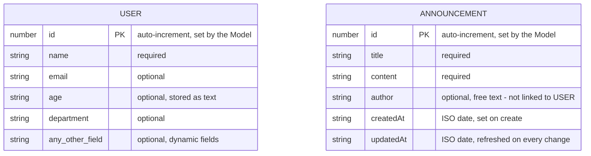
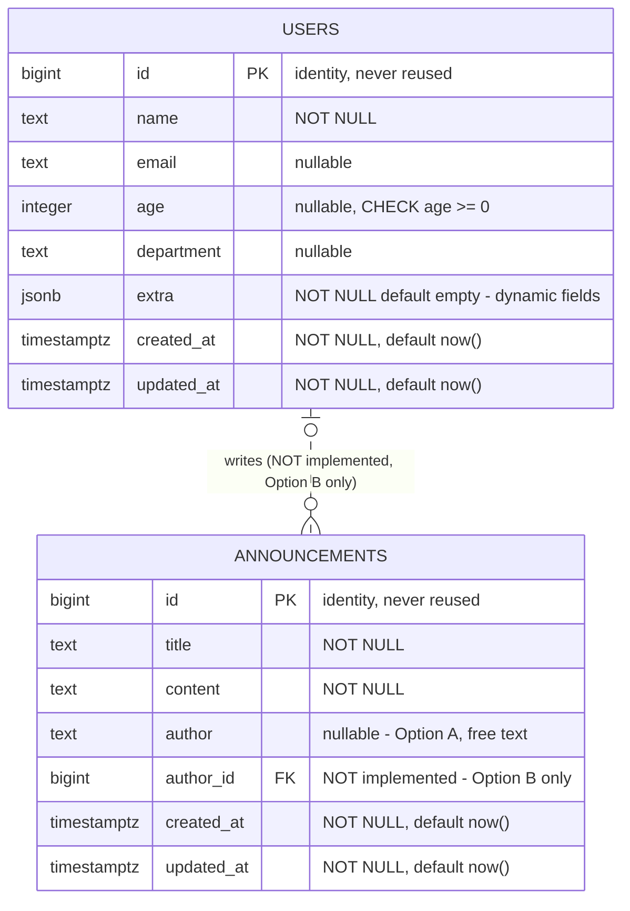

# 🗂️ Data Design Documentation

> Part of the **Alumni Tracking System** — back to the [README](README.md).

---

## 🎯 Purpose

This document describes the data the app works with, the rules the code enforces, and how it is stored in PostgreSQL. The app first kept everything in memory, so — as [🧪 The Forgetting Test](README.md#-the-forgetting-test) showed — all data disappeared whenever the server restarted or the Docker container was removed. This design prepared the move to a real database, and it is now **implemented**: the tables are created by the migrations in `migrations/`, and the Models in `lib/models/` read and write them with **plain, parameterized SQL** through `lib/db.ts` (the `pg` driver, no ORM). The data now survives restarts and `docker compose down`.

---

## 💾 Data in the app

Both entities are defined as TypeScript types in `lib/models/` and stored in PostgreSQL (tables `users` and `announcements`). The Models turn each table row into the object below — mapping `snake_case` columns to `camelCase` fields — so the controllers, views and API see the same shapes as before the database (with one change: `age` is now a number).

### User — `lib/models/user.ts`

| Field | TypeScript type | Required? | Description |
|---|---|---|---|
| `id` | `number` | Set by the database | Assigned by PostgreSQL (`GENERATED ALWAYS AS IDENTITY`). Clients can't choose it; an `id` sent in a request is ignored |
| `name` | `string` | **Required** | The user's name. Must be a non-empty string |
| `email` | `string` | Optional | Email address. Stored as sent — no format check on the server (the page form uses `type="email"`, which is only checked by the browser) |
| `age` | `number` | Optional | Age as a **whole number** (stored in an `integer` column). Sent as text in form-data (e.g. `"22"`) and checked by the controllers |
| `department` | `string` | Optional | Department, e.g. `"MIS"` |
| *any other key* | `string` | Optional | **Dynamic fields** — see below |

**Dynamic fields.** The `User` type has an index signature (`[field: string]: string | number | undefined`), so a user can carry **any extra field**. `POST /api/users`, `PUT` and `PATCH` accept *every* text field sent in the form-data (e.g. `city`). `name`, `email`, `age` and `department` go into their own columns; **every other field is stored in the `extra` jsonb column** (e.g. `{"city": "Istanbul"}`) and returned side by side with the columns, so a user looks exactly as flat as before. The pages only use `name`, `email` and `age` in their forms; other fields can only be set through the API, but are kept when a user is edited on the pages.

The `users` table also has `created_at` and `updated_at`, but they are **not returned** with the user (the API kept its old shape).

### Announcement — `lib/models/announcement.ts`

| Field | TypeScript type | Required? | Description |
|---|---|---|---|
| `id` | `number` | Set by the database | Assigned by PostgreSQL (`GENERATED ALWAYS AS IDENTITY`). Clients can't choose it |
| `title` | `string` | **Required** | Title. Must be a non-empty string |
| `content` | `string` | **Required** | Body text. Must be a non-empty string. Text typed in the page's textarea arrives with `\r\n` line breaks |
| `author` | `string` | Optional | **Free text** (e.g. `"Alumni Office"`) — not linked to a User |
| `createdAt` | `string` | Set by the database | ISO date string (e.g. `"2026-10-10T09:30:00.000Z"`) from the `created_at` column, set when the announcement is created |
| `updatedAt` | `string` | Set by the database | ISO date string from `updated_at`, set on create and refreshed on every replace or update |

Unlike users, announcements have a **fixed set of fields**: the Model only stores `title`, `content` and `author`, so any other field sent to the API is ignored.

---

## 📏 Entities and rules

These are the rules the code enforces **now** (controllers + database constraints).

### User

- **Validation** (in `UserController`, used by both the page and API controllers):
  - Create (`POST /api/users`, the "Add a user" form) and replace (`PUT /api/users/{id}`): `name` is **required** and must be a non-empty string (a name of only spaces is rejected).
  - Partial update (`PATCH /api/users/{id}`, the edit form): `name` may be left out, but if it is sent it can't be blank.
  - `age`, if sent and not empty, must be a **whole number** (`0` or more) — needed since the column is an `integer`.
  - The database also checks `name` (`NOT NULL`, not blank) and `age >= 0`; if it ever rejects a value, the controllers answer **400** with a clear message instead of crashing.
- **What is stored:** values are stored **as sent** — the `trim()` check is only used for validation, so a name like `" Ayman "` keeps its spaces.
- **Empty optional fields:**
  - The "Add a user" form leaves empty fields out entirely (the columns stay `NULL`).
  - The edit form and `PATCH` store a cleared text field as an empty string `""`, as before; a cleared `age` becomes `NULL` (an integer column can't hold `""`).
  - `PUT` replaces the whole user: columns not sent become `NULL` and `extra` is replaced.
  - `NULL` columns are left out of the returned user, like fields that were never sent.
- **Ids:** assigned by PostgreSQL. Ids only go up and are **never reused**, even after a restart (the old in-memory counter restarted at 1). `--fresh` seeding resets them on purpose (`RESTART IDENTITY`). An id in a URL that isn't a whole number (`abc`, `1.5`) is answered with **404**, as before.
- **Timestamps:** `created_at` and `updated_at` exist in the table (`updated_at` is set to `now()` on every replace / update), but aren't returned.
- **Order:** `getAllUsers()` returns users oldest first (`ORDER BY id`), as before.
- **Uniqueness:** none — two users can have the same name or email (no unique constraint, see open question 6).

### Announcement

- **Validation** (in `AnnouncementController.validateAnnouncement`, used by both the page and API controllers):
  - Create (`POST /api/announcements`, the "Add an announcement" form) and replace (`PUT`): `title` **and** `content` are **required** and must be non-empty strings.
  - Partial update (`PATCH`, the edit form): `title` and `content` may be left out, but can't be blank if sent.
  - `author` is not validated. The database also checks `title` and `content` (`NOT NULL`, not blank).
- **What is stored:** values are stored as sent (not trimmed). Only `title`, `content` and `author` are kept.
- **Empty optional fields:** the create form leaves an empty `author` out (`NULL`); the edit form and `PATCH` store a cleared `author` as `""`; `PUT` sets `author` to `NULL` if it isn't sent.
- **Ids:** assigned by PostgreSQL, never reused. An id in a URL must be a whole number (`/^\d+$/`); otherwise the API answers **400** (users answer **404** for the same case — kept as before).
- **Timestamps:** `created_at` and `updated_at` default to `now()` in the database. `created_at` never changes; every replace and update sets `updated_at = now()` in its `UPDATE` query.
- **Order:** `getAllAnnouncements()` returns the newest first (`ORDER BY created_at DESC, id DESC`).

---

## 🔗 Relationships

**There is no relationship between User and Announcement.** `Announcement.author` is a **free text field**: it is not an id, it is not checked against the users, and deleting or renaming a user has no effect on any announcement. Two announcements by the same person can spell the author differently.

This was a **design decision** for the database; **Option A was chosen** (see the decisions below):

- **Option A — keep `author` as text.** Simple and matches the current API and forms. Works for authors who aren't users (e.g. "Alumni Office"), but there is no way to list "all announcements by user X" reliably.
- **Option B — make it a reference to a User** (`author_id` → `users.id`). Gives a real link and consistent names, but every author must then be a user, the forms and API would need to send a user id instead of a name, and we must decide what happens to announcements when their author is deleted.

See [Decisions and open questions](#-decisions-and-open-questions).

---

## 📊 ER diagram

### Before the database (in-memory, history)

How the data looked when it was kept in memory: two separate entities with **no relationship**. `author` is plain text.

### PostgreSQL (implemented — what the app uses now)

These tables are created by `migrations/` and used by the Models. The dashed relationship and `author_id` are the only parts **not** implemented: they would only exist if **Option B** is chosen later.

---

## 🐘 Database design (PostgreSQL) — implemented

> **Status: implemented.** These tables are **created by the plain SQL migrations in `migrations/`** (`001_create_users`, `002_create_announcements`), which run automatically with `docker compose up` (see [🧱 Migrations](README.md#-migrations)), and **the app uses them**: the Models in `lib/models/` read and write them with plain, parameterized SQL through `lib/db.ts` (the `pg` driver — **no ORM**, confirmed by the professor). The PostgreSQL service is the `db` service in `docker-compose.yml` (`postgres:17-alpine`, with the `pgdata` volume).
>
> The choices made along the way are listed in [Decisions and open questions](#-decisions-and-open-questions). Any change to these tables is made with a new migration.

### `users`

| Column | SQL type | Constraints | Note |
|---|---|---|---|
| `id` | `bigint` | `PRIMARY KEY`, `GENERATED ALWAYS AS IDENTITY` | Auto-increment, never reused — and, unlike the old in-memory counter, it keeps counting across restarts. Returned as a JS `number` |
| `name` | `text` | `NOT NULL`, `CHECK (btrim(name) <> '')` | Same rule as `UserController.validateName` |
| `email` | `text` | nullable | No unique or format constraint (open question 6) |
| `age` | `integer` | nullable, `CHECK (age >= 0)` | The controllers check it's a whole number before saving; returned as a JS `number` |
| `department` | `text` | nullable | Used by the users list page |
| `extra` | `jsonb` | `NOT NULL`, `DEFAULT '{}'::jsonb` | Every other dynamic field, e.g. `{"city": "Istanbul"}` |
| `created_at` | `timestamptz` | `NOT NULL`, `DEFAULT now()` | Set by the database; not returned by the API (users kept their old shape) |
| `updated_at` | `timestamptz` | `NOT NULL`, `DEFAULT now()` | Set to `now()` by the Model's `UPDATE` queries; not returned by the API |

**How to handle the dynamic User fields.** The API accepts any field, so the database needs a way to store fields it doesn't know in advance. The options that were considered:

1. **Only fixed columns** — every allowed field becomes a column. Clear and strictly typed, but any field not on the list would be rejected or lost, which changes how `POST /api/users` behaves today.
2. **Only a flexible `jsonb` column** — store the whole user except `id` in one JSON column. Keeps today's behaviour exactly, but the database can't enforce `name NOT NULL`, types or uniqueness, and queries are harder.
3. **Fixed columns + one `jsonb` column** — columns for the fields the code already knows (`name`, `email`, `age`, `department`), and an `extra` `jsonb` column for everything else.

**Chosen and implemented: option 3.** It keeps the API working (unknown fields still go somewhere instead of being dropped), while the fields the pages actually use get real types and constraints that PostgreSQL can enforce and index. A field that becomes important later can be moved from `extra` to its own column.

### `announcements`

| Column | SQL type | Constraints | Note |
|---|---|---|---|
| `id` | `bigint` | `PRIMARY KEY`, `GENERATED ALWAYS AS IDENTITY` | Auto-increment, never reused, keeps counting across restarts. Returned as a JS `number` |
| `title` | `text` | `NOT NULL`, `CHECK (btrim(title) <> '')` | Same rule as `validateAnnouncement` |
| `content` | `text` | `NOT NULL`, `CHECK (btrim(content) <> '')` | Same rule as `validateAnnouncement` |
| `author` | `text` | nullable | **Option A** (free text) — implemented |
| `author_id` | `bigint` | nullable, `REFERENCES users(id)` | **Option B only — not created** by the migrations (Option A was used); what happens on user delete (`ON DELETE SET NULL` or `RESTRICT`) would need deciding if Option B is chosen later |
| `created_at` | `timestamptz` | `NOT NULL`, `DEFAULT now()` | Returned as the ISO string `createdAt` |
| `updated_at` | `timestamptz` | `NOT NULL`, `DEFAULT now()` | Set to `now()` by every replace / update query; returned as `updatedAt` |

An index on `announcements (created_at DESC)` supports the "newest first" list (`announcements_created_at_idx`), which `getAllAnnouncements()` uses.

**Sample data.** Development sample data comes from the **factories** in `scripts/factories/` and the **seed** script `scripts/seed.mjs` (see [🌱 Factories and Seeding](README.md#-factories-and-seeding)), which inserts 10 users and 8 announcements with parameterized SQL. The factories follow the table rules: every user has a non-blank `name`, a **unique `email`** (it contains the user's number, even though the table itself has no unique constraint yet — open question 6), an `age` between 22 and 45 (`>= 0`), a `department`, and an `extra` object (some users get a `city`); every announcement has a non-blank `title` and `content`, a free-text `author` (sometimes empty, since it's optional — Option A), and fixed `created_at` / `updated_at` dates one day apart. Values are picked in order, not randomly, so every seed gives the same data.

**`updated_at`.** Neither table has a trigger: the Models set `updated_at = now()` in their `UPDATE` queries (implemented for both tables).

**Naming.** Columns use `snake_case` (the usual PostgreSQL style), while the app uses `camelCase` (`createdAt`). The Models translate between them in small mapping functions (`toUser`, `toAnnouncement`), so the API's JSON didn't have to change.

**Queries.** Every query is plain SQL with `$1, $2, …` parameters — never built by string concatenation, so input like `x'); DROP TABLE users; --` is stored as plain text. Creates, updates and deletes use `… RETURNING`, so one query both changes and returns the row. A partial update (`PATCH`) uses one fixed `UPDATE` with a "was this field sent?" flag per column, and merges extra fields with `extra || $n::jsonb`.

---

## ❓ Decisions and open questions

| # | Question | Status |
|---|---|---|
| 1 | **ORM or plain SQL?** ~~Supabase JS client, Prisma, Drizzle~~ — not chosen. | ✅ **Decided: PostgreSQL, no ORM (plain SQL), confirmed by the professor.** Implemented with the `pg` driver (one shared pool in `lib/db.ts`) |
| 2 | **Should `Announcement.author` reference a User** (Option B) or stay free text (Option A)? If it references a user: what happens to an author's announcements when the user is deleted, and how do non-user authors like "Alumni Office" work? | ✅ **Implemented: Option A** (`author text`, no `author_id`). Can be changed later with a new migration |
| 3 | **Do ids stay numeric** (auto-increment `bigint`) or switch to UUIDs? The routes, Swagger docs and the announcement id check (`/^\d+$/`) all assume whole-number ids today. | ✅ **Implemented: numeric** (`bigint GENERATED ALWAYS AS IDENTITY`, returned as a JS `number`) |
| 4 | **How to store dynamic User fields** — fixed columns, `jsonb`, or both? Should the API keep accepting *any* field at all? | ✅ **Implemented: option 3** — fixed columns + `extra jsonb`; the API still accepts any field |
| 5 | **Should `age` become a number?** In the in-memory version it was free text with no server-side check. | ✅ **Implemented: yes** — `integer` with `CHECK (age >= 0)`; the API returns it as a number, and the controllers reject an age that isn't a whole number with a 400 |
| 6 | **Should `email` be unique and format-checked?** Neither is enforced. | **Still open.** Implemented as nullable `text` with no constraint. If a unique index is added later, a duplicate email will get a clear 400 (`23505` is already handled) |
| 7 | **Should users get `created_at` / `updated_at`** like announcements? | ✅ **Implemented in the table** (`updated_at` set on every change), but **not returned** by the API yet, to keep the users' JSON shape |
| 8 | **Empty values:** should cleared fields be stored as `""` or `NULL`? | **Partly decided:** text fields keep the old behaviour (`""`); a cleared `age` becomes `NULL` (an integer can't be `""`); fields never sent are `NULL` and left out of the JSON. Whether text fields should also become `NULL` is still open |
| 9 | **Trimming:** values are validated with `trim()` but stored with their surrounding spaces. Should they be trimmed before saving? | Still open (values are stored as sent, as before) |
| 10 | **Invalid ids:** an id like `abc` gives 400 for announcements but 404 for users. Should both behave the same? | Still open — both kept exactly as before when the database was connected |
