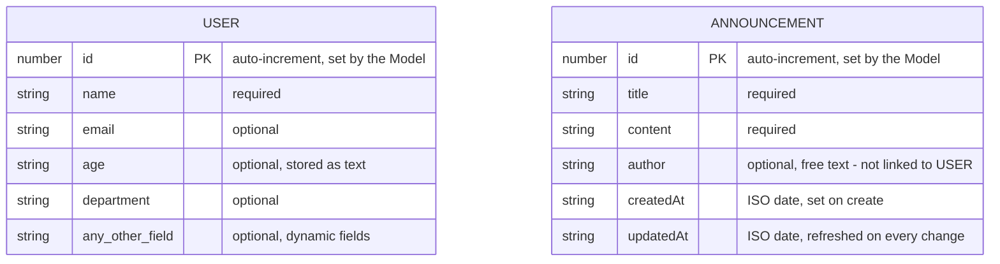
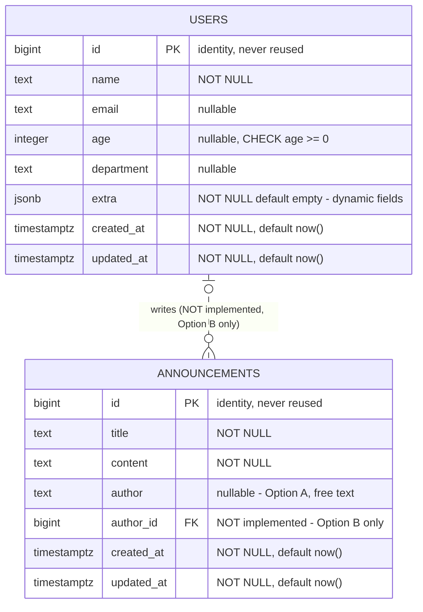
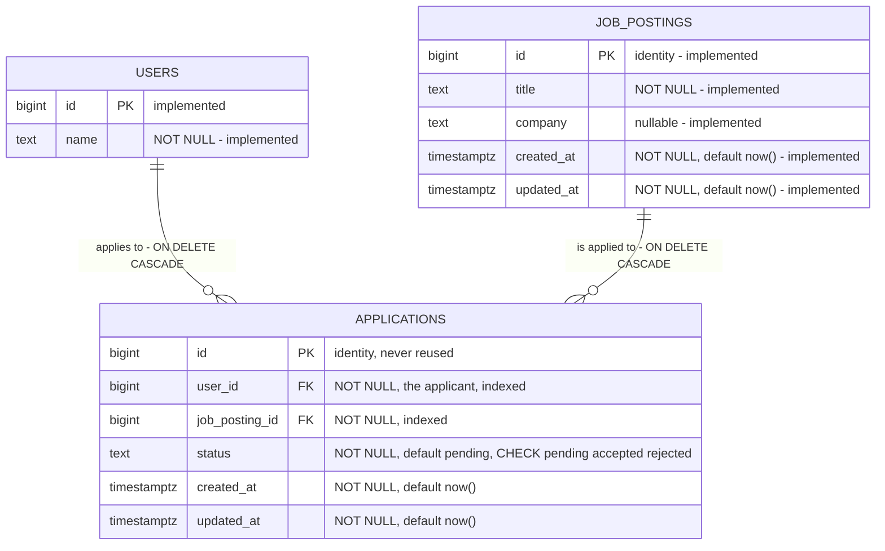

# 🗂️ Data Design Documentation

> Part of the **Alumni Tracking System** — back to the [README](README.md).

---

## 🎯 Purpose

This document describes the data the app works with, the rules the code enforces, and how it is stored in PostgreSQL. The app first kept everything in memory, so — as [🧪 The Forgetting Test](README.md#-the-forgetting-test) showed — all data disappeared whenever the server restarted or the Docker container was removed. This design prepared the move to a real database, and it is now **implemented**: the tables are created by the migrations in `migrations/`, and the Models in `lib/models/` read and write them with **plain, parameterized SQL** through `lib/db.ts` (the `pg` driver, no ORM). The data now survives restarts and `docker compose down`.

The next table, **`job_postings`**, was **designed here first** ("design first, then the code") and is **created by migration `003_create_job_postings`**, with its **Model and rules in `lib/models/jobPosting.ts`** a **JSON API**, and **pages** at `/jobs` (✅ implemented).

> **Design change — partly implemented (the professor's whiteboard design).** Users and job postings are linked **only through the `applications` join table** — a **many-to-many** relationship. There is **no direct owner**: the `job_postings.user_id` column was **removed by migration `004_drop_job_postings_user_id`**, and the job-posting code was updated to match (✅ both implemented — job postings are created with `POST /api/jobs`, without any user). The **`applications` table** is created by **migration `005_create_applications`**, with its **Model and rules in `lib/models/application.ts`** and its **JSON API** in `ApiApplicationController` (✅ all implemented); the include is still **planned**. A user's **"jobs"** are the job postings linked to that user through `applications`, and `GET /api/users/{id}` will be able to include them (like `User.find(1, { include: "jobs" })`). See the [relationship](#users--job-postings-many-to-many-through-applications), [💼 `job_postings`](#-job_postings--implemented-planned-change-no-owner-column), [📝 `applications`](#-applications--implemented-migration-005), the [API](#-api-job-postings-and-applications) and the [🔧 changes needed in the code](#-changes-needed-in-the-code).

---

## 💾 Data in the app

Both entities are defined as TypeScript types in `lib/models/` and stored in PostgreSQL (tables `users` and `announcements`). The Models turn each table row into the object below — mapping `snake_case` columns to `camelCase` fields — so the controllers, views and API see the same shapes as before the database (with one change: `age` is now a number).

### User — `lib/models/user.ts`

| Field | TypeScript type | Required? | Description |
|---|---|---|---|
| `id` | `number` | Set by the database | Assigned by PostgreSQL (`GENERATED ALWAYS AS IDENTITY`). Clients can't choose it; an `id` sent in a request is ignored |
| `name` | `string` | **Required** | The user's name. Must be a non-empty string |
| `email` | `string` | Optional | Email address. Stored as sent — no format check on the server (the page form uses `type="email"`, which is only checked by the browser) |
| `age` | `number` | Optional | Age as a **whole number** (stored in an `integer` column). Sent as text in form-data (e.g. `"22"`) and checked by the controllers |
| `department` | `string` | Optional | Department, e.g. `"MIS"` |
| *any other key* | `string` | Optional | **Dynamic fields** — see below |

**Dynamic fields.** The `User` type has an index signature (`[field: string]: string | number | undefined`), so a user can carry **any extra field**. `POST /api/users`, `PUT` and `PATCH` accept *every* text field sent in the form-data (e.g. `city`). `name`, `email`, `age` and `department` go into their own columns; **every other field is stored in the `extra` jsonb column** (e.g. `{"city": "Istanbul"}`) and returned side by side with the columns, so a user looks exactly as flat as before. The pages only use `name`, `email` and `age` in their forms; other fields can only be set through the API, but are kept when a user is edited on the pages.

The `users` table also has `created_at` and `updated_at`, but they are **not returned** with the user (the API kept its old shape).

### Announcement — `lib/models/announcement.ts`

| Field | TypeScript type | Required? | Description |
|---|---|---|---|
| `id` | `number` | Set by the database | Assigned by PostgreSQL (`GENERATED ALWAYS AS IDENTITY`). Clients can't choose it |
| `title` | `string` | **Required** | Title. Must be a non-empty string |
| `content` | `string` | **Required** | Body text. Must be a non-empty string. Text typed in the page's textarea arrives with `\r\n` line breaks |
| `author` | `string` | Optional | **Free text** (e.g. `"Alumni Office"`) — not linked to a User |
| `createdAt` | `string` | Set by the database | ISO date string (e.g. `"2026-10-10T09:30:00.000Z"`) from the `created_at` column, set when the announcement is created |
| `updatedAt` | `string` | Set by the database | ISO date string from `updated_at`, set on create and refreshed on every replace or update |

Unlike users, announcements have a **fixed set of fields**: the Model only stores `title`, `content` and `author`, so any other field sent to the API is ignored.

### JobPosting — `lib/models/jobPosting.ts` (used by the job postings API)

| Field | TypeScript type | Required? | Description |
|---|---|---|---|
| `id` | `number` | Set by the database | Assigned by PostgreSQL (`GENERATED ALWAYS AS IDENTITY`). An `id` in the data is ignored |
| `title` | `string` | **Required** | The job title, **trimmed**; 1–200 characters |
| `company` | `string` | Optional | The hiring company, **trimmed**; at most 200 characters. Left out when empty (`NULL`) |
| `createdAt` | `string` | Set by the database | ISO date string from `created_at` |
| `updatedAt` | `string` | Set by the database | ISO date string from `updated_at`, refreshed on every update |

Like announcements, job postings have a **fixed set of fields**: only `title` and `company` are taken from the data; anything else (`id`, `userId`, `createdAt`, …) is ignored. **A job posting has no owner** (✅ implemented): there is no `userId` field and no `user_id` column.

---

## 📏 Entities and rules

These are the rules the code enforces **now** (controllers + database constraints).

### User

- **Validation** (in `UserController`, used by both the page and API controllers):
  - Create (`POST /api/users`, the "Add a user" form) and replace (`PUT /api/users/{id}`): `name` is **required** and must be a non-empty string (a name of only spaces is rejected).
  - Partial update (`PATCH /api/users/{id}`, the edit form): `name` may be left out, but if it is sent it can't be blank.
  - `age`, if sent and not empty, must be a **whole number** (`0` or more) — needed since the column is an `integer`.
  - The database also checks `name` (`NOT NULL`, not blank) and `age >= 0`; if it ever rejects a value, the controllers answer **400** with a clear message instead of crashing.
- **What is stored:** values are stored **as sent** — the `trim()` check is only used for validation, so a name like `" Ayman "` keeps its spaces.
- **Empty optional fields:**
  - The "Add a user" form leaves empty fields out entirely (the columns stay `NULL`).
  - The edit form and `PATCH` store a cleared text field as an empty string `""`, as before; a cleared `age` becomes `NULL` (an integer column can't hold `""`).
  - `PUT` replaces the whole user: columns not sent become `NULL` and `extra` is replaced.
  - `NULL` columns are left out of the returned user, like fields that were never sent.
- **Ids:** assigned by PostgreSQL. Ids only go up and are **never reused**, even after a restart (the old in-memory counter restarted at 1). `--fresh` seeding resets them on purpose (`RESTART IDENTITY`). An id in a URL that isn't a whole number (`abc`, `1.5`) is answered with **404**, as before.
- **Timestamps:** `created_at` and `updated_at` exist in the table (`updated_at` is set to `now()` on every replace / update), but aren't returned.
- **Order:** `getAllUsers()` returns users oldest first (`ORDER BY id`), as before.
- **Uniqueness:** none — two users can have the same name or email (no unique constraint, see open question 6).

### Announcement

- **Validation** (in `AnnouncementController.validateAnnouncement`, used by both the page and API controllers):
  - Create (`POST /api/announcements`, the "Add an announcement" form) and replace (`PUT`): `title` **and** `content` are **required** and must be non-empty strings.
  - Partial update (`PATCH`, the edit form): `title` and `content` may be left out, but can't be blank if sent.
  - `author` is not validated. The database also checks `title` and `content` (`NOT NULL`, not blank).
- **What is stored:** values are stored as sent (not trimmed). Only `title`, `content` and `author` are kept.
- **Empty optional fields:** the create form leaves an empty `author` out (`NULL`); the edit form and `PATCH` store a cleared `author` as `""`; `PUT` sets `author` to `NULL` if it isn't sent.
- **Ids:** assigned by PostgreSQL, never reused. An id in a URL must be a whole number (`/^\d+$/`); otherwise the API answers **400** (users answer **404** for the same case — kept as before).
- **Timestamps:** `created_at` and `updated_at` default to `now()` in the database. `created_at` never changes; every replace and update sets `updated_at = now()` in its `UPDATE` query.
- **Order:** `getAllAnnouncements()` returns the newest first (`ORDER BY created_at DESC, id DESC`).

### JobPosting — rules

> Unlike users and announcements, whose rules live in the controllers, **the job posting rules live in the Model** (`lib/models/jobPosting.ts`), in one function — `validateJobPosting` — used by both create and update, so each rule exists once.

- **`title`:** required when creating. It must be text; it is **trimmed**, must not be empty after trimming, and can be at most **200** characters. On update it may be left out (it stays as it is), but if it is sent the same rules apply.
- **`company`:** optional. If sent it must be text; it is **trimmed** and can be at most **200** characters. An empty company (`""` or only spaces) means "no company" and is stored as `NULL`.
- **Valid ids only.** A posting id that isn't a whole number greater than 0 (`"abc"`, `"1.5"`, `-2`, `0`, or a number too large for an id) is reported as an invalid id — no query is run.
- **No owner** *(✅ implemented)*. The old rules "the user must exist" and "the owner never changes" are **gone** with the `user_id` column: creating a posting needs no user, and the `23503` (foreign key) handling was removed from the Model.
- **How problems are reported.** The Model returns a result instead of throwing, and `ApiJobPostingController` turns each result into an HTTP status (**implemented**):

  | Result | Meaning | HTTP response |
  |---|---|---|
  | `{ jobPosting }` / `{ jobPostings }` | Success | 200 (read, update) / 201 (create) |
  | `true` from `deleteJobPosting` | Deleted | **204**, no body |
  | `{ error: "validation", message }` | A rule above is broken, e.g. `"title" can't be empty` | 400 with that message |
  | `{ error: "invalid-id", message }` | The id can't match a row, e.g. `Job posting id "abc" is not a valid number` | 400 with that message |
  | `{ error: "not-found", message }` / `false` from delete | The posting doesn't exist | 404 `{"error": "Job posting not found"}` |

  `deleteJobPosting` returns `true` (deleted) or `false` (not found), or an invalid-id result.
- **Database errors aren't swallowed.** Any other database error is logged on the server and thrown again; the API answers **500** `{"error": "Internal server error"}`, like the other models' routes.
- **Deleting a user no longer deletes job postings** *(✅ implemented by migration 004 — the `ON DELETE CASCADE` foreign key went with `user_id`)*. Since migration 005, deleting a user deletes only their applications (`ON DELETE CASCADE` on `applications.user_id`).
- **Order:** postings are listed newest first (`ORDER BY created_at DESC, id DESC`).

### Application — rules

> ✅ **Implemented in the Model** (`lib/models/application.ts`), like the job posting rules: the data and its rules live in one place. ✅ **Routes implemented:** `ApiApplicationController` turns each result into the HTTP code below (see the [API](#-api-job-postings-and-applications)). ✅ **Pages implemented:** `ApplicationController` (page side) turns the same results into messages on `/jobs/{id}`, e.g. "User already applied to this job posting".

- **`userId` and `jobPostingId`:** both required when creating. Each must be a whole number greater than 0, sent as a number or as text (e.g. `3` or `"3"`). A missing one is a validation error; anything else that isn't a valid id (`"abc"`, `0`, `-2`, `1.5`) is reported as an **invalid id** — no query is run.
- **`status`:** optional when creating — it **defaults to `pending`**. If sent it must be **exactly** `pending`, `accepted` or `rejected` (no trimming, no capitals); anything else is a validation error. The list is `APPLICATION_STATUSES`, the same values as the table's `CHECK`.
- **Ignored fields:** only `userId`, `jobPostingId` and `status` are read; `id`, `createdAt`, `updatedAt` or anything else in the data is ignored.
- **The user and the job posting must exist**, and **a user can apply to a posting only once.** These are checked by the **database**, not by a query before the insert: the foreign keys reject a missing user or posting (`23503`) and `UNIQUE (user_id, job_posting_id)` rejects a second application (`23505`). The Model reads the **constraint name** of the error and turns it into a clear result. Because the database does the check, two requests at the same time can't create a duplicate (✅ verified: 5 parallel creates of the same pair gave 1 success and 4 "already applied").
- **Only the status can change.** `updateApplicationStatus(id, status)` takes nothing else, and its SQL only sets `status` and `updated_at = now()`: the user and the job posting of an application are **fixed** once it is created.
- **Functions:** `createApplication({ userId, jobPostingId, status? })`, `getAllApplications()`, `getApplicationsByJobPostingId(jobPostingId)` (a posting's applicants), `getApplicationsByUserId(userId)` (what a user applied to), `getApplicationById(id)`, `updateApplicationStatus(id, status)`, `deleteApplication(id)`, and for the pages two **read-only joins** with no rules of their own: `getApplicationsWithUsersByJobPostingId(jobPostingId)` (each application with its applicant's `id`, `name`, `email`) and `getApplicationsWithJobPostingsByUserId(userId)` (each with its job posting's `id`, `title`, `company`). Every list is **newest first** (`ORDER BY created_at DESC, id DESC`). The two "by" lists check that the user / posting exists, so a missing one gives "not found" while an existing one with no applications gives `[]`.
- **How problems are reported** (a result instead of throwing, like the JobPosting Model):

  | Result | Meaning | HTTP response |
  |---|---|---|
  | `{ application }` / `{ applications }` | Success | 200 (read, update) / 201 (create) |
  | `true` / `false` from `deleteApplication` | Deleted / no application with this id | **204** / 404 |
  | `{ error: "validation", message }` | A rule is broken, e.g. `"status" must be one of: pending, accepted, rejected` | **400** |
  | `{ error: "invalid-id", message }` | An id can't match a row, e.g. `User id "abc" is not a valid number` | **400** |
  | `{ error: "not-found", message }` | The application doesn't exist | **404** `"Application not found"` |
  | `{ error: "user-not-found", message }` | The user doesn't exist (`23503` on `applications_user_id_fkey`) | **404** `"User not found"` |
  | `{ error: "job-posting-not-found", message }` | The job posting doesn't exist (`23503` on `applications_job_posting_id_fkey`) | **404** `"Job posting not found"` |
  | `{ error: "already-applied", message }` | This user already applied to this posting (`23505` on `applications_user_id_job_posting_id_key`) | **409** `"User already applied to this job posting"` |
- **Database errors aren't swallowed.** Any other database error is logged on the server and thrown again (→ **500** `{"error": "Internal server error"}`), like the other models.

---

## 🔗 Relationships

Users and job postings are connected in **one relationship only: many-to-many, through the `applications` join table** (the professor's whiteboard design). There is **no direct owner** link between a user and a job posting.

| Relationship | Kind | Stored in | Status |
|---|---|---|---|
| A user **applies to** job postings | many-to-many | the `applications` join table (`user_id`, `job_posting_id`) | ✅ **Implemented** (migration `005_create_applications`, `lib/models/application.ts`, `ApiApplicationController`) |

> **Status:** migration `003_create_job_postings` gave `job_postings` an owner column (`user_id` → `users.id`, one-to-many). That owner relationship is **not part of the design any more**: the column was **removed by migration `004_drop_job_postings_user_id`**, and the code that used it (the nested route `/api/users/{id}/jobs` and the owner functions in the Models) was **removed too** (✅ implemented). Since migration `005_create_applications`, users and job postings are linked in the database **only** through `applications`; the Application Model (`lib/models/application.ts`) reads and writes it, but no route uses it yet.

### User and Announcement (implemented)

**There is no relationship between User and Announcement.** `Announcement.author` is a **free text field**: it is not an id, it is not checked against the users, and deleting or renaming a user has no effect on any announcement. Two announcements by the same person can spell the author differently.

This was a **design decision** for the database; **Option A was chosen** (see the decisions below):

- **Option A — keep `author` as text.** Simple and matches the current API and forms. Works for authors who aren't users (e.g. "Alumni Office"), but there is no way to list "all announcements by user X" reliably.
- **Option B — make it a reference to a User** (`author_id` → `users.id`). Gives a real link and consistent names, but every author must then be a user, the forms and API would need to send a user id instead of a name, and we must decide what happens to announcements when their author is deleted.

See [Decisions and open questions](#-decisions-and-open-questions).

### Users ↔ Job postings: many-to-many through applications

> ✅ **Table implemented** by migration `005_create_applications`, and its **Model and rules** in `lib/models/application.ts` ([rules](#application--rules)), and its **JSON API** (`ApiApplicationController`, [routes](#-api-job-postings-and-applications)). The owner column `job_postings.user_id` is gone (migration 004), so `applications` is the **only** link between users and job postings (see [🔧 Changes needed in the code](#-changes-needed-in-the-code)).

**A user applies to job postings:** this is a **many-to-many** relationship — **one user can apply to many job postings, and one job posting can have many applicants.** A foreign key column can only hold one value, so neither table can store this on its own — `users` would need a list of posting ids, and `job_postings` a list of user ids. The usual solution is a **join table**, `applications`, with **one row per application**:

- `applications.user_id` is a **foreign key** to `users.id` — the applicant.
- `applications.job_posting_id` is a **foreign key** to `job_postings.id` — the posting applied to.
- So the many-to-many relationship becomes **two one-to-many relationships**: a user has many applications, a job posting has many applications, and each application belongs to exactly one user and one posting.
- A join table can also hold facts about the relationship itself — here the application's **`status`** (`pending`, `accepted` or `rejected`) and its timestamps.
- `UNIQUE (user_id, job_posting_id)` makes sure a user can apply to the same posting **only once**.

**A user's "jobs".** Because there is no owner, a user's **jobs** are **the job postings linked to that user through `applications`** — the postings they applied to. In the Models (without an ORM) this will be a plain SQL join, `applications JOIN job_postings … WHERE applications.user_id = $1`, and `GET /api/users/{id}` will be able to include them, like `User.find(1, { include: "jobs" })` — see the [include decision](#decision-how-get-apiusersid-includes-a-users-jobs).

What happens to applications when a user or a posting is deleted is the [Decision: delete rules for applications](#decision-what-happens-to-applications-when-a-user-or-a-job-posting-is-deleted).

---

## 📊 ER diagram

### Before the database (in-memory, history)

How the data looked when it was kept in memory: two separate entities with **no relationship**. `author` is plain text.



### PostgreSQL (implemented — what the app uses now)

These tables are created by `migrations/` and used by the Models. The dashed relationship and `author_id` are the only parts **not** implemented: they would only exist if **Option B** is chosen later.



### Users, job postings and applications (implemented)

**One relationship between users and job postings: many-to-many through `APPLICATIONS`.** All three tables and both relationship lines are **implemented** in the database (`APPLICATIONS` by migration `005_create_applications`); only the Application Model uses `APPLICATIONS` so far (no routes yet). There is **no** direct line between `USERS` and `JOB_POSTINGS`: the old `job_postings.user_id` owner column was removed by migration 004 (✅ implemented), so the `JOB_POSTINGS` box shows the real table. (`USERS` is shortened to its key and name; its full columns are in the diagram above.)



The two lines into `APPLICATIONS` together form the **many-to-many** relationship: a user has many applications, a job posting has many applications, and each application joins exactly one user and one posting. Both delete rules are `ON DELETE CASCADE` ([decided](#decision-what-happens-to-applications-when-a-user-or-a-job-posting-is-deleted)).

`UNIQUE (user_id, job_posting_id)` (one application per user and posting) can't be drawn in Mermaid; it's in the [table](#-applications--implemented-migration-005) below.

---

## 🐘 Database design (PostgreSQL) — implemented

> **Status: implemented.** These tables are **created by the plain SQL migrations in `migrations/`** (`001_create_users`, `002_create_announcements`, then `003`–`005` for job postings and applications), which run automatically with `docker compose up` (see [🧱 Migrations](README.md#-migrations)), and **the app uses them**: the Models in `lib/models/` read and write them with plain, parameterized SQL through `lib/db.ts` (the `pg` driver — **no ORM**, confirmed by the professor). The PostgreSQL service is the `db` service in `docker-compose.yml` (`postgres:17-alpine`, with the `pgdata` volume).
>
> The choices made along the way are listed in [Decisions and open questions](#-decisions-and-open-questions). Any change to these tables is made with a new migration.
>
> **`users` and `announcements` are implemented and used by the app. [`job_postings`](#-job_postings--implemented-planned-change-no-owner-column) is created by migration `003_create_job_postings` and used by the job postings JSON API; its owner column was removed by migration 004. [`applications`](#-applications--implemented-migration-005) is created by migration `005_create_applications` and used by the Application Model, but no route uses it yet.**

### `users`

| Column | SQL type | Constraints | Note |
|---|---|---|---|
| `id` | `bigint` | `PRIMARY KEY`, `GENERATED ALWAYS AS IDENTITY` | Auto-increment, never reused — and, unlike the old in-memory counter, it keeps counting across restarts. Returned as a JS `number` |
| `name` | `text` | `NOT NULL`, `CHECK (btrim(name) <> '')` | Same rule as `UserController.validateName` |
| `email` | `text` | nullable | No unique or format constraint (open question 6) |
| `age` | `integer` | nullable, `CHECK (age >= 0)` | The controllers check it's a whole number before saving; returned as a JS `number` |
| `department` | `text` | nullable | Used by the users list page |
| `extra` | `jsonb` | `NOT NULL`, `DEFAULT '{}'::jsonb` | Every other dynamic field, e.g. `{"city": "Istanbul"}` |
| `created_at` | `timestamptz` | `NOT NULL`, `DEFAULT now()` | Set by the database; not returned by the API (users kept their old shape) |
| `updated_at` | `timestamptz` | `NOT NULL`, `DEFAULT now()` | Set to `now()` by the Model's `UPDATE` queries; not returned by the API |

**How to handle the dynamic User fields.** The API accepts any field, so the database needs a way to store fields it doesn't know in advance. The options that were considered:

1. **Only fixed columns** — every allowed field becomes a column. Clear and strictly typed, but any field not on the list would be rejected or lost, which changes how `POST /api/users` behaves today.
2. **Only a flexible `jsonb` column** — store the whole user except `id` in one JSON column. Keeps today's behaviour exactly, but the database can't enforce `name NOT NULL`, types or uniqueness, and queries are harder.
3. **Fixed columns + one `jsonb` column** — columns for the fields the code already knows (`name`, `email`, `age`, `department`), and an `extra` `jsonb` column for everything else.

**Chosen and implemented: option 3.** It keeps the API working (unknown fields still go somewhere instead of being dropped), while the fields the pages actually use get real types and constraints that PostgreSQL can enforce and index. A field that becomes important later can be moved from `extra` to its own column.

### `announcements`

| Column | SQL type | Constraints | Note |
|---|---|---|---|
| `id` | `bigint` | `PRIMARY KEY`, `GENERATED ALWAYS AS IDENTITY` | Auto-increment, never reused, keeps counting across restarts. Returned as a JS `number` |
| `title` | `text` | `NOT NULL`, `CHECK (btrim(title) <> '')` | Same rule as `validateAnnouncement` |
| `content` | `text` | `NOT NULL`, `CHECK (btrim(content) <> '')` | Same rule as `validateAnnouncement` |
| `author` | `text` | nullable | **Option A** (free text) — implemented |
| `author_id` | `bigint` | nullable, `REFERENCES users(id)` | **Option B only — not created** by the migrations (Option A was used); what happens on user delete (`ON DELETE SET NULL` or `RESTRICT`) would need deciding if Option B is chosen later |
| `created_at` | `timestamptz` | `NOT NULL`, `DEFAULT now()` | Returned as the ISO string `createdAt` |
| `updated_at` | `timestamptz` | `NOT NULL`, `DEFAULT now()` | Set to `now()` by every replace / update query; returned as `updatedAt` |

An index on `announcements (created_at DESC)` supports the "newest first" list (`announcements_created_at_idx`), which `getAllAnnouncements()` uses.

### 💼 `job_postings` — implemented, planned change: no owner column

> **Status:** the table is **created by migration `003_create_job_postings`**. Migration 003 also gave it a `user_id` owner column (`bigint NOT NULL REFERENCES users(id) ON DELETE CASCADE`, with the index `job_postings_user_id_idx`).
>
> ✅ **Column removal implemented:** following the whiteboard design, job postings have **no owner**. The **new migration `004_drop_job_postings_user_id`** (migration 003 was not edited) drops the foreign key `job_postings_user_id_fkey`, the index `job_postings_user_id_idx` and the `user_id` column. **The table below is the real table now.** Its `down` file adds `user_id` back only as **nullable and empty** — the old owners can't be restored.
>
> ✅ **Code updated:** the Model (`lib/models/jobPosting.ts`), `ApiJobPostingController` and the routes `/api/jobs`, `/api/jobs/{id}` work **without an owner** (verified against the Docker database after migration 004). Users and postings are linked only through [`applications`](#-applications--implemented-migration-005) (✅ table created by migration 005).

| Column | SQL type | Constraints | Note |
|---|---|---|---|
| `id` | `bigint` | `PRIMARY KEY`, `GENERATED ALWAYS AS IDENTITY` | Auto-increment, never reused, like the other tables |
| `title` | `text` | `NOT NULL`, `CHECK (btrim(title) <> '')` | The job title, e.g. "Junior Data Analyst". Required and not blank — the same rule style as `announcements.title`. The Model also trims it and limits it to 200 characters |
| `company` | `text` | nullable | The hiring company, e.g. "Trendyol". Optional; the Model trims it, limits it to 200 characters, and stores an empty company as `NULL` |
| `created_at` | `timestamptz` | `NOT NULL`, `DEFAULT now()` | Set by the database when the posting is created |
| `updated_at` | `timestamptz` | `NOT NULL`, `DEFAULT now()` | Set to `now()` by every replace / update query in the Model (no trigger), like the other tables |

The job postings API is described, with what changes, in the [API](#-api-job-postings-and-applications).

**No extra index.** The old `job_postings_user_id_idx` was dropped with the `user_id` column (migration 004). Lookups between users and postings will go through the `applications` indexes instead.

### 📝 `applications` — implemented (migration 005)

> ✅ **Table implemented:** created by **migration `005_create_applications`** (its `down` file drops the table again), after the migration that removed the owner column (`004_drop_job_postings_user_id`). It follows the same style as the other tables (`bigint` identity ids, `snake_case` columns, `timestamptz` timestamps). ✅ **Model implemented:** `lib/models/application.ts`, with the [rules](#application--rules). ✅ **Routes implemented:** `ApiApplicationController` and the nested / direct [routes](#-api-job-postings-and-applications). ✅ **Pages implemented:** the Applications section on `/jobs/{id}` (add by choosing a user, change the status, remove) and a read-only one on `/users/{id}`; they read through two read-only joins, `getApplicationsWithUsersByJobPostingId` and `getApplicationsWithJobPostingsByUserId`. **Not yet:** a factory and seed for applications. `seed:fresh` empties `applications` through `CASCADE`.
>
> **Delete rule (CASCADE):** if a user or a job posting is deleted, all of its applications are deleted with it.

| Column | SQL type | Constraints | Note |
|---|---|---|---|
| `id` | `bigint` | `PRIMARY KEY`, `GENERATED ALWAYS AS IDENTITY` | Auto-increment, never reused, like the other tables |
| `user_id` | `bigint` | `NOT NULL`, `REFERENCES users(id) ON DELETE CASCADE` | **Foreign key** to the **applicant**; same type as `users.id`. Deleting the user deletes their applications ([decision below](#decision-what-happens-to-applications-when-a-user-or-a-job-posting-is-deleted)) |
| `job_posting_id` | `bigint` | `NOT NULL`, `REFERENCES job_postings(id) ON DELETE CASCADE` | **Foreign key** to the **job posting applied to**; same type as `job_postings.id`. Deleting the posting deletes its applications ([decision below](#decision-what-happens-to-applications-when-a-user-or-a-job-posting-is-deleted)) |
| `status` | `text` | `NOT NULL`, `DEFAULT 'pending'`, `CHECK (status IN ('pending', 'accepted', 'rejected'))` | Where the application stands. A new application is `pending`; the `CHECK` makes PostgreSQL reject any other value (error `23514`) |
| `created_at` | `timestamptz` | `NOT NULL`, `DEFAULT now()` | When the user applied; set by the database |
| `updated_at` | `timestamptz` | `NOT NULL`, `DEFAULT now()` | Set to `now()` by every update query (e.g. a status change) in the Model, no trigger — like the other tables |

**Table constraint.** `UNIQUE (user_id, job_posting_id)` (named `applications_user_id_job_posting_id_key`) — **one application per user and posting.** Applying twice to the same posting is rejected by PostgreSQL with a unique violation (`23505`). The API reports it as **409 Conflict** (see the [API](#-api-job-postings-and-applications)): the Application Model catches the `23505` itself and returns `already-applied`, which `ApiApplicationController` maps to 409 (the shared error helper would have made it a 400).

**Indexes.** PostgreSQL doesn't index foreign keys by itself, so each one gets its own index: `applications_user_id_idx` ("all applications of user X") and `applications_job_posting_id_idx` ("all applicants of posting Y"). They also let PostgreSQL apply the delete rule quickly when a user or a posting is deleted. (The unique constraint creates a third index, on `(user_id, job_posting_id)`.)

**Why `text` + `CHECK` for `status`.** A `CHECK` on a `text` column is easy to read and to change later with a new migration (e.g. adding a `withdrawn` status). A PostgreSQL `ENUM` type would also work, but changing its values is more awkward.

#### Decision: what happens to applications when a user or a job posting is deleted?

> ✅ **Decided and implemented: `ON DELETE CASCADE` on both foreign keys** (migration `005_create_applications`). Both options are kept below for reference.

**1. `user_id` — when the applicant is deleted**

| Option | What happens | Trade-off |
|---|---|---|
| **`ON DELETE CASCADE`** | The user **and all their applications** are deleted together | Simple; the existing Delete button and `DELETE /api/users/{id}` keep working. The postings lose that applicant from their lists, with no trace |
| **`ON DELETE RESTRICT`** | Deleting a user who has applied is **refused** until their applications are deleted | Keeps every application on record. But any user who ever applied can't be deleted without extra steps, and today's Delete would show an error |

**2. `job_posting_id` — when the job posting is deleted**

| Option | What happens | Trade-off |
|---|---|---|
| **`ON DELETE CASCADE`** | The posting **and all its applications** are deleted together | Simple; `DELETE /api/jobs/{id}` keeps working. Applicants lose the record that they applied |
| **`ON DELETE RESTRICT`** | Deleting a posting that has applications is **refused** | Protects applicants' history. But `DELETE /api/jobs/{id}` would fail for any posting with applicants until they're removed |

**Why `ON DELETE CASCADE` on both.**
- An application only means something while **both** its applicant and its posting exist (both columns are `NOT NULL`, so `SET NULL` isn't possible).
- Today's Delete actions (`DELETE /api/users/{id}`, the Delete button, `DELETE /api/jobs/{id}`) keep working without extra steps.
- With no owner column any more, deleting a user no longer deletes job postings — only that user's applications.

The trade-off is that application history disappears with the user or the posting. If keeping that history matters later, a better tool than `RESTRICT` would be to **close** postings instead of deleting them (e.g. a status on `job_postings`) — an open question below.

**Sample data.** Development sample data comes from the **factories** in `scripts/factories/` and the **seed** script `scripts/seed.mjs` (see [🌱 Factories and Seeding](README.md#-factories-and-seeding)), which inserts 10 users, 8 announcements and 10 job postings with parameterized SQL (applications are not seeded). The factories follow the table rules: every user has a non-blank `name`, a **unique `email`** (it contains the user's number, even though the table itself has no unique constraint yet — open question 6), an `age` between 22 and 45 (`>= 0`), a `department`, and an `extra` object (some users get a `city`); every announcement has a non-blank `title` and `content`, a free-text `author` (sometimes empty, since it's optional — Option A), and fixed `created_at` / `updated_at` dates one day apart; every job posting has a realistic `title` (e.g. "Junior Data Analyst") and `company` (e.g. "Trendyol") that pass the JobPosting Model's rules (non-blank, trimmed, at most 200 characters), no owner, and fixed dates one day apart. A normal seed checks users + announcements together and job postings on their own (each group is seeded only if empty); `--fresh` runs `TRUNCATE users, announcements, job_postings RESTART IDENTITY CASCADE`, which also empties `applications`. Values are picked in order, not randomly, so every seed gives the same data.

**`updated_at`.** Neither table has a trigger: the Models set `updated_at = now()` in their `UPDATE` queries (implemented for both tables).

**Naming.** Columns use `snake_case` (the usual PostgreSQL style), while the app uses `camelCase` (`createdAt`). The Models translate between them in small mapping functions (`toUser`, `toAnnouncement`), so the API's JSON didn't have to change.

**Queries.** Every query is plain SQL with `$1, $2, …` parameters — never built by string concatenation, so input like `x'); DROP TABLE users; --` is stored as plain text. Creates, updates and deletes use `… RETURNING`, so one query both changes and returns the row. A partial update (`PATCH`) uses one fixed `UPDATE` with a "was this field sent?" flag per column, and merges extra fields with `extra || $n::jsonb`.

---

## 🧭 API: job postings and applications

> **Job postings and applications: implemented** (✅ `ApiJobPostingController`, `ApiApplicationController`, verified with `curl` against the Docker database). Only the `?include=jobs` row is still planned. Bodies are JSON or form-data, like today's job postings API. "URL" means an id taken from the path; "body" means a field sent in the request body. Every route can also answer **500** `{"error": "Internal server error"}`. The **Today** column says what exists now.

| Method | URL | What it does | Id from the URL | From the body | Success | Errors | Today |
|---|---|---|---|---|---|---|---|
| `POST` | `/api/jobs` | Create a job posting | — | `title` (required), `company`; any `id` / `userId` / `createdAt` is ignored | **201** + the posting | 400 invalid data or body | ✅ **Implemented** |
| `GET` | `/api/jobs` | All postings, newest first | — | — | 200 | — | Implemented |
| `GET` | `/api/jobs/{id}` | One posting | `{id}` = **job posting** | — | 200 | 400 invalid id; 404 "Job posting not found" | ✅ Implemented (no `userId`) |
| `PATCH` | `/api/jobs/{id}` | Change `title` and/or `company` | `{id}` = **job posting** | `title`, `company` | 200 + the posting | 400; 404 | ✅ Implemented (no owner) |
| `DELETE` | `/api/jobs/{id}` | Delete the posting (and, by CASCADE, its applications) | `{id}` = **job posting** | — | **204**, no body | 400; 404 | ✅ Implemented |
| `POST` | `/api/jobs/{id}/applications` | User applies to posting `{id}` | `{id}` = **job posting** | `userId` (the applicant) — required, e.g. `{"userId": 3}` | **201** + the application (`status: "pending"`) | 400 invalid data / ids; 404 user or posting not found; **409** already applied | ✅ **Implemented** |
| `GET` | `/api/jobs/{id}/applications` | The **applicants** of posting `{id}` | `{id}` = **job posting** | — | 200 (empty list is fine) | 400 invalid id; 404 posting not found | ✅ **Implemented** |
| `GET` | `/api/users/{id}/applications` | What user `{id}` **applied to** | `{id}` = **user** | — | 200 (empty list is fine) | 400 invalid id; 404 user not found | ✅ **Implemented** |
| `GET` | `/api/users/{id}?include=jobs` | The user, with a `jobs` list inside: the postings linked through `applications` | `{id}` = **user** | — (`include` is a **query** parameter) | 200 | 400 unknown `include` value; 404 user not found (as today) | Planned — see the [Decision](#decision-how-get-apiusersid-includes-a-users-jobs). Without `include`, the response stays exactly as today |
| `GET` | `/api/applications` | All applications | — | — | 200 | — | ✅ **Implemented** |
| `GET` | `/api/applications/{id}` | One application | `{id}` = **application** | — | 200 | 400; 404 | ✅ **Implemented** |
| `PATCH` | `/api/applications/{id}` | Change the **status only** | `{id}` = **application** | `status` (`pending`, `accepted`, `rejected`); `userId` / `jobPostingId` ignored | 200 + the application | 400 missing / invalid status, invalid id; 404 | ✅ **Implemented** |
| `DELETE` | `/api/applications/{id}` | Withdraw / remove the application | `{id}` = **application** | — | **204**, no body | 400; 404 | ✅ **Implemented** |

**Removed:** `POST /api/users/{id}/jobs` and `GET /api/users/{id}/jobs` — the nested routes depended on the owner column and were **deleted** (✅ implemented; they now answer 404). A posting is created with `POST /api/jobs`, and a user's jobs will come from `GET /api/users/{id}?include=jobs` or `GET /api/users/{id}/applications`.

#### Decision: how `GET /api/users/{id}` includes a user's jobs

> **Decision — to be confirmed.** The recommendation below is not final.

**Recommendation: a query parameter, `GET /api/users/{id}?include=jobs`.**
- It's the usual REST way to ask for related data (like `User.find(1, { include: "jobs" })`), and it keeps `GET /api/users/{id}` **unchanged** when `include` isn't sent, so nothing that uses the API today breaks.
- It can grow: `include` takes a comma-separated list (e.g. `include=jobs,applications` later). An **unknown value** gives **400**, so a typo doesn't silently return less data.
- It's served by one plain-SQL join (`applications JOIN job_postings`), not one query per job.

**What each included job contains (recommended):** the job posting's own fields, plus an `application` object for **this user's** application to it — so the job fields and the application fields don't get mixed up:

```json
{
  "id": 3,
  "name": "Elif Koç",
  "email": "elif.koc3@outlook.com",
  "jobs": [
    {
      "id": 7,
      "title": "Junior Developer",
      "company": "Acme",
      "createdAt": "2026-10-21T09:30:00.000Z",
      "updatedAt": "2026-10-21T09:30:00.000Z",
      "application": { "id": 12, "status": "pending", "appliedAt": "2026-10-22T08:00:00.000Z" }
    }
  ]
}
```

- `jobs` is **always an array** — `[]` if the user applied to nothing.
- Ordered by **most recent application first** (`applications.created_at DESC`).
- `application.appliedAt` is the application's `created_at`; `status` is its current status.
- **Alternative** (not recommended): flat fields such as `applicationStatus` on each job — shorter, but it mixes job and application data and gets crowded if more application fields are added.

---

## 🔧 Changes needed in the code

> **Status:** the **migration** (✅ `004_drop_job_postings_user_id`) and the **job-posting code changes** (✅) are **done** and verified against the Docker database. The `applications` table is **created** too (✅ migration `005_create_applications`). Its **Model** (✅ `lib/models/application.ts`) and **JSON API** (✅ `ApiApplicationController`, nested and direct routes) are done too. The **pages** are done too (✅ `/jobs`, `/jobs/new`, `/jobs/{id}` with its Applications section, `/jobs/{id}/edit`, and the Applications section on `/users/{id}`). What's left is the include, and an applications factory and seed (later steps).

| Where | What depends on the owner today | Change needed |
|---|---|---|
| `migrations/003_create_job_postings.up.sql` | Creates `user_id … REFERENCES users(id) ON DELETE CASCADE` and `job_postings_user_id_idx` | ✅ **Done:** 003 **not edited**; the **new migration `004_drop_job_postings_user_id`** drops the foreign key, the index and the column. ✅ **Then:** `005_create_applications` created the `applications` table |
| `lib/models/jobPosting.ts` | The `JobPosting.userId` field, `user_id` in the SQL and mapping, `createJobPosting(userId, data)` with the user-must-exist check, `getJobPostingsByUserId`, `getOwnerOfJobPosting` | ✅ **Done:** no `userId` / `user_id`; `createJobPosting(data)`; the two owner functions, the user-must-exist rule and the `23503` handling removed. `validateJobPosting`, the invalid-id results and log-and-rethrow kept |
| `lib/models/user.ts` | `getJobPostingsForUser(userId)` and the header comment about deleting a user's postings | ✅ **Done:** removed (the file is back to its Week 5 version). **Later:** "jobs through applications" for `?include=jobs` |
| `lib/controllers/ApiJobPostingController.ts` | `createForUser`, `getAllForUser`, the "User not found" mapping | ✅ **Done:** replaced by `create` (`POST /api/jobs`); `getAll`, `getById`, `update`, `delete` kept |
| `app/api/users/[id]/jobs/route.ts` | The nested routes `GET` / `POST /api/users/{id}/jobs` | ✅ **Done:** file and folder deleted; `POST` added to `app/api/jobs/route.ts` |
| `lib/openapi.ts` (Swagger) | `jobOwnerIdParam`, the nested path, `userId` in the schema and examples, the owner wording | ✅ **Done:** all removed; `POST /api/jobs` documented. ✅ The 7 applications routes documented (tag **API Applications**, `ApplicationStatus` enum). **Later:** `?include=jobs` |
| `lib/models/application.ts` | — (new) | ✅ **Done:** the Application Model and its [rules](#application--rules) |
| `lib/controllers/ApiApplicationController.ts`, `app/api/jobs/[id]/applications/`, `app/api/users/[id]/applications/`, `app/api/applications/` | — (new) | ✅ **Done:** `createForJob`, `getAllForJob`, `getAllForUser`, `getAll`, `getById`, `updateStatus`, `delete`; the nested routes take the parent id from the URL only |
| `lib/controllers/JobPostingController.ts`, `lib/controllers/ApplicationController.ts`, `app/jobs/`, `lib/views/jobs/`, `lib/views/applications/`, `app/users/[id]/page.tsx` | — (new pages) | ✅ **Done:** the job posting pages (`/jobs`, `/jobs/new`, `/jobs/{id}`, `/jobs/{id}/edit`), the Applications section on `/jobs/{id}` (add, change status, remove) and a read-only one on `/users/{id}`, built like the announcement pages. Two **read-only** Model functions were added for them: `getApplicationsWithUsersByJobPostingId`, `getApplicationsWithJobPostingsByUserId` (joins, no new rules) |
| `lib/controllers/ApiUserController.ts`, `app/api/users/[id]/route.ts` | — (nothing depends on the owner) | Add the `include=jobs` option to `GET /api/users/{id}` (later task) |
| `scripts/factories/`, `scripts/seed.mjs` | **Nothing** — they didn't create job postings or use `user_id` | ✅ Verified: after migration 004, `TRUNCATE users, announcements … CASCADE` no longer emptied `job_postings`. ✅ **Done (later task):** `scripts/factories/jobPostingFactory.mjs` and 10 seeded job postings; `--fresh` now truncates `job_postings` itself (question 12) |
| `README.md` | Features, Project Structure, MVC tables, routes tables and request flow for `POST /api/users/{id}/jobs`, the migrations table | ✅ **Done:** updated to the owner-less job postings |
| `ddd.md` | — | Mark the change as implemented once done |

### What broke, and what is fixed

Between migration 004 and the code update, the job-posting code still named the dropped `user_id` column in its SQL, so most job-posting requests would have failed at runtime (PostgreSQL error `42703`, answered as 500). **All of that is fixed now** (✅ verified with `curl` against the Docker database):

| File | What used `user_id` | Now |
|---|---|---|
| `lib/models/jobPosting.ts` | `COLUMNS` / `JobPostingRow` / `toJobPosting`, `createJobPosting`, `getAllJobPostings`, `getJobPostingById`, `updateJobPosting`, `getJobPostingsByUserId`, `getOwnerOfJobPosting` | ✅ Fixed — no `user_id`; the two owner functions removed |
| `lib/models/user.ts` | `getJobPostingsForUser` | ✅ Removed |
| `lib/controllers/ApiJobPostingController.ts` | `createForUser`, `getAllForUser`, `getAll`, `getById`, `update` | ✅ Fixed — `create`, `getAll`, `getById`, `update`, `delete` |
| Routes | `/api/users/{id}/jobs` (GET, POST), `/api/jobs` (GET), `/api/jobs/{id}` (GET, PATCH) | ✅ `/api/jobs` (GET, POST) and `/api/jobs/{id}` (GET, PATCH, DELETE) work; the nested route is gone (404) |
| `lib/openapi.ts` | Documented the nested routes and `userId` | ✅ Updated |
| `scripts/factories/`, `scripts/seed.mjs` | Nothing | Unchanged and working |
| Users and announcements (pages, API), `/api/health`, `/api/swagger` | Nothing | Unchanged and working |

**Existing rows.** Dropping `user_id` **permanently loses who created each existing job posting** — after migration 004 the database no longer knows it. The rows themselves are **kept**: every posting keeps its `id`, `title`, `company` and timestamps, so `GET /api/jobs` still lists them. The owners are **not** turned into applications, because owning a posting and applying to it mean different things. Migration 004's `down` file can add the column back, but only as **nullable and empty** — the old owner values can't be restored. If that information matters, it must be exported (e.g. `SELECT id, user_id FROM job_postings`) **before** migration 004 runs on that database — and `docker compose up` runs pending migrations automatically. Migration 003 hadn't been committed yet; even so, the rule was followed and a new migration was added rather than editing 003.

---

## ❓ Decisions and open questions

The job postings design added questions 11–15, the JobPosting Model 16–17, and the applications design 18–24. **The many-to-many change** (no owner column) **removes questions 11, 14 and 19**, which only made sense with an owner: 11 (what happens to a user's postings when the user is deleted), 14 (how a posting's user is chosen) and 19 (may a user apply to their own posting). It decides question 18 and adds questions 25–29.

| # | Question | Status |
|---|---|---|
| 1 | **ORM or plain SQL?** ~~Supabase JS client, Prisma, Drizzle~~ — not chosen. | ✅ **Decided: PostgreSQL, no ORM (plain SQL), confirmed by the professor.** Implemented with the `pg` driver (one shared pool in `lib/db.ts`) |
| 2 | **Should `Announcement.author` reference a User** (Option B) or stay free text (Option A)? If it references a user: what happens to an author's announcements when the user is deleted, and how do non-user authors like "Alumni Office" work? | ✅ **Implemented: Option A** (`author text`, no `author_id`). Can be changed later with a new migration |
| 3 | **Do ids stay numeric** (auto-increment `bigint`) or switch to UUIDs? The routes, Swagger docs and the announcement id check (`/^\d+$/`) all assume whole-number ids today. | ✅ **Implemented: numeric** (`bigint GENERATED ALWAYS AS IDENTITY`, returned as a JS `number`) |
| 4 | **How to store dynamic User fields** — fixed columns, `jsonb`, or both? Should the API keep accepting *any* field at all? | ✅ **Implemented: option 3** — fixed columns + `extra jsonb`; the API still accepts any field |
| 5 | **Should `age` become a number?** In the in-memory version it was free text with no server-side check. | ✅ **Implemented: yes** — `integer` with `CHECK (age >= 0)`; the API returns it as a number, and the controllers reject an age that isn't a whole number with a 400 |
| 6 | **Should `email` be unique and format-checked?** Neither is enforced. | **Still open.** Implemented as nullable `text` with no constraint. If a unique index is added later, a duplicate email will get a clear 400 (`23505` is already handled) |
| 7 | **Should users get `created_at` / `updated_at`** like announcements? | ✅ **Implemented in the table** (`updated_at` set on every change), but **not returned** by the API yet, to keep the users' JSON shape |
| 8 | **Empty values:** should cleared fields be stored as `""` or `NULL`? | **Partly decided:** text fields keep the old behaviour (`""`); a cleared `age` becomes `NULL` (an integer can't be `""`); fields never sent are `NULL` and left out of the JSON. Whether text fields should also become `NULL` is still open |
| 9 | **Trimming:** values are validated with `trim()` but stored with their surrounding spaces. Should they be trimmed before saving? | Still open (values are stored as sent, as before) |
| 10 | **Invalid ids:** an id like `abc` gives 400 for announcements but 404 for users. Should both behave the same? | Still open — both kept exactly as before when the database was connected |
| 12 | **Seeding with `--fresh`:** `scripts/seed.mjs --fresh` runs `TRUNCATE users, announcements … CASCADE`. Since migration 004, job postings no longer reference users, so `--fresh` **keeps** them (✅ verified: 3 postings survived a `seed:fresh`); since migration 005 it also empties `applications` (through the `user_id` foreign key's CASCADE). Should the seed reset and create job postings explicitly? | ✅ **Decided and implemented: yes.** The seed creates 10 job postings (`jobPostingFactory.mjs`); `--fresh` runs `TRUNCATE users, announcements, job_postings RESTART IDENTITY CASCADE` (which also empties `applications`); a normal seed adds job postings only if `job_postings` is empty |
| 13 | **Should `company` be required** (`NOT NULL`) like `title`? | ✅ **Decided: optional** — the Model's rules allow it to be left out (empty → `NULL`) |
| 15 | **More columns for job postings?** e.g. a description, location, link to apply, or closing date. | Open — the table only has `title` and `company` for now |
| 16 | **Should the database also enforce the 200-character limits** (e.g. `CHECK (char_length(title) <= 200)` in a new migration)? Today only the Model checks them. | Open |
| 17 | **Trimming:** job postings are trimmed before saving, but users and announcements are not (question 9). Should they all behave the same? | Open |
| 18 | **Applications: what happens when the applicant or the job posting is deleted?** See the [Decision](#decision-what-happens-to-applications-when-a-user-or-a-job-posting-is-deleted). | ✅ **Decided: `ON DELETE CASCADE` for both** `user_id` and `job_posting_id` (✅ implemented in migration `005_create_applications`) |
| 20 | **Status changes:** may any status change to any other (e.g. `rejected` back to `pending`)? Who may change it — the applicant, an admin? (There is no login yet, and postings have no owner who could do it.) | Open |
| 21 | **Withdrawing:** should an applicant withdraw by **deleting** the application (as planned), or with a `withdrawn` status that keeps the record? | Open |
| 22 | **Keeping history:** should job postings be **closed** (e.g. an `is_open` / status column) instead of deleted, so their applications aren't lost? | Open |
| 23 | **After an `accepted` application,** can other users still apply to that posting, and should the other applications change status? | Open |
| 24 | **Seeding applications:** should the factories and seed create sample applications? `seed:fresh`'s `TRUNCATE users, announcements, job_postings … CASCADE` empties `applications` (✅ verified). | Open — to settle with the applications factory and seed (the table exists since migration 005) |
| 25 | **With no owner, how do we know who created a posting? Is that needed?** Today `user_id` records it; after the change nothing does. Options: not needed (postings are shared by the alumni office); a separate, optional "created by" column (not an owner in the relationship sense); or an admin-only feature once there is a login. | Open |
| 26 | **Who may create, edit and delete job postings** once they have no owner? Without a login, anyone who can reach the API can. | Open |
| 27 | **`include=jobs` format** — the query parameter, and each job with an `application` object inside. See the [Decision](#decision-how-get-apiusersid-includes-a-users-jobs). | **Decision — to be confirmed.** Recommended: `?include=jobs`, with `application: { id, status, appliedAt }` on each job |
| 28 | **Naming:** "jobs" means two things — `/api/jobs` lists **all** job postings, while a user's `jobs` (`?include=jobs`) are only the postings **they applied to**. Is that clear enough, or should the include be called `appliedJobs`? | Open |
| 29 | **Keep the owner information before dropping it?** | ✅ **Settled — nothing to keep:** the real (Docker) database had never applied migration 003, so `job_postings` didn't exist there; `docker compose up` applied 003 and 004 together, and no owner data was lost |
